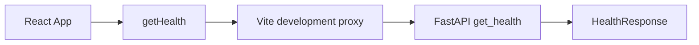
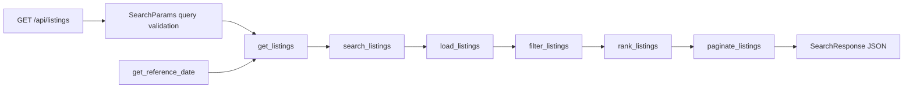
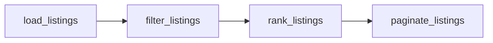

# Listing Search Service: Codebase Guide

This is a living guide for a junior developer preparing to explain and modify this project. Paths below are relative to the project root. The guide describes the current health-check foundation, Phase 1 backend models/repository, Phase 2 filtering, Phase 3 scoring, Phase 4 ranking/pagination, Phase 5 HTTP search, Phase 6.2A frontend search controls, Phase 6.2B ranked cards and pagination, and the post-submission property exploration and Map Explorer Phase 1 extensions.

For concise explanations of confirmed fixes and interview takeaways, see [FIX_LOG.md](FIX_LOG.md). [AGENTS.md](../AGENTS.md#required-fix-explanations-and-history) defines the required reporting format; detailed architecture remains in this guide.

[INTERVIEW_PREP.md](INTERVIEW_PREP.md) provides a current-source learning path, React/Python examples, worked calculations, map trade-offs and live-change exercises. Its showcase snapshot is distinct from the preserved submitted ZIP and the historical phase records below.

## 1. Project Overview

The assessment asks for a full-stack property listing search application. Its implemented features are price, bedroom, city, and description-keyword filters; relevance based on target budget and recency; ranked results; pagination; deliberate validation; and loading, empty, and error states.

The UI renders API-backed search; the health endpoint remains available for diagnostics. Phase 1 adds listing models, a callable JSON repository, and search parameter validation. These remain independently usable Python code. Phase 2 adds a pure filtering engine using these validated inputs. Phase 3 adds deterministic relevance scoring. Phase 4 adds ranking and pagination as independently callable functions. Phase 5 exposes the pipeline through `GET /api/listings`. Phase 6.2A adds React search controls, validation, API requests, and result-count feedback. Phase 6.2B renders actual listing cards and backend pagination.

`docs/Instructions.pdf` and `docs/Coding_Test_Question_Paper.pdf` define assessment requirements. `docs/requirements-review.md` records their review and unresolved semantics. React is required by the assessment; Python, FastAPI, TypeScript, Vite, and the specific testing tools are project choices supplied by the developer.

## 2. Technology Stack

| Tool | Current responsibility |
| --- | --- |
| Python / FastAPI | Serve health and listing search HTTP endpoints |
| Pydantic | Validate health responses, listing records, and search parameters |
| Uvicorn | Run the FastAPI application locally |
| pytest / HTTPX | Run backend tests and support FastAPI TestClient |
| React / TypeScript | Render HAVEN and manage theme, health, search drafts, and request state |
| Vite | Serve frontend source, proxy development API calls, and build static assets |
| Vitest / React Testing Library / jsdom | Test UI behavior in a simulated browser environment |
| Local JSON | Validated by the repository on demand; not read by the health endpoint |

Runtime and test dependency versions are in `backend/requirements.txt`, `backend/requirements-dev.txt`, and `frontend/package.json`. `frontend/package-lock.json` records the resolved npm dependency tree. Python direct dependencies are pinned, but their transitive dependencies are not fully locked.

## 3. Architecture Overview



The health diagram above describes the standalone diagnostic path; App no longer calls it or displays a health badge. `SearchPanel` now calls `/api/listings` through `useListingSearch` and `getListings`. The new search endpoint is reachable directly or through the same `/api` proxy:



The route manages HTTP concerns and response serialization; `search_listings` coordinates the existing algorithms. The service does not know FastAPI, status codes, or the system clock. This keeps its tests independent of HTTP while the route can be tested through real request/response contracts.

## 4. Directory and File Responsibilities

| Path | Responsibility |
| --- | --- |
| `AGENTS.md` | Permanent coding, scope, testing, and documentation rules |
| `README.md` | Installation, startup, test/build commands, and historical foundation verification |
| `backend/app/__init__.py` | Marks `app` as a Python package |
| `backend/app/main.py` | Health/search routes and date/dataset dependencies |
| `backend/app/search.py` | `search_listings` orchestrates load → filter → rank → paginate |
| `backend/app/schemas.py` | `ListingResult` and public `SearchResponse` models |
| `backend/tests/test_search.py` | Service orchestration and error propagation |
| `backend/tests/test_listings_api.py` | HTTP search, validation, response, dependency, and failure tests |
| `backend/app/models.py` | `Listing`, composite identity, and `SearchParams` validation |
| `backend/app/repository.py` | Project-relative JSON loading and `ListingRepositoryError` |
| `backend/app/filtering.py` | Pure `filter_listings` function with AND matching |
| `backend/tests/test_filtering.py` | Sample-data and edge-case filtering tests |
| `backend/app/scoring.py` | Relevance calculation and named weights/window |
| `backend/tests/test_scoring.py` | Fixed-date scoring examples, boundaries, precision, and mutation tests |
| `backend/app/ranking.py` | `ScoredListing` and deterministic `rank_listings` |
| `backend/app/pagination.py` | `PaginatedResults` and ordered result slicing |
| `backend/tests/test_ranking.py` | Ranking priorities, precision, determinism, and stable ties |
| `backend/tests/test_pagination.py` | Metadata, page boundaries, nonmutation, and sample pipeline tests |
| `backend/tests/conftest.py` | Fresh A1 fixture for field-validation tests |
| `backend/tests/test_models.py` | Listing and search-parameter validation tests |
| `backend/tests/test_repository.py` | Dataset loading, identity preservation, and failure tests |
| `backend/tests/test_health.py` | Tests the health HTTP contract |
| `backend/pytest.ini` | Selects `tests` and places backend root on Python's import path |
| `backend/requirements.txt` | Backend runtime dependencies |
| `backend/requirements-dev.txt` | Includes runtime dependencies and adds test dependencies |
| `frontend/index.html` | HTML entry page containing the React root element |
| `frontend/src/main.tsx` | Mounts React with StrictMode and imports local fonts/CSS |
| `frontend/src/App.tsx` | Composes shell and search; owns the single theme hook |
| `frontend/src/components/SearchPanel.tsx` | Single search owner, desktop/mobile drafts, and results callbacks |
| `frontend/src/components/SearchResults.tsx` | Server-ranked results, controlled Grid/Map presentation, shared map selection, summaries, and recovery |
| `frontend/src/map/MapExplorer.tsx` | Responsive map/list composition, featured selection, and lazy map boundary |
| `frontend/src/map/ListingMap.tsx` | React Leaflet tiles, markers, shared-location chooser, fit, and resize lifecycle |
| `frontend/src/map/mapListings.ts` | Composite identity and grouping exact valid coordinates |
| `frontend/src/map/MapBoundary.tsx` | Isolate map import/render failures from the rest of search |
| `frontend/src/map/*.test.ts*` | Coordinate, state, transport-fallback, and cleanup tests with a mocked renderer |
| `frontend/scripts/check_map_explorer.cjs` | Optional real Chrome Map Explorer regression checks; intercept provider tiles |
| `frontend/src/components/ListingCard.tsx` | Actual listing fields, decorative responsive image, and native details action |
| `frontend/src/components/ListingDetails.tsx` | Selected-record modal, scrolling, metadata, score explanation, and focus lifecycle |
| `frontend/src/components/AppearanceControl.tsx` | Shared appearance controls, using App theme state |
| `frontend/src/components/listingPresentation.ts` | Shared currency/number display formatters |
| `frontend/src/components/ListingDetails.test.tsx` | Details data, identity, close/cancel, focus, cleanup, and theme tests |
| `frontend/src/components/Pagination.tsx` | Metadata-driven previous/next and bounded numbered controls |
| `frontend/src/assets/listingImage.ts` | Stable source/id to image selection |
| `frontend/src/search/results.test.tsx` | Card formatting, image stability, pagination, and accessibility |
| `frontend/scripts/optimize_properties.py` | Reproduce twelve property WebP derivatives |
| `frontend/src/search/filters.ts` | Draft types, labels, defaults, and submission validation |
| `frontend/src/search/useListingSearch.ts` | Applied criteria, request lifecycle, cancellation, and retry |
| `frontend/src/api/listings.ts` | Public types, query encoding, response checks, and HTTP errors |
| `frontend/src/search/search.test.tsx` | Search validation, transport, state, and interaction tests |
| `frontend/src/api/health.ts` | Fetches and validates the health response |
| `frontend/src/styles.css` | Responsive header/hero/sections and visible focus styling |
| `frontend/src/assets/images.ts` | Hero/theme responsive paths and original presentation assets |
| `frontend/src/components/SiteHeader.tsx` | Wordmark, real navigation anchors, and shared appearance controls |
| `frontend/src/components/Hero.tsx` | Editorial headline and decorative responsive hero |
| `frontend/src/theme/useTheme.ts` | Preference/resolved palette state, storage, system listener |
| `frontend/src/theme/tokens.css` | Semantic light/dark palettes and typography/radius/shadow tokens |
| `frontend/src/theme/fonts.css` | Two locally bundled normal Latin variable fonts |
| `frontend/public/theme-init.js` | Apply saved/system palette before first paint |
| `frontend/src/theme/theme.test.tsx` | Theme, header, cleanup, initial paint, and semantic Axe tests |
| `frontend/scripts/optimize_hero.py` | Rebuild the six WebP derivatives without altering PNGs |
| `frontend/public/images/` | Ten unchanged PNGs organized by hero/footer/properties |
| `docs/IMAGE_ASSETS.md` | Exact asset inventory, crop/performance recommendations, and proposed identity mapping |
| `docs/DESIGN_SYSTEM.md` | Image accessibility, responsiveness, theme, and performance standards |
| `frontend/src/App.test.tsx` | Tests public search integration, editorial content, and footer theme selection |
| `frontend/src/api/health.test.ts` | Tests the preserved diagnostic health contract |
| `frontend/src/components/EditorialSection.tsx` | Accurate feature explanations and theme-selected decorative footer |
| `frontend/src/test/setup.ts` | Adds DOM assertions and resets rendered UI/global mocks after tests |
| `frontend/vite.config.ts` | React plugin, development server/proxy, and Vitest setup |
| `frontend/tsconfig.json` | Strict TypeScript checking with no compiler output |
| `frontend/package.json` | Dependencies and npm scripts |
| `frontend/package-lock.json` | Resolved npm dependency versions |
| `data/sample_listings.json` | Original 12 listing records |
| `docs/Instructions.pdf` | Independent-work assessment addendum |
| `docs/Coding_Test_Question_Paper.pdf` | Main assessment handout |
| `docs/requirements-review.md` | Requirements, dataset characteristics, and ambiguities |
| `docs/CODEBASE_GUIDE.md` | This guide; update alongside relevant code changes |
| `.gitignore` | Excludes environments, dependencies, builds, caches, secrets, and logs |

`backend/.venv`, `frontend/node_modules`, and `frontend/dist` are generated local directories, not source files.

## 5. Backend Architecture and Code Walkthrough

`backend/app/main.py` creates one FastAPI instance named `app`. Uvicorn's `app.main:app` means “import the module `app.main` and serve its variable `app`.” Run from `backend/` so that import resolves.

`HealthResponse` inherits from Pydantic `BaseModel` and declares one string field, `status`. The route's `response_model` supplies an explicit response schema and FastAPI validates/serializes the returned model.

```python
@app.get("/api/health", response_model=HealthResponse)
def get_health() -> HealthResponse:
    return HealthResponse(status="ok")
```

`get_health` receives no application input and returns a health model. It performs no I/O, so a simple synchronous function is sufficient. It proves that the HTTP application responds; it does not check dataset availability or readiness of future search services. If health requirements change, revise its response model, implementation, frontend contract, and tests together.

`backend/app/models.py` now defines data contracts and `backend/app/repository.py` handles file I/O. The health endpoint remains independent and does not load listings. `backend/app/filtering.py` now performs pure filtering without calling the repository or an HTTP handler. `backend/app/scoring.py` calculates a score without changing records. `rank_listings` in `ranking.py` and `paginate_listings` in `pagination.py` now provide ordering and page slicing. The new service coordinates these functions for the HTTP search endpoint.

### Loading listings step by step

`load_listings(path=DEFAULT_DATA_PATH)` returns `list[Listing]`. The default path is anchored to `repository.py` using `Path(__file__).resolve().parents[2]`, which is the project root in this layout. Starting Python from a different directory does not change the default dataset location. An explicitly supplied relative path still follows normal Python working-directory rules; use an absolute temporary path in tests.

1. Read UTF-8 text from the file.
2. Parse it with `json.loads`.
3. Require a top-level array; an empty array is valid.
4. Validate every element using `Listing.model_validate`.
5. Return every validated record in original file order.

The loader fails the entire call when any record is invalid. It does not silently skip records, merge properties, filter statuses, or cache results. Each call reads fresh data and returns fresh models. This is simple for the small assessment dataset; repeated reads may later justify caching if there is an actual need.

File/encoding errors, malformed JSON, wrong top-level shape, and invalid records raise `ListingRepositoryError`. Messages include the path; record errors include the zero-based index and Pydantic field details. The original exception is chained when available. Keeping this code separate allows tests to supply temporary files and future search functions to receive models without dealing with disk access. No abstract repository class is needed for one local JSON file.

### Search service

`search_listings(params, as_of_date, data_path=DEFAULT_DATA_PATH)` in `backend/app/search.py` loads validated listings, filters them, ranks all matches, and then slices the requested page. It returns the existing `PaginatedResults` dataclass. It receives validated `SearchParams`, one explicit reference date, and an optional dataset path for isolated tests. It never fetches another date or duplicates calculations.

The order is deliberate: counts describe all filtered records and scores are globally ordered before slicing. Every feed identity survives unless it fails an explicit filter. Repository failures propagate as `ListingRepositoryError`; only the route translates them into public HTTP errors. A small function is sufficient—no service class, database, or new dependency is involved.

## 6. Frontend Architecture and Code Walkthrough

`frontend/src/main.tsx` mounts `App` into the root element supplied by `frontend/index.html`. The non-null assertion on that element relies on this controlled HTML contract. StrictMode enables development checks, including an extra effect setup/cleanup cycle; it is useful for detecting incomplete cleanup.

`App` composes SiteHeader, Hero, SearchPanel, EditorialSection, and the footer. It also passes its existing theme controls through SearchPanel and SearchResults to the property dialog. It calls `useTheme` once and passes the resolved palette to both decorative image components. SearchPanel owns the existing search state and effect; App has no duplicate search request.

Phase 6.3A removes the public health badge and its mount-time request. `getHealth` remains available as a diagnostic service, with direct tests for success, HTTP failure, malformed data, and signal forwarding. The backend endpoint and its tests are unchanged. To check health manually, open `/api/health` through Vite or the backend; search failures still appear in the results live region with Retry.

### HAVEN image preparation for Phase 6

Ten supplied PNGs are now organized under `frontend/public/images/hero/`, `footer/`, and `properties/`. The four hero/footer images are 1672 × 941, and the six property illustrations are 1448 × 1086. No pixels were changed: files were moved, and before/after hashes confirm the original bytes remain intact. `docs/IMAGE_ASSETS.md` contains exact filenames, sizes, and paths; `docs/DESIGN_SYSTEM.md` establishes future image-use standards.

`frontend/src/assets/images.ts` exports a readonly `imageAssets` object with two theme pairs and an ordered six-image array. Public browser URLs omit the `public` directory, for example `/images/hero/hero-light.png`. The Phase 6.1B `Hero` now imports this manifest and renders selected WebP derivatives; property/footer PNGs remain unused. Having files in public makes them available to Vite and the production output; it does not cause the browser to download every file.

The property assets are illustrative, not verified photos of the MLS records. They must not supply amenities, views, locations, or other property facts. Future cards should use actual API text and generally treat illustrations as decorative with `alt=""`, plus a clarification that the imagery is illustrative. Hero/footer imagery should also be decorative, with meaningful text in HTML and sufficient overlay contrast.

The inventory proposes (but does not implement) a deterministic hash of `JSON.stringify([source, id])` to select one of six property illustrations. Using identity rather than array position keeps images stable when filters, rank, or page change. Collisions are expected and harmless for decoration. Keeping the canonical image order and algorithm stable matters once that mapping is adopted; neither backend records nor relevance should change because of imagery.

Responsive crop positions and derivative formats remain recommendations. Prefer 4:3 card image space initially, preserve the architectural subject when cropping, reserve image dimensions, prioritize the visible hero variant, and lazy-load below-the-fold card images. Original PNGs total 25.31 MiB, so rendering all full-resolution assets unnecessarily would be expensive. The organization phase made no conversion or UI changes. Phase 6.1B adds only the visual foundation and hero derivatives described below. Phase 6.2A adds filters and result-count feedback; Phase 6.2B adds cards, pagination, and deterministic property-image assignment.


### Phase 6.1B visual foundation

The approved visual reference is `listing-project-ui.png` in the project root (the referenced design-references directory is not present). It guides composition and palette; mockup prices, locations, filters, account features, and match percentages are not application requirements.

`App` calls `useTheme` once and passes its resolved theme to `Hero` and its preference/change handler to `SiteHeader`. The original health display was removed in Phase 6.3A; diagnostics remain available through the health service and endpoint. A perspective section supplies the header’s real on-page destination; a minimal footer links back to the top. Theme changes do not initiate search requests or reset filters.

`useTheme` distinguishes preference (`system`, `light`, `dark`) from resolved palette (`light`, `dark`). On mount it reads `haven-theme`, resolves System via `matchMedia`, subscribes to preference changes, and updates the root `data-theme`. Explicit Light/Dark overrides ignore system changes; switching to System uses the current system value again. User selection updates React state and localStorage. Listener cleanup prevents duplicate subscriptions after remount/StrictMode. Storage failures keep the current UI functional; cross-tab synchronization is not implemented.

`public/theme-init.js` runs in the head before React to set the same root palette early and reduce first-paint flashing. Its small preference-resolution logic is repeated in plain JavaScript because the React bundle is not loaded yet; a test exercises that exact script to keep it aligned. The image is selected on React’s initial render from the same saved/system preference.

`SiteHeader` uses a native labeled select rather than a custom menu, preserving standard keyboard and touch behavior. HAVEN links to #top and Our perspective links to #perspective. On mobile the anchor moves below the compact wordmark/select row; there is no unnecessary hamburger. A visible-on-focus skip link targets the main landmark. There is one h1 and a following h2.

`Hero` uses `imageAssets.heroResponsive[theme]`, a 640/1024/1672px WebP srcSet, high loading priority, and an empty alt attribute because the illustration carries no listing facts. HTML holds the real editorial text. CSS reserves a fixed responsive frame (360px mobile; 370–520px desktop) with the search panel overlapping its lower edge by 24px. The same image element and geometry remain when the theme changes. The dark/light headline panel uses a high-opacity overlay to protect contrast; no color interpolation or image animation is used.

`theme/tokens.css` centralizes semantic text, backgrounds, surfaces, borders, controls, focus, accent, shadows, radii, and font families. `fonts.css` references only the two local Latin normal WOFF2 files from Fontsource; Playfair Display headings and Inter controls have fallbacks and font-display swap. To change appearance, edit tokens and layout rules, not duplicated theme pages. Detailed values and intentional mockup differences are recorded in `DESIGN_SYSTEM.md`.

`optimize_hero.py` is an offline build aid in a frontend-local ignored Python environment. It uses Pillow quality 82 WebP encoding and Lanczos resizing, preserving the PNG originals. This is lossy conversion and is documented explicitly. Largest variants are 172010 and 180024 bytes rather than multi-megabyte PNGs; smaller candidates avoid oversized transfers where appropriate. No Python tooling is shipped in the browser bundle.

Final Chrome checks covered 375/390/768/1024/1280/1440 widths in both palettes: no document overflow, hero loaded, and zero Axe violations from the selected WCAG A/AA tags. Keyboard focus/selection and reload persistence were checked. Unit tests cover system changes, invalid stored values, blocked storage, cleanup, and initial head-script behavior. jsdom’s semantic Axe test disables color checks because it lacks real rendering; the live browser audits supply contrast coverage. This does not certify physical devices, every browser, or human screen-reader use.

### Phase 6.2A search controls and request flow

`SearchPanel` owns presentation and editable drafts. The shared `FilterFields` component renders the same labels, controlled inputs, and associated errors for desktop and mobile. `filters.ts` translates strings into validated `SearchParams`; `useListingSearch` owns submitted criteria and requests; `api/listings.ts` owns HTTP and runtime response checking. No new dependency or client-side filtering/ranking algorithm is involved.

There are three distinct kinds of state:

- **Draft:** six strings in the form, including unfinished numeric edits. Typing never fetches. Theme changes rerender the same component without resetting these values.
- **Applied:** numeric/text API parameters for the latest submitted search, initially `{page: 1, pageSize: 10}`. These are independent of further edits.
- **Request:** a discriminated union describing initial loading, searching, success with the complete response, or failure with a message. Success with totalCount zero is the no-matches state. Previous counts are removed while a new request is pending so they cannot be mistaken for current results.

On initial mount, `useListingSearch` requests defaults. On Search or Apply, `validateFilters` checks the draft, trims city/keyword, omits blank values, converts numeric strings, and resets page to 1 while retaining the applied pageSize. Zero prices and bedrooms are valid. Prices must be finite and nonnegative; minimum bedrooms must also be an integer; targetBudget must be finite and positive; minimum cannot exceed maximum price. Page/pageSize must be positive integers, with no arbitrary upper cap. Numeric inputs use text plus numeric/decimal inputMode so invalid or unfinished text can receive an explicit error rather than silently becoming blank. The backend remains the authority.

Client errors set `aria-invalid`, connect each input to its message with `aria-describedby`, and focus a summary. The advanced panel remains open on invalid Apply and scrolls its summary into view; invalid drafts never become applied criteria. FastAPI 422 detail arrays become readable field/message text in the live region; non-422 server errors receive a safe generic message. Network and invalid-response failures have a recovery message. Retry uses applied parameters, never unsubmitted draft text.

`buildSearchQuery` uses URLSearchParams and an explicit eight-key allowlist, preserves zero, omits blanks, and URL-encodes text. `getListings` checks HTTP status and validates the unknown JSON response before React receives it. The typed response preserves all 16 listing fields plus relevanceScore, and items/totalCount/page/pageSize/totalPages. It neither merges identities nor changes server order. Basic runtime type checks supplement TypeScript; backend Pydantic remains responsible for detailed feed constraints.

For example, enter Springfield and maximum price 500000. Submission requests `/api/listings?maxPrice=500000&city=Springfield&page=1&pageSize=10`; the sample response includes MLS_A/A1 at 450000 and MLS_B/B7 at 452000, with totalCount 2. The current UI announces “2 homes match your search.” An omitted budget uses backend recency ranking; a supplied budget affects ranking only. No fake cards or matches are generated.

The request effect depends only on applied criteria and a retry counter. Each run creates an AbortController; cleanup aborts the old signal. Both success and failure callbacks check that signal before updating state. This protects against stale responses even if a transport ignores cancellation. React development StrictMode may start an initial request, cancel it, then start another; it does not indicate per-keystroke fetching. A separate test deliberately resolves an old request last.

The mobile Filters and desktop More filters triggers now share `AdvancedFilterDialog` (see the showcase section below). Both copy the unsent main draft into disposable panel-local state. A valid Apply commits it; Close/Escape discard it. Reset all edits only the panel draft. Main-bar Clear applies defaults immediately.

Hooks remain small: useState stores drafts/status, useEffect handles network/dialog lifecycles and error focus, and useRef targets the dialog, opener, and error summaries. Native modality avoids a focus-trap dependency. The same open dialog changes layout across a viewport resize without losing edits.

**Phase 6.2B integration:** `SearchPanel` remains the shared search/results owner. It passes request state, applied targetBudget, and callbacks to `SearchResults`. Page changes submit `{...applied, page: nextPage}`, preserving submitted filters rather than reading drafts. Filter submissions still reset page 1. Cards and pagination are now implemented; URL persistence, caching, and cross-reload filter persistence remain outside scope.

## 7. API Endpoints and Request/Response Flow

`GET /api/health` still returns HTTP 200 with `{"status":"ok"}`. FastAPI also supplies `/docs` and `/openapi.json`.

### Search query contract

`GET /api/listings` accepts these query parameters through `Annotated[SearchParams, Query()]` in `get_listings`:

| Query name | Meaning / default |
| --- | --- |
| minPrice / maxPrice | Optional inclusive price bounds |
| minBedrooms | Optional inclusive minimum bedrooms |
| city | Optional trimmed, case-insensitive exact city match |
| keyword | Optional trimmed, case-insensitive description substring |
| targetBudget | Optional positive budget used only for scoring |
| page | One-based requested page; default 1 |
| pageSize | Positive page size; default 10, no maximum |

Use these external names, including camelCase. FastAPI exposes them in OpenAPI and uses the existing model's parsing, normalization, and cross-field validation. Invalid values return standard HTTP 422 responses with a `detail` list containing error location, type, and message. Inverted price ranges report a model-level query error naming both bounds; they are not silently turned into empty results. Unknown extra query fields follow the model's default ignored-extra behavior; use the documented names.

### Reference date and dataset dependencies

`get_reference_date` in `main.py` obtains the current UTC calendar date once for each valid search request. `Depends` injects that date into the route, which passes it unchanged to the service and ranking stage. UTC is a project choice to avoid dependence on the server's configured timezone. No per-listing clock reads occur.

Tests override this dependency with `date(2026, 9, 28)` using `app.dependency_overrides`; no global datetime patch is needed. The API does not expose an as-of query parameter. `get_listing_path` supplies the project-relative dataset path and can likewise be overridden with temporary files. Overrides are restored after tests.

### Response structure

The explicit response model is `SearchResponse` in `backend/app/schemas.py`:

```text
items: array of all 16 listing fields plus relevanceScore (number)
totalCount: integer, all matches before pagination
page: integer, requested page
pageSize: integer, requested/default size
totalPages: integer, zero when there are no matches
```

`ListingResult` extends `Listing` with `relevance_score`, serialized as `relevanceScore`. Date fields serialize as ISO strings under `listedDate`; source/ID and string ZIPs are preserved. The route creates response models from the scored page without adding fields to original listing objects. Numerical relevance is never rounded. Pagination's Python dataclass remains an internal structure, while this schema defines public JSON names.

For `city=Springfield&maxPrice=500000&targetBudget=500000&pageSize=1`, the fixed test date 2026-09-28 produces:

```json
{
  "items": [{
    "id": "A1", "source": "MLS_A", "address": "123 Main St, Apt 4B",
    "city": "Springfield", "state": "VA", "zip": "22150",
    "price": 450000.0, "bedrooms": 2, "bathrooms": 1.5, "sqft": 980,
    "latitude": 38.7893, "longitude": -77.1873,
    "listedDate": "2026-08-29", "status": "active",
    "description": "Bright top-floor condo near shops and transit. Pet friendly.",
    "relevanceScore": 88.0
  }],
  "totalCount": 2, "page": 1, "pageSize": 1, "totalPages": 2
}
```

A1 and B7 pass the filters, and A1 ranks first. Page 2 returns B7 with approximately 87.94666667 at that fixed date. Normal live requests use today's UTC date, so scores change with recency. Page 3 returns HTTP 200 with empty items, count 2, pages 2, and page 3. An unknown city returns HTTP 200 with empty items and zero counts/pages, even for a later requested page. There is no city-existence validation error.

### Frontend communication

The existing `getHealth` diagnostic service still fetches `/api/health`, checks HTTP success, and validates a string status. App no longer invokes it for public presentation. `frontend/vite.config.ts` forwards every `/api` request to port 8000, including `/api/listings`. This proxy is development-only; production API routing remains unconfigured.

`frontend/src/api/listings.ts` now constructs URL query parameters using these names, fetches `/api/listings`, checks `response.ok`, and validates response types. `SearchPanel` currently announces totalCount; items and page metadata now drive SearchResults, ListingCard, and Pagination.

To add a filter later, extend `SearchParams`, the backend filtering condition, and related tests; FastAPI's query-model binding exposes the new input without duplicating it in route arguments. Update the public documentation and eventual frontend control. To change scoring, edit its constants/calculation and tests; the endpoint and response shape can remain unchanged.

## 8. Data Models and Validation

The health response uses `HealthResponse(status: str)`; search adds the models described below. The TypeScript interface is also called `HealthResponse` and declares `status: string`; it does not validate JSON by itself. Runtime validation in `getHealth` checks the shape, but does not restrict the string to `ok`. A response such as `{"status":"maintenance"}` would be returned to a diagnostic caller as received; the current backend always returns `ok`.

### Listing model

`Listing` in `backend/app/models.py` includes all 16 required feed fields. `model_validate` checks an input dictionary and either returns a typed instance or raises `ValidationError` with field-level details. All listing fields are required. Strings remain strings, counts are integers, numeric measurements/prices are floats, and `listed_date` is a Python `date`.

The model uses strict feed types: numeric strings and booleans cannot masquerade as numbers, and fractional bedroom/square-foot counts are rejected. JSON integer prices are accepted as floats. Monetary amounts and property counts/measurements cannot be negative; numeric fields must be finite. No arbitrary upper bounds, coordinate ranges, address normalization, string length rules, ZIP pattern, or feed-name restriction is introduced. Unknown extra keys follow Pydantic's default behavior and are ignored.

`parse_listed_date` accepts a Python date or an exact valid `YYYY-MM-DD` string. It rejects impossible dates, timestamps, numeric epochs, and compact date strings. The explicit parser lets the rest of the model remain strict while converting the dataset's date strings. Future dates are not prohibited. `status` accepts only `active`, `pending`, and `sold`; no active-only rule exists.

Python attribute `listed_date` uses alias `listedDate`. Both aliases and internal names can populate these models, and serialization defaults to external names. JSON-mode serialization converts the date back to its ISO string:

```python
from app.repository import load_listings

listing = load_listings()[0]
assert listing.identity == ("MLS_A", "A1")
assert listing.bathrooms == 1.5
assert listing.model_dump(mode="json")["listedDate"] == "2026-08-29"
```

A1 and B7 share coordinates and structural values but differ in price, date, description, and address. Both remain present. `Listing.identity` returns `(source, id)` because IDs are unique only within a feed. This property is not an additional serialized field. The repository does not enforce uniqueness of identical source/ID pairs or resolve conflicting records; that ingestion policy remains unspecified. It never merges apparent duplicate properties.

### Search parameter model

`SearchParams` declares optional `min_price`, `max_price`, `min_bedrooms`, `city`, `keyword`, and `target_budget` fields. Their external aliases are `minPrice`, `maxPrice`, `minBedrooms`, and `targetBudget` where needed. Omitted or explicitly null filters are `None`. Pagination is required to have a value: omitted `page` defaults to 1 and omitted `pageSize` defaults to 10; explicit null pagination is invalid.

Validation rules:

- Price bounds are finite and nonnegative; zero is valid.
- Minimum bedrooms is a nonnegative integer.
- A supplied target budget is finite and strictly positive.
- Page and page size are integers of at least 1, with no invented upper limit.
- `validate_price_range` rejects minPrice greater than maxPrice only when both are supplied. Equal bounds and one-sided ranges are allowed.
- `normalize_text` trims surrounding whitespace in city/keyword and maps blank text to `None`. Case and internal spaces remain unchanged in the model; the filtering function handles case-insensitive matching.
- `reject_boolean_numbers` prevents True/False from being treated as 1/0.

Unlike feed records, search inputs accept numeric strings because URL query parameters arrive as text. Pydantic also accepts whole-number numeric values for integer search fields, but rejects fractions. The same parsing now applies to HTTP query inputs through FastAPI. Invalid fields produce Pydantic errors using external aliases; inverted ranges produce a model-level error naming both price bounds.

```python
from app.models import SearchParams

params = SearchParams(minPrice="400000", city=" Springfield ")
assert params.min_price == 400000
assert params.city == "Springfield"
assert params.page == 1
assert params.page_size == 10
```

Choosing page size 10 keeps the initial page small and would spread the 12 sample records over two pages before filtering. These defaults are implementation choices authorized in Phase 1, not values specified in the handout. The filtering function never slices pages; the separate pagination function now does. There is no city-existence validation: the API returns HTTP 200 with zero matches for an unknown city.

## 9. Search Filtering Logic

`filter_listings` in `backend/app/filtering.py` accepts an ordered `Sequence[Listing]` (such as a list or tuple) and validated `SearchParams`. It returns a new `list[Listing]` of matching original objects. There is no disk access, HTTP request, state mutation, ranking, or pagination in this function. The caller validates inputs first; the function does not repeat Pydantic validation.

### How the scan works

Before scanning, the function case-folds the optional city and keyword once. `casefold()` provides Unicode-aware case-insensitive comparisons, including equivalents such as Straße and STRASSE. The search model has already trimmed surrounding input whitespace and converted blank text to `None`.

For each listing, it checks these conditions in order:

| Filter | Required match |
| --- | --- |
| minPrice | Price greater than or equal to the supplied minimum |
| maxPrice | Price less than or equal to the supplied maximum |
| minBedrooms | Bedrooms greater than or equal to the supplied minimum |
| city | Case-insensitive exact equality after trimming the listing city's surrounding whitespace |
| keyword | Case-insensitive substring present in description only |

A failed condition uses `continue` to move to the next record. A record is appended only after passing every supplied condition. This is AND logic: each input narrows the result rather than providing an alternative way to qualify. `None` skips a condition. Explicit `is not None` checks ensure zero price/bedroom bounds are evaluated rather than accidentally treated as absent.

City matching is exact: Spring does not match Springfield. Internal spaces are preserved. Keyword matching is literal substring matching, not token matching, regular expressions, or a pet-policy classifier. For example, `itchen` matches the descriptions of A2 and B8, while `pets` also matches A3's `no pets`. Address and city text are never searched by the keyword filter.

### Walkthrough with the supplied data

Run this Python example from `backend/` with the local environment:

```python
from app.filtering import filter_listings
from app.models import SearchParams
from app.repository import load_listings

matches = filter_listings(
    load_listings(), SearchParams(city=" Springfield ", maxPrice=500000)
)
assert [listing.identity for listing in matches] == [
    ("MLS_A", "A1"), ("MLS_B", "B7")
]
```

A1 is in Springfield and costs 450000, so it passes both conditions. B7 is also in Springfield and costs 452000, so it passes. A2 and B8 match the city but cost 525000 and 527500, exceeding the maximum. Every remaining record fails the city condition. The output therefore contains A1 then B7, as in the source array.

### Order, identity, and edge cases

Appending during a single forward scan preserves whatever order the caller supplies. This function does not establish relevance ordering. Apparent property duplicates and identical IDs from different feeds remain separate. Status is not a filter: pending A7 is returned when its other conditions match, and a matching sold record is also included.

No filters returns every record in a new list; empty input or no matches returns `[]`. Blank optional text acts as omitted. `targetBudget`, `page`, and `pageSize` do not restrict or slice results. Unknown cities produce no matches at this function boundary; the HTTP endpoint represents this as successful empty results.

The function does not modify the input sequence, records, or parameters. Output records are the same model instances, not deep copies. This keeps filtering simple and avoids unnecessary allocations, but a caller that subsequently modifies a returned model will also modify that model in the original collection.

### Extending and understanding the cost

To add a filter later, add its validated input to `SearchParams`, add one clear reject condition in `filter_listings`, and test its individual behavior and combinations with existing filters. Update this guide and the requirements review. HTTP query-model binding now exposes the inputs; add frontend controls only when that phase is authorized.

There is one scan of n records and a fixed number of checks per record: O(n) if text lengths are treated as bounded. More precisely, text work depends on the city/description lengths and substring matching cost; it is not constant for arbitrarily long strings. The result requires O(k) references for k matches, with temporary case-folded text allocated during comparisons. No index, cache, sorting step, or additional library is needed for the small dataset.

## 10. Relevance Scoring Algorithm

`calculate_relevance_score(listing, target_budget, as_of_date)` in `backend/app/scoring.py` returns one unrounded float between 0 and 100. It is a pure function: no clock access, file reads, network calls, filtering, sorting, or mutation. The caller supplies a validated `Listing`, a positive finite budget from `SearchParams` (or `None`), and a Python `date`. Validation remains at the established model boundary; passing an invalid raw budget directly violates this function's contract.

The assessment requires budget and recency to influence relevance, but does not prescribe a formula. The Phase 3 request chooses these named constants:

```python
BUDGET_WEIGHT = 0.70
RECENCY_WEIGHT = 0.30
RECENCY_WINDOW_DAYS = 180
```

### Step 1: Recency

Calculate calendar-day age from the explicit reference date, with future dates clamped to age zero:

```text
age_days = max(0, (as_of_date - listing.listed_date).days)
recency_score = 100 * max(0, 1 - age_days / 180)
```

New and future listings receive 100. At 30 days, recency is approximately 83.333333; at 90 days it is 50; at 180 days or older it is zero. Python date subtraction avoids time-of-day or timezone differences inside scoring. The API supplies the current UTC date once per request; direct callers still choose their explicit date. Tests always pass a fixed date so expected scores do not drift when tests run later.

### Step 2: Budget proximity

If budget is absent, return the full recency score immediately; do not multiply it by 0.30. Otherwise:

```text
budget_score = 100 * max(0, 1 - abs(listing.price - target_budget) / target_budget)
```

An exact match receives 100. A price 10% away receives 90 whether it is above or below the target. A distance of at least one full budget receives zero; for nonnegative listing prices, this includes price zero and prices at least twice the target. Dividing by the target compares relative rather than absolute differences: a 50000 difference matters more for a 100000 budget than for a 1000000 budget.

The target is a preference, not a maximum-price filter. Filtering remains independent and uses maxPrice only when explicitly supplied.

### Step 3: Combine normalized factors

```text
relevance_score = 0.70 * budget_score + 0.30 * recency_score
```

Both components use the same 0–100 scale so the weights express their intended importance. The weights sum to 1. Budget has more influence because the Phase 3 choice prioritizes proximity to the user's price preference while still rewarding newer listings; this is not a statistically calibrated ranking model. The final combined result is clamped to [0, 100]. Without budget, recency is already bounded by its age clamp and zero floor.

No intermediate or final rounding occurs. Python float precision is retained so later ordering can use the calculated score; presentation can choose a display precision without changing the underlying value. Tests use `pytest.approx` for expected floating-point results.

### Worked examples from the actual dataset

Use the fixed reference date **2026-09-28** and budget **500000**:

| Record | Price | Listed date | Age | Budget score | Recency score | Final score |
| --- | --- | --- | --- | --- | --- | --- |
| MLS_A / A1 | 450000 | 2026-08-29 | 30 | 90 | 83.333333… | 88 |
| MLS_B / B7 | 452000 | 2026-08-27 | 32 | 90.4 | 82.222222… | 87.946666… |

For A1, the budget distance is 50000 / 500000 = 0.10, giving 90 points. Age 30 gives 100 × (1 − 30/180) = 83.333333… points. Combining them yields 0.70 × 90 + 0.30 × 83.333333… = 63 + 25 = **88**.

For B7, distance 48000 / 500000 = 0.096 gives 90.4. Age 32 gives 82.222222… . The contributions are 63.28 and 24.666666…, totaling **87.946666…**. Its slightly better budget proximity does not fully offset its older listing date. These calculations do not sort the records. Without a budget, A1 would receive 83.333333… directly.

Run this example from `backend/`:

```python
from datetime import date
from app.repository import load_listings
from app.models import SearchParams
from app.scoring import calculate_relevance_score

listing = load_listings()[0]
params = SearchParams(targetBudget=500000)
score = calculate_relevance_score(listing, params.target_budget, date(2026, 9, 28))
# score is approximately 88; the original listing has no score field added.
```

### Trade-offs, complexity, and extension

Scoring one listing uses O(1) time and O(1) additional space. A future caller scoring n listings would perform O(n) scoring work before any sorting.

The formula is deliberately simple and explainable. It treats equally distant prices above/below target alike, although users might prefer cheaper listings. Old listings stop losing points after 180 days; equally distant prices can tie. Future dates receive maximum recency, which prevents negative ages but may reward incorrect feed dates. The model does not account for status, location, quality, price per square foot, or user behavior. These limitations are choices, not hidden extra filters.

To prioritize recency, change both weights together, keeping their sum at 1 (for example 0.30 budget / 0.70 recency), then revise expected weighted tests and documentation. To change the decay window, adjust `RECENCY_WINDOW_DAYS` to a positive value and update boundary tests. Current tests intentionally verify the chosen 180-day behavior.

For an additional factor, first define its input and a justified 0–100 normalization, then explicitly rebalance all weights and decide how missing inputs affect the calculation. Add focused tests and worked examples. Do not introduce a generic scoring framework until actual requirements need it. Scoring remains independent of the Phase 4 ranking and pagination functions. API integration, React search controls, listing cards, and pagination controls are implemented.

## 11. Sorting and Pagination

Phase 4 adds two focused modules, independent of file access and HTTP handlers. Call them after filtering in this order:



### Scored records and ranking

`ScoredListing` in `backend/app/ranking.py` is a frozen dataclass with `listing: Listing` and `relevance_score: float`. It pairs the complete original model with a score, preserving every field and composite identity. It does not add a score field to `Listing` or copy the model. Frozen means the wrapper's attributes cannot be reassigned; it does not make the nested listing immutable.

`rank_listings(listings, target_budget, as_of_date)` accepts an ordered sequence of validated listings, a validated optional budget, and an explicit date. It calls the existing `calculate_relevance_score` once per record, then returns a new list sorted by these priorities:

1. Relevance score, descending.
2. Actual listed date, descending.
3. Source, ascending.
4. Listing ID, ascending.

The key passed to Python's `sorted` is:

```python
(-item.relevance_score,
 -item.listing.listed_date.toordinal(),
 item.listing.source,
 item.listing.id)
```

Python compares tuple fields from left to right, consulting the next only when earlier values are equal. Negating the score makes larger scores sort first. A date's ordinal is its calendar-day number; negating it makes newer dates sort first without changing source/ID to descending order. Text comparisons use ordinary case-sensitive Python string ordering. IDs are strings: A10 sorts before A2 when the earlier priorities tie; no natural-number ID interpretation is introduced.

Sorting reuses the scoring function instead of duplicating its calculation. Full precision is retained: two values that display identically after rounding may still have different relevance and must not be treated as ties.

`sorted` leaves the input unchanged and is stable. Stability means records with equal complete keys stay in their input order. With unique `(source, id)` pairs, distinct records have distinct full keys, so shuffling input does not change output order. Repeated identities with equal keys can retain different input orders; the repository still does not resolve those feed conflicts. No record is deduplicated.

Future listing dates are age zero for scoring. If scores tie, the actual later future date wins the date priority; the ranking function does not clamp the tie-break date to the reference date. Very old zero-recency records also use actual dates when their scores tie.

### Page structure and slicing

`PaginatedResults` in `backend/app/pagination.py` is a frozen dataclass containing `results`, `total_count`, `page`, `page_size`, and `total_pages`. These are internal Python field names; `SearchResponse` maps them to the public camelCase JSON contract. The result list is newly allocated; its scored wrappers and nested listings are shared references.

`paginate_listings(listings, page=1, page_size=10)` receives the complete already-ranked sequence and uses `SearchParams(page=page, pageSize=page_size)` to reuse existing validation. There is no separate numeric-rule implementation or maximum page size. Defaults match the search model and a test checks that they stay aligned.

```text
total_count = len(listings)
total_pages = (total_count + page_size - 1) // page_size
start = (page - 1) * page_size
results = listings[start : start + page_size]
```

The integer division rounds the positive count up to include a partial final page, without floating-point division. For zero matches it yields zero pages. Slices include their start and exclude their end: page 2 with size 5 selects indexes 5 through 9. Slicing beyond the sequence returns an empty list, so an out-of-range request preserves the requested page while accurately reporting totals. It never clamps the request to the final page.

Sorting must precede slicing. Otherwise each page would rank only its own subset, allowing a highly relevant record on a later page to remain hidden behind weaker records on the first. Pagination never sorts for the caller or verifies the collection's ordering; the caller is responsible for passing ranked results.

### Sample pipeline and metadata

With reference date 2026-09-28 and budget 500000, Springfield plus maxPrice 500000 matches A1 and B7. Their scores are 88 and approximately 87.94666667, respectively. At page size 1, page 1 contains A1 and page 2 contains B7; both report total_count 2 and total_pages 2. Page 3 is empty and still reports page 3, count 2, and pages 2.

```python
from datetime import date
from app.models import SearchParams
from app.repository import load_listings
from app.filtering import filter_listings
from app.ranking import rank_listings
from app.pagination import paginate_listings

params = SearchParams(city="Springfield", maxPrice=500000,
                      targetBudget=500000, pageSize=1)
ranked = rank_listings(filter_listings(load_listings(), params),
                       params.target_budget, date(2026, 9, 28))
page = paginate_listings(ranked, params.page, params.page_size)
assert page.results[0].listing.identity == ("MLS_A", "A1")
assert (page.total_count, page.total_pages) == (2, 2)
```

Without filters, the 12 sample records rank as A2, A5, B8, A1, B7, B11, A7, B10, A3, A4, B9, A6 at that budget/date. Size 5 creates pages containing 5, 5, and 2 records, each reporting count 12 and pages 3. No matches gives results `[]`, count 0, and pages 0, while keeping the requested page and size.

### Costs, changes, and limitations

Ranking n records calculates n scores and performs O(n log n) sorting in the general case, with O(n) extra space for scored wrappers and sorting. Pagination over a list/tuple uses O(k) time and O(k) space for the returned slice of k records; length and metadata are O(1). These costs assume bounded text keys and normal sequence slicing. There is no database, cache, or streaming page retrieval: the full matching set is ranked in memory before slicing.

To change priorities, revise the tuple in `rank_listings`, update tests that distinguish each priority, and document the new behavior. To change page defaults, update both the function defaults and `SearchParams`, retaining the alignment test. To change out-of-range behavior, revise `paginate_listings` and its metadata tests deliberately. Large pages are permitted; enforce a limit only if future requirements justify it. The HTTP route maps dataclass fields to public JSON names without changing these algorithms.

## 12. Error Handling

`fetch` can resolve even when the HTTP status is an error, which is why `getHealth` checks `response.ok`. A malformed JSON body or wrong response shape also fails. `getHealth` rejects diagnostic failures; public search failures are handled by `useListingSearch` and announced by SearchResults with a Retry action.

Cancellation during cleanup is ignored instead of displayed as backend failure. The signal checks also prevent an older cleaned-up request from replacing current state. This matters during StrictMode checks and unmounts.

The UI does not distinguish a network failure from HTTP 503 or malformed JSON. More detailed recovery could be added if it becomes useful. The current health endpoint has no user-input validation or custom error handler. Model validation raises `ValidationError`; repository failures raise `ListingRepositoryError`. FastAPI maps input validation to standard 422 responses. The route catches repository failures, logs the chained exception with internal path/field details, and returns HTTP 503 with `{"detail":"Listing data is unavailable."}`. No paths or stack traces appear in that public body. Unexpected programming errors are not disguised as dataset failures.

## 13. Testing Strategy

`backend/tests/test_health.py` uses `TestClient(app)` to call the HTTP route without binding a network port. It asserts HTTP 200, JSON content type, and the exact response object. This verifies the application contract, not Uvicorn startup or Vite routing.

`frontend/src/App.test.tsx` stubs fetch to verify initial search integration, visible search failure/retry, real navigation destinations, accurate editorial feature content, removal of public health diagnostics, and theme-dependent decorative footer images. `frontend/src/api/health.test.ts` preserves health success/HTTP-failure coverage independently of the removed badge, and adds malformed-response validation. These tests do not call a real backend.

`frontend/src/test/setup.ts` cleans rendered components and restores globals after each test. jsdom cannot establish image contrast, layout, or native dialog behavior. Search tests continue to cover malformed responses, network rejection, and stale-response cancellation; browser checks supplement them.

Phase 1 adds direct model/repository tests:

- `test_models.py` checks all required fields, statuses, ISO dates, external-name serialization, strict feed types, invalid numeric/text values, optional inputs, aliases, numeric query strings, whitespace, equal/one-sided ranges, and pagination input boundaries.
- `test_repository.py` checks all 12 sample listings, loading after changing working directory, retention of A1/B7, same IDs across feeds, missing files, malformed JSON, invalid UTF-8, wrong top-level shapes, invalid records, and empty arrays.
- `conftest.py` reads A1 into a fresh dictionary per test, so tests can change one field without modifying the supplied file. The cross-feed identity test creates a synthetic MLS_B record with ID A1 because the actual sample has no repeated IDs.

Run all backend tests from `backend/` using `.venv/bin/python -m pytest`. To focus on the new tests, use `.venv/bin/python -m pytest tests/test_models.py tests/test_repository.py`. Parametrized cases account for many collected tests; each checks a specific boundary or malformed input. Model failures assert the offending field, and repository tests check useful error context.

Phase 2 adds `test_filtering.py`: 36 cases cover all five filters, inclusive bounds, zero values, AND combinations, exact city versus substring keyword behavior, case/whitespace rules, Unicode case folding, description-only matching, blank filters, no matches, empty inputs, order, identity, mutation, all statuses, and ignored budget/pagination inputs. The fixture loads fresh sample data through the real repository, so these include integration-style checks without starting a server. Synthetic records cover sold status and repeated IDs across feeds because the sample does not include those cases.

Run only these cases from `backend/` with `.venv/bin/python -m pytest tests/test_filtering.py`, or run the entire backend suite with `.venv/bin/python -m pytest`. Phase 2 verification ran the full suite: 133 passed, including the existing 97 cases and health test. Python compilation also succeeded. The existing Starlette/AnyIO deprecation warning remains nonblocking.

Phase 3 adds `test_scoring.py`: 45 cases cover exact/above/below budget prices, symmetric distances, zero prices, extreme finite numbers, 0/30/90/180-day and older ages, future dates, missing budget, weighted examples, bounds, unrounded precision, fixed-date repeatability, ties between feed records, and nonmutation. It uses the existing A1 fixture plus actual repository records. Invalid budget validation is already covered by model tests and is not duplicated.

Run the scoring tests from `backend/` with `.venv/bin/python -m pytest tests/test_scoring.py`. Phase 3 verification ran the complete suite: 178 passed, including the 133 existing tests and health regression test. Python compilation succeeded. The existing dependency deprecation warning remains nonblocking.

Phase 4 adds 14 ranking tests and 28 pagination/integration cases. Ranking tests isolate every priority, shuffle unique identities, verify stable complete-key ties and future dates, distinguish scores with equal two-decimal displays, and preserve records. Pagination tests cover default alignment, first/middle/last/partial pages, exact boundaries, single/zero results, out-of-range metadata, varying sizes, complete coverage across pages, and nonmutation. Integration cases load the sample, filter, rank, and slice with fixed dates, including a verified full 12-record order.

Run the new tests from `backend/` with `.venv/bin/python -m pytest tests/test_ranking.py tests/test_pagination.py`. Phase 4 verification ran the full suite: 220 passed, including all 178 earlier cases and health regression. Compilation and whitespace checks succeeded. React search tests remain future work.

Phase 5 adds 38 HTTP cases in `test_listings_api.py` and four service tests in `test_search.py`. HTTP tests exercise the actual sample pipeline, every query input, no-budget and budget ranking, pages/totals, empty and out-of-range results, camelCase JSON/OpenAPI names, sold records, standard 422 errors, safe 503 responses for three repository failure modes, diagnostic logging, and once-per-request dates. Service tests check orchestration, repeatability, empty data, and repository error propagation. Existing model/algorithm tests remain authoritative for detailed boundary behavior.

Run these from `backend/` with `.venv/bin/python -m pytest tests/test_listings_api.py tests/test_search.py`; run all checks with `.venv/bin/python -m pytest`. Phase 5 verification: 262 tests passed, including the original 220, and Python compilation succeeded. Live direct/proxied searches, range validation, and health checks succeeded on ports 8000 and 5185. No React search or browser rendering was tested in this phase.

The earlier foundation verification recorded one passing backend test, two passing frontend tests, a successful build, and live browser/proxy success in `README.md`. These are historical results, not a guarantee about every future change. Report fresh verification separately when tests are rerun.

## 14. Important Design Decisions and Trade-offs

- A local JSON dataset follows the requested scope and avoids database setup. The repository loads it on demand; HTTP search uses it through the service; no caching is added.
- The health route, data models, file repository, pure filtering, scoring, ranking, and pagination remain focused modules, joined by a small orchestration service and response-schema module. No generic service framework or new dependency was needed.
- Separate frontend HTTP code keeps protocol validation outside presentation.
- Runtime JSON checking complements TypeScript's compile-time types, at the cost of a small amount of explicit checking.
- AbortController and callback guards make cleanup deliberate without introducing a request library.
- A Vite proxy simplifies development; separate origins with CORS are a reasonable alternative if hosting requirements change.
- Strict TypeScript checking runs before Vite builds. No separate linting or formatting dependency is configured.
- HAVEN styling follows the approved visual reference as explicitly authorized in Phase 6.1B; the assessment itself does not require visual polish.

## 15. Running and Debugging the Application

Install from the project root:

```sh
python3 -m venv backend/.venv
backend/.venv/bin/python -m pip install -r backend/requirements-dev.txt
cd frontend
npm ci
```

Start the backend from the project root in one terminal:

```sh
cd backend
.venv/bin/python -m uvicorn app.main:app --host 127.0.0.1 --port 8000 --reload
```

Start the frontend from the project root in another terminal:

```sh
cd frontend
npm run dev
```

Default UI: http://127.0.0.1:5173. Health: http://127.0.0.1:8000/api/health. Interactive API docs: http://127.0.0.1:8000/docs. Vite uses `strictPort`, so an occupied port causes startup failure; choose an alternate using `npm run dev -- --port 5185`. Port 5185 was used in earlier verification, not a guaranteed available port.

For a failed health check, inspect the browser Network panel for `/api/health`, confirm the backend responds directly, and compare with the proxied request. Check terminal logs and the proxy target before changing component logic. App does not request health automatically; make an explicit diagnostic request. For search failures, inspect `/api/listings` and its response-shape validation.

Run backend checks from `backend/` with `.venv/bin/python -m pytest`. Run frontend checks from `frontend/` with `npm test` and `npm run build`. Use `npm run test:watch` while iterating. The build creates static assets in `frontend/dist`; it does not prove live API communication.

## 16. Interview Preparation and Potential Extensions

Be able to explain `get_listings`, its dependencies, `search_listings`, `SearchResponse`, `rank_listings`, `ScoredListing`, `paginate_listings`, `PaginatedResults`, `calculate_relevance_score`, its three constants, `filter_listings`, `Listing`, its `identity`, `parse_listed_date`, `SearchParams` validators, `load_listings`, `ListingRepositoryError`, `get_health`, `HealthResponse`, `getHealth`, `useListingSearch`'s effect and cleanup, the Vite proxy, and what each test proves. Practice tracing the exact request from the effect through fetch and Vite to FastAPI, then back through runtime validation to a React state update.

Useful questions to rehearse:

- Why check `response.ok`? HTTP failures do not necessarily reject fetch.
- Why parse into `unknown`? A TypeScript interface cannot enforce the actual server payload.
- Why abort and check the signal? Cleanup must stop obsolete requests from updating the display.
- Why separate the API module? Transport details can change independently of component markup.
- Does health prove search works? No; it does not invoke the repository, and the health route does not invoke filtering, scoring, or pagination.
- Why keep feed types strict but accept numeric query strings? The file has declared JSON types, while future URL parameters naturally arrive as text.
- Why keep both A1 and B7? Feed records have distinct identities; deduplicating properties is not required.

**Future extension guidance:** keep extending the established frontend search state instead of adding another request owner. Keep routes responsible for translating requests/responses. Put frontend endpoint calls under `frontend/src/api/`, and add inputs/results components under `frontend/src/` only as needed.

To modify a filter, update its `SearchParams` contract and validation if needed, the condition in `filter_listings`, and focused tests. Update the corresponding frontend field, validation, API interface, and tests too. To modify relevance scoring, change the calculation/constants in `scoring.py`, update expected tests and worked examples, and preserve bounded scores and the missing-budget behavior. Filtering, scoring, ranking, and pagination are implemented as independent functions; HTTP integration is implemented; React search controls, listing cards, and pagination controls are implemented.

For incorrect future search results, reproduce the query using a small known set of records; inspect validation, filtered candidates, calculated scores, sorted order, and page slicing in that sequence. A1/B7 are useful for distinguishing feed identity from property identity. A2/B8 demonstrate why ZIP agreement cannot be assumed. Do not change all stages at once.

Potential interview edge cases include equal scores, an empty dataset, a city with no matches, inverted price limits, a zero page size, a page beyond the final page, missing fields, invalid/future dates, duplicate IDs across sources, pending/sold listings, and negative pet wording. Some are required test cases and others are possible extensions; clarify semantics before implementing them. Update the relevant guide sections with actual code and verified examples as features are added.

### Scoring questions to rehearse

- Why weighted scoring? It makes the trade-off explicit: budget contributes 70% and recency 30%, rather than hiding importance in unrelated numeric scales.
- Why normalize both components? A shared 0–100 scale makes the weights comparable and the combined score easy to explain.
- How would you prioritize recency? Increase `RECENCY_WEIGHT` and reduce `BUDGET_WEIGHT` so they still sum to 1; update numerical tests.
- What if targetBudget is missing? Return recency directly, giving it full influence instead of penalizing an omitted preference.
- Why pass the reference date? The same inputs always produce the same result, tests never depend on today's date, and future callers can select the date consistently for a whole request.
- How would you add a factor? Define and normalize it, rebalance weights, decide missing-value behavior, and test it before any API/UI integration.
- What are the limits? Symmetric budget penalties may not match user preferences; dates may be unreliable; scores saturate; distinct listings can tie; this formula is a transparent heuristic rather than a learned ranking model.

### Phase 6.1B verification record

`npm test` from `frontend/` passed 12 cases, including both existing health tests. `npm run build` passed strict TypeScript checking and Vite production packaging. Axe is development-only; its semantic test disables jsdom color evaluation, and twelve live Chrome width/theme audits supplied rendered contrast coverage. Initial color-transition findings were corrected by removing palette interpolation. Manual token calculations also checked text/button and focus/control contrast. Backend source and all ten original image hashes are unchanged. This phase did not rerun backend tests or certify physical devices/cross-browser behavior.

### Phase 6.2A verification record

From frontend/, `npm run build` passed strict TypeScript checking and Vite production packaging; `git diff --check` passed. `npm test` passed 33 tests: all 12 existing cases plus 21 search cases. Existing health/theme mocks now provide fresh URL-specific responses because App makes both health and listing requests; their original assertions remain. New coverage includes all six inputs, query encoding, validation boundaries, default loading, submit/clear, 422/server/network/malformed responses, retry, modal apply/cancel/clear/error focus, theme preservation, and stale-response protection. jsdom supplies only minimal dialog-method stubs; it cannot establish native modality, layout, or color contrast.

Local Chrome responsive checks covered 375, 390, 768, 1024, 1280, and 1440px in both themes: no horizontal document overflow and zero Axe violations for wcag2a/wcag2aa/wcag21aa/wcag22aa. The 375px dialog also passed both theme audits. Keyboard editing, Escape dismissal, and focus restoration were checked in Chrome. Live form submission returned the expected two Springfield listings via Vite; default loading displayed the real total of 12. These checks do not certify physical devices, other browsers, or human screen-reader behavior. Backend business logic and image assets were not edited in this phase; backend test results above remain historical.

### Phase 6.2B results and pagination walkthrough

`SearchPanel` still calls `useListingSearch` exactly once. It passes the returned request state into `SearchResults`; there is no second fetch effect, client-side sorting, filtering, or slicing. `SearchResults` maps the API items directly to `ListingCard` inside a ranked ordered list. React keys serialize `[source, id]`, preserving separate feeds even for apparent duplicate properties such as MLS_A/A1 and MLS_B/B7.

Each `ListingCard` receives one typed Listing. It formats price as en-US USD (up to two decimal places), square footage with grouping separators, bedroom/bathroom counts with explicit labels, and relevance using `toFixed(1)`. The original score remains unchanged; 87.94666666666667 displays as 87.9 / 100. The card also shows the actual address, city/state, status, and MLS source. It invents no amenities or names. `useId` connects each article to its address heading without relying on an address being unique. Cards are not links because no detail route exists.

The accessible How relevance works disclosure describes recency-only relevance without targetBudget, or 70% budget proximity / 30% listing recency with a budget. It reads the **applied** budget so an unsubmitted edit never changes the explanation for displayed results. Score badges reference that explanation through aria-describedby. The visible illustration notice and empty image alt text prevent the decorative scenes from becoming claimed MLS facts.

`getListingImage(source, id)` serializes the pair with JSON.stringify, computes an unsigned 32-bit rolling hash over UTF-16 character codes (`hash = (31 * hash + code) >>> 0`), then selects `hash % 6` from the canonical responsive manifest. JSON encoding avoids ambiguities from directly concatenating strings. Six images necessarily permit collisions; shared illustrations do not merge listings. Keep manifest order and hash stable to preserve assignments across pages, themes, filtering, and rerenders. This is a presentation choice, independent of relevance and backend data.

`Pagination` receives the server response metadata and an onPage callback. Previous/Next are disabled at boundaries. The current page is labeled with aria-current and disabled. A bounded set shows first, last, current, and neighboring pages, with ellipses for gaps; it does not allocate one button per potentially huge page count. The results summary uses backend page/pageSize/totalCount/totalPages and item length to state the displayed range. For the sample, defaults produce ten items on page 1 and two on page 2, totalCount 12 on both. No frontend slice is performed.

A page click submits the applied criteria with only page replaced. `SearchResults` focuses its persistent heading and scrolls there immediately because the clicked control disappears during loading. This also provides a useful location after Clear/Retry recovery. `useRef` targets the heading; no extra results state is needed. The existing request effect still aborts obsolete requests and guards callbacks, while filter submissions reset page 1 and theme changes leave searches intact.

Loading/searching use a polite live message and three static decorative skeletons; the grid wrapper is aria-busy. Skeletons reserve an initial area, not the exact height of every possible response. Real images reserve a 4:3 frame before decoding, avoiding image-driven movement. No matches shows zero totals and a Clear filters action wired to the same draft/default reset as the form. HTTP/network errors show the existing message and Retry applied criteria. An empty out-of-range response preserves the requested page and true totals, explains that page has no listings, and offers Back to first page. Previous from an out-of-range page returns to the last available page. There are no page controls when totalPages is zero.

Presentation lives in ListingCard and the results CSS. Edit these for spacing, label, or formatting changes; do not alter the API data or hash merely to rearrange the grid. The grid uses one column below 768px, two from 768–1199px, and three at 1200px and above. Metadata wraps, card height fills its row, image frames retain 4:3, and mobile pagination puts numbered controls on another row. Hover changes only shadow, with transitions disabled for reduced motion. See IMAGE_ASSETS.md for derivative reproduction and trade-offs.

Phase 6.2B verification: `npm test` passed all previous 33 plus 11 results cases (44 total), covering sample fields/order, formatters, scores/explanations, image stability, page transitions/boundaries, submitted-versus-draft criteria, page reset, loading, empty clear, errors/retry, out-of-range recovery, and semantic accessibility. `npm run build` passed strict TypeScript checking and Vite production packaging; `git diff --check` passed. Tests use actual sample records with fixed synthetic scores so they do not depend on today's date. One previous Clear test now scopes its query to the form because an additional results Clear action is intentionally present. Runtime dialog/layout/contrast behavior still needs a browser, not jsdom.

Live Chrome checks at 375/390/768/1024/1280/1440 in both themes reported expected 1/1/2/2/3/3 columns, no horizontal overflow, and zero Axe WCAG-tag violations. The live API returned page sizes 10 and 2 with 12 distinct composite identities, and real UI navigation displayed page 2 including pending A7. Keyboard Tab/Enter navigated back and focused the results heading. Backend and original-image hashes match the earlier snapshot. No backend business changes, dependency additions, or commit were made. Physical devices, other browsers, and human screen-reader certification remain unverified.


### Phase 6.3A editorial refinement

SiteHeader now includes Discover → `#search` and Our perspective → `#perspective`. Both are native links to existing sections, so no router or extra state is needed. The 74px desktop header now uses the animated Light/Dark switch and Auto restoration button described below. Mobile keeps branding and appearance together, with a compact second row of real navigation links. Theme persistence and system tracking are unchanged.

Hero retains its existing responsive WebP sources and a single prioritized image. CSS now reserves 380–420px on desktop and 340px on mobile. The directional overlay remains concentrated behind text and fades to transparency across the architecture: 38–72% horizontally on desktop and 48–78% vertically on mobile. Semantic `hero-panel` tokens use warm ivory in light mode and forest charcoal in dark mode. Text, not the image, supplies all meaningful content. The mobile crop favors the right-hand building at 75% 50%; desktop remains centered.

The search panel overlaps by 32px on desktop and 24px on mobile through a negative margin, remaining in normal flow. Expanded fields therefore move results down instead of covering them. A separate `search-shadow` token refines elevation without changing property-card shadows. Labels are slightly larger, controls retain comfortable minimum heights, and the existing disclosure is now labeled More filters. Only presentation and the navigation target changed in SearchPanel; its drafts, validation, mobile dialog, applied criteria, and request handling are unchanged.

`EditorialSection({theme})` composes the introduction, `EditorialSlideshow`, and the decorative image from `imageAssets.footerResponsive[theme]`. The slideshow owns only editorial state; it does not fetch, calculate scores, or change search state. Its fixed three-item array preserves the relevance scoring, thoughtful filters, and clearer decisions explanations. Only the active h3/description is visible and exposed to assistive technology; CSS grid overlays inactive, hidden slides to reserve the longest text height without clipping or a fixed card height.

The compact editorial section keeps all copy in a 420px left zone (380px on tablet), over a full-width image from 768px. A masked pseudo-element applies translucent theme glass and a 12px backdrop blur behind the copy, fading across 64px outside it. The open middle/right image receives no overlay or blur. Content determines height. Below 768px, copy and a 240px image area stack with a 48px overlap, leaving 192px beyond the text. Footer-only tokens retain warm ivory glass/dark text in light mode and Obsidian glass/ivory text in dark mode, including readable alpha backing without blur. `ThemeImage` retains the same sources, lazy decoding and theme crossfade.

`EditorialSlideshow` uses one continuous 3px progress track and a small native Next button. The CSS `editorial-progress` animation fills over five seconds; its `animationend` advances the local feature index, and a keyed fill element starts the next duration at zero. There are no JavaScript timers, frame updates or scroll listeners. `animation-play-state` preserves elapsed progress while hovered, focused, off-screen (IntersectionObserver) or in a hidden document. Rotation resumes when all pause conditions clear; touch does not set hover. Next resets the fill and keeps focus on the button. The observer and visibility/motion listeners are removed on unmount. Without IntersectionObserver, visibility defaults to enabled; the other pause conditions still apply.

Reduced motion disables both automatic rotation and the subtle slide reveal; Next still cycles through every message. Inactive slides remain hidden visually and from assistive technology, the timing bar is decorative, and `aria-live="off"` avoids automatic announcements. The next control has a 44px minimum target and a visible theme-aware focus outline. Semantic `--editorial-progress-track` colors provide a stone track in light mode and graphite in dark mode; the existing editorial accent supplies forest/champagne fill. Image treatment, section proportions and search/map state are unchanged.

The continuous-progress refinement passed 146 frontend tests, TypeScript, production build and whitespace checks. The footer browser script verified twelve Chrome width/theme cases, five-second progress/reset, hover/focus and off-screen pause/resume, reduced-motion navigation, touch emulation and zero scoped Axe findings. Unit tests cover hidden-tab behavior and observer/listener cleanup. Native Safari, Firefox, physical devices and human screen-reader behavior remain unverified for this change; see DESIGN_SYSTEM.md for the evidence record.

The four new footer WebPs come from preserved PNGs through `scripts/optimize_footer.py`. See IMAGE_ASSETS.md for byte sizes, reproduction, and compression trade-offs. No runtime dependency was added. Property cards, ranking, pagination, and backend source remain outside this visual change.

### Phase 6.3A verification record (before animated-switch extension)

`npm --prefix frontend test` passed 48 tests in five files. The updated App tests cover initial listing loading, public health-badge removal, real navigation targets, editorial content, visible search failure/retry, and theme-selected decorative footer sources. Three direct health-client tests preserve successful JSON, failed HTTP, and malformed-response coverage. Existing search, results, pagination, and theme assertions remain; selectors changed only for More filters. `npm --prefix frontend run build` passed strict TypeScript checking and Vite packaging. `backend/.venv/bin/python -m pytest backend/tests/test_health.py` passed one test with an existing AnyIO deprecation warning. The full backend suite was not rerun because backend code is unchanged.

Live Chrome responsive emulation covered 320/375/390/768/1024/1280/1440 CSS pixels in both themes. Header/hero/search and lower editorial screenshots were reviewed: no clipped text, overlapping controls, or horizontal document overflow was found. All fourteen page audits reported zero Axe WCAG A/AA-tag violations. Additional audits covered the expanded dark desktop filters and the 375px native mobile dialog in both themes. Keyboard checks verified mobile Tab navigation, Escape dismissal with focus returning to Filters, and native appearance selection. Reduced-motion rules remain intact, with no new animation.

The live Vite-proxied search returned the expected two Main Street records for Springfield with maxPrice 500000; clearing restored the 12-home total. A proxied health request returned `{"status":"ok"}`. These checks establish local integration, not deployment readiness.

A separate conservative hero contrast calculation used rendered text-range bounds, the CSS gradient alpha at the furthest text edge, and worst-case black/white image backgrounds. The lowest large-heading ratio across these widths was 3.90:1 (above the 3:1 large-text threshold); eyebrow/caption ratios were at least 11.28:1. The decorative signature has its own full-strength panel rather than relying on the fading gradient. Solid editorial text was included in the live Axe checks. Image dimensions and CSS frames reserve layout space; this is not a formal performance/CLS benchmark.

Git whitespace and scope review passed. Original PNGs, backend code, API contracts, search hooks, and property-card implementation are unchanged. Browser evidence is local Chrome emulation, not physical-device, cross-browser, or human screen-reader certification.

### Phase 6.3A extension: theme switch and image transitions

`SiteHeader` receives both preference and resolved theme from App. The switch uses the resolved theme, so clicking it while Auto is active selects the opposite of the currently visible palette. Its stable accessible name is Dark appearance; aria-checked says whether dark is on, and an associated description explains the next action. Native button behavior supplies Enter/Space activation without custom key handlers. Auto calls selectTheme('system'); aria-pressed and an underline expose automatic mode.

`useTheme` remains the sole theme authority. It reads/writes haven-theme in localStorage, follows matchMedia changes only while System is selected, and tolerates blocked storage. The existing early theme-init.js still applies the saved/system palette before React and styles load. No new theme store or search effect was introduced. SearchPanel and results retain their component identities, drafts, applied filters, and current page.

`ThemeImage` is a small presentation helper shared by Hero and EditorialSection. Inputs are the resolved theme, two responsive source descriptions, reserved dimensions, sizes, and optional hero priority. On initial render only the current scene exists. On a theme change it adds the requested scene with the existing WebP srcset, keeping the previous scene visible until load and decode complete. A loaded-theme map and displayed-theme state let the effect reveal only the currently requested decoded scene: a delayed obsolete image cannot override a rapid reversal. Decoded scenes remain mounted for later toggles. Failed image loads leave the previous scene visible. Initial hero loading stays eager/high priority; alternate hero loading is eager/automatic priority, and footer loading remains lazy. Original PNGs are never requested.

The retained layers are decorative, empty-alt images inside existing fixed frames. CSS data-visible controls opacity; no search component is remounted. The helper needs local loading state because network/decode timing differs from the user's chosen theme. It does not manage theme persistence. Source descriptions are built once at module scope in each caller.

CSS handles 350ms thumb movement, 300ms icon fades/track colors/page background, and 420ms image fades. Text and its immediate backing change together to avoid transient contrast failures. The reduced-motion media rule disables all new transitions without a React media listener. An uncached scene cannot appear before loading, even with reduced motion; it appears immediately once decoded.

Run `npm --prefix frontend test` for theme persistence/system/bootstrap, switch semantics and both directions, delayed/failed image loading, rapid reversal, and search-preservation tests. The page-preservation case navigates to page 2, enters an unsent city, switches both ways and restores Auto, then checks card identity, page metadata, draft value, and unchanged API request count. Native keyboard behavior and actual CSS motion require a browser: in Chrome Rendering emulate prefers-reduced-motion: reduce, toggle, and verify computed transitionDuration is 0s on body, toggle, thumb, SVG icons, and theme images; restore normal emulation afterward. Also test Enter/Space, visible focus, mobile dialog Escape, both palettes, and image fades in the live page.

Extension verification: 53 tests passed in six files; strict TypeScript checking, Vite production build, and git diff --check passed. Live Chrome checked the switch at 1440px and 320/390px mobile, including Enter/Space activation, Auto persistence, reduced-motion emulation, and mobile dialog Tab/Escape/focus restoration. Checked desktop/mobile states had no overflow or Axe WCAG-tag violations. Footer frame sampling observed intermediate opacity and stable image height; computed reduced-motion durations were all 0s, and emulation was restored afterward. This does not certify physical devices, other browsers, or human screen-reader operation. No backend changes or dependencies were introduced.

### Phase 6.3B: compact interactive filters

Historical Phase 6.3B snapshot: the advanced surfaces below were superseded by Showcase Enhancement 2. At this phase, `SearchPanel` owned the desktop draft and separate disposable mobile draft. `useListingSearch`, API encoding, backend validation, scoring, and pagination are unchanged. Three small presentation components make the controls reusable:

- `FilterFields.tsx` contains the existing labeled text/decimal-input rendering. Text drafts allow unfinished numeric edits; submission still goes through `validateFilters`.
- `PriceRange.tsx` receives the draft, errors, prefix, and change callback. Desktop shows one Price range trigger and a nonmodal panel; mobile uses the same contents inline in the native dialog. Two native range inputs provide minimum/maximum adjustment without overlapping custom thumbs or a slider dependency.
- `BedroomSelection.tsx` is a labeled fieldset with native buttons. Exactly one button has `aria-pressed=true`; Any writes an empty draft string, while 1+ through 5+ write the corresponding integer string. Existing validation converts that string into `minBedrooms` only at submission.

The price sliders cover $0–$2,000,000 in $10,000 steps as a convenience, not an API constraint. Editable amounts remain the authoritative string drafts. A slider event writes only its own bound; numeric changes update the corresponding displayed slider position. An omitted minimum displays at zero, an omitted maximum at the far end, with “No limit” announced. Moving either endpoint explicitly sets a numeric bound, including zero. Clearing the range restores both to omitted.

Typed values are never rounded, capped, or silently corrected. For example, a maximum of `4000000.75` remains that exact number in the submitted query even though the slider sits at its visual maximum; its value description explains the out-of-range amount. `validateFilters` supplies immediate price errors and the existing focused submission summary: negative/nonfinite/nonnumeric amounts and minimum greater than maximum cannot submit. Crossing sliders deliberately produces the same range error rather than unexpectedly changing the other price. Decimal precision comes from the editable amounts, not the coarse slider steps.

Opening the desktop panel scrolls its bounded surface into view and focuses Minimum price. Escape and Done close it and return focus to the trigger. Native Tab traversal remains untrapped; moving focus outside or clicking elsewhere dismisses it without submitting. The trigger exposes expanded state and its current price summary. Controls have visible labels, associated errors, native range semantics and currency value announcements, and shared focus tokens. Mobile retains native dialog modality, Close/Escape dismissal, return focus to Filters, independent scrolling, and a sticky Apply/Clear footer.

Desktop uses City, Price range, Minimum bedrooms, Search, and More filters. At tablet widths, bedroom buttons and More filters wrap onto a second row. Below 768px, the compact City/Search/Filters panel opens the existing full-screen dialog, ordered City → price → bedrooms → target budget → description keyword. Target budget remains an editable amount under More filters, with an explanation that it influences ranking rather than limiting maximum price. No extra budget slider was needed.

Draft edits never fetch. Apply/Search validates and resets page to 1; desktop Clear submits defaults. Mobile Clear edits only the disposable draft until Apply, and dismissal discards all mobile edits. Theme toggles retain search state. The existing stale-response guards, retry behavior, and applied-criteria pagination remain unchanged.

Run `npm --prefix frontend test` for the original search/theme/pagination coverage plus `FilterControls.test.tsx`. The new tests exercise both sliders, numeric synchronization, prices above the slider range, precise decimal submission, invalid/crossed bounds, every bedroom mapping, Any/reset, outside dismissal, Escape/focus restoration, mobile Apply/Close, and Axe semantics. Native key movement, actual modal behavior, geometry, and rendered contrast require Chrome checks; jsdom alone cannot establish those properties.

Historical packaging note: `haven-listing-search.zip` and `docs/ASSESSMENT_AUDIT.md` record the earlier submission audit. The archive predates Phase 6.3B. The assessment has since been submitted: preserve this original ZIP unchanged. Any separately authorized future package must use a different filename.

Phase 6.3B verification: all 67 frontend tests passed (53 existing plus 14 focused control cases). Standalone TypeScript checking, Vite production build, and `git diff --check` passed. Local Chrome emulation covered 375/390/768/1024/1280/1440px in light and dark: all twelve final expanded-control audits had no document/panel horizontal overflow, panels within viewport bounds, and zero Axe WCAG A/AA-tag violations. A small slider-label spacing correction keeps the keyboard focus ring clear of the label; the width/theme matrix was rerun afterward.

Native browser keys verified Tab traversal, slider Right-arrow updates reflected in the numeric input, Space selection of 2+, mobile Escape/opener restoration, and desktop Enter opening, input focus, and Escape/trigger restoration. A keyboard-submitted Springfield query with minPrice=400000, maxPrice=500000, minBedrooms=2 returned the two real Main Street records priced $450,000 and $452,000. A separate Vite-proxied request also verified the combined targetBudget/keyword query. Backend files, search state/validation helpers, dependency manifests, theme files, hero/footer/card components, and image mapping were unchanged against the previously verified archive. Backend tests were not rerun for this frontend-only phase. Browser checks establish local Chrome behavior, not physical-device, cross-browser, or human screen-reader certification. The earlier ZIP remains unchanged and does not contain this version. It is now preserved as the submitted artifact.


### Post-submission showcase: property exploration

This frontend enhancement extends the submitted assessment; it is not a new assessment requirement. The reviewed pre-showcase source baseline is commit `ddd82f8`, with feature work on `feature/haven-showcase`. The already-submitted `haven-listing-search.zip` is preserved separately and must not be rebuilt for this task.

`SearchResults` stores its details-modal state (`details`) as either null or `{ listing, opener }`: the exact selected API object and its originating button. It does not copy listing fields, fetch details, merge feeds, or change search state. Each card keeps its article/heading structure and adds one native button labeled with the address, source, and ID. A CSS pseudo-element extends that button across the card surface. Enter/Space use native button activation; visible “View details” text makes the interaction discoverable.

`ListingDetails` receives that record, applied targetBudget, the opener, a close callback, and the existing App appearance props. It uses the same `getListingImage(source, id)` mapping and shared currency/number formatters as the card. Its fields are the API address/city/state/ZIP, price, bedrooms, bathrooms, sqft, description, status, source, ID, listedDate, and relevanceScore. The image caption explicitly disclaims actual listing photography. Calendar dates format in UTC to avoid shifting a date-only field in local timezones. Scores retain full API precision in memory and display one decimal place, just like cards.

The expandable native details element explains the existing server algorithm. Without an applied target budget, it explains recency alone; otherwise it names the applied budget and 70% budget / 30% recency weights. It describes the 180-day recency window and future-date behavior without recalculating scores, inventing factors, or guessing the server reference date. A draft budget is never used in this explanation.

On mount, the dialog calls showModal, focuses Close, and saves/locks body scrolling. Native modal behavior makes the background inert, contains page focus, and emits cancel on Escape. Close and cancel clear selection. Cleanup closes the native dialog, restores the previous body overflow value, and restores focus to the exact opener if it remains connected. The effect depends on the opener, so theme changes do not reopen or reset the dialog. StrictMode lifecycle and unmount cleanup have automated coverage. No backdrop dismissal is added; Close and Escape are explicit, predictable actions.

`AppearanceControl` extracts the existing switch and Auto controls from SiteHeader. It owns no theme state and uses useId for distinct descriptions when both instances exist. The modal instance is necessary because the page header is inert while open. App/useTheme remain the only theme authority; switching appearance preserves the selected object, modal scroll position, drafts, applied criteria, and current result page.

The desktop side sheet is at most 640px wide and fills the viewport height. Below 768px it fills the screen. The toolbar is outside the independently scrolling image/content region; Close remains reachable after long descriptions or expanded score explanations. Safe-area padding, min-width:0 grid tracks, wrapping metadata, and existing semantic tokens support small screens and both themes. There is no new modal animation or runtime dependency.

Automated tests: run `npm test` from frontend for the details contract plus existing search/theme suites; `npm run build` includes strict TypeScript checking. jsdom models showModal/close only: native key activation, focus containment, touch geometry, contrast, and responsive scrolling require browser checks. The verification record below distinguishes those checks.

The optional real-browser regression script is `frontend/scripts/check_property_details.cjs`. It requires the dev servers, Google Chrome, and an externally available Playwright installation. No Playwright dependency is added to package.json. If Playwright is outside the project, expose its existing node_modules directory through NODE_PATH:

```sh
NODE_PATH=/path/to/existing/node_modules node frontend/scripts/check_property_details.cjs
```

Set HAVEN_BASE_URL to override its default http://127.0.0.1:5185. The script uses the live supplied dataset, writes screenshots/results to a newly created system temporary directory, and closes its own browser in finally. It checks both themes at 375/390/768/1024/1440px, native Enter/Space/Tab/Shift+Tab/Escape, exact opener restoration, the full-card pointer target, applied budget/source identity, page/draft preservation, reduced motion, visible focus, and a 375×667 touch/scroll case. It runs Axe with WCAG A/AA tags on the open dialog, including rendered contrast. These checks supplement npm test; they are not part of that jsdom command.

Showcase verification (2026-10-19): 75 frontend tests passed, standalone `npx tsc --noEmit` passed, and `npm run build` passed. The baseline full backend run passed 262 tests with one existing Starlette/AnyIO deprecation warning; backend code is unchanged. The browser script passed all ten width/theme cases plus the short mobile touch case with no horizontal overflow, zero Axe violations, and no browser page errors. Screenshot review covered all five widths in both themes and the lower mobile metadata/explanation. Theme switches retained the selected record without new API requests; the page-two/draft and actual Springfield budget-query checks passed. Reduced-motion switch duration was 0s and the keyboard close-control outline was 3px solid.

`git diff --check` passed for showcase changes. The submitted ZIP SHA-256 remains `099f6d3bb3a3731f20e562b45ce5d56c428dc5b10d733455478c3b962a3d4858`. The source baseline intentionally preserves one pre-existing trailing blank line in FilterFields.tsx. Live verification used local Chrome emulation, not physical devices, other browsers, production hosting, or human screen-reader certification.


### Map Explorer Phase 1

This is a post-submission presentation enhancement on `feature/haven-showcase`, layered over the existing API page. The original ZIP remains unchanged. The previous property-details implementation and all other uncommitted work are preserved. No backend, filters, scoring, API contract, dataset, or pagination rules change.

**Dependencies and lazy loading.** The app uses React/React DOM 19.2.0 and TypeScript 5.9.3. React Leaflet 5.0.0 declares React 19 and Leaflet ^1.9 peers; Leaflet 1.9.4 and development-only @types/leaflet 1.9.21 are pinned in package.json/package-lock.json. React Leaflet brings @react-leaflet/core transitively. `MapExplorer` uses React.lazy and Suspense to import ListingMap. Leaflet and its CSS are therefore a separate production chunk, requested only after Map is activated with a nonempty page. There are no map tiles or map instances in initial Grid, empty-result, or error states.

**State and data flow.** SearchPanel now owns Grid/Map mode (initially Grid) for the shared selectors. SearchResults owns the existing details-modal state and one shared `selectedListing` state containing an encoded source/ID key plus the response object that key came from. The response reference is a freshness guard, not a second listing collection. It suppresses a previous selection immediately when request data changes; a request effect clears stored selection. MapExplorer resolves the key against data.items each render. Markers and compact cards call the same callback. No selection, view, or theme event calls getListings. Existing filter submissions and pagination remain the only search authority. A new request clears selection but keeps mode; a bounded placeholder reserves the map region during loading.

**Map records and geographic fit.** `listingKey` JSON-encodes [source, id], avoiding concatenation collisions and preserving feed distinctions. `groupMapLocations` scans the current page and groups only exact latitude/longitude pairs. Each group retains references to every original record, in API order. Nonfinite/out-of-range geographic coordinates are excluded from the map and counted in its notice; their cards stay usable. Zero coordinates are valid. No geocoding, coordinate jitter, distance calculation, deduplication, or enlarged page-size request is performed. The visible scope says “Showing N of T matching properties”; N is the loaded page length, not an all-results promise.

**Markers and shared coordinates.** Each location gets one 44px DivIcon at the actual coordinate. A single-record icon shows a house symbol; a shared-location icon shows its record count. Price/location/source descriptions are accessible labels, and price tooltips supplement the simple marker. Selected markers add a check mark, pressed state, and outline, so color is not the only cue. Feed strings never enter DivIcon HTML; React renders their text in the chooser and tooltips. Single markers select directly. Shared markers open a React popup with a separate button for every MLS record. Initial popup focus goes to the first record; Escape closes it and restores marker focus. Choosing a record closes the popup and focuses the selected-property heading. Close selection restores the originating compact card action, or Fit this page after marker selection.

`fitResults` passes real group coordinates to Leaflet fitBounds, with 48px padding, a maximum fit zoom of 14, and no animated camera movement. The map has manual pan/zoom and a Fit this page control. Selecting a card or marker never pans, zooms, or refits the map. Manual navigation and Fit this page remain explicit camera controls. Mouse wheel zoom is disabled so normal page scrolling remains available. Arrow keys pan the focused map; marker Enter is supplied by Leaflet and Space is added with a cleaned-up native listener.

**Resize and cleanup.** MapViewport observes the actual Leaflet container. It cancels/coalesces ResizeObserver callbacks through requestAnimationFrame, then calls invalidateSize without panning. It fits once when the page/map mounts and once 450ms later, after the 400ms CSS transition; reduced motion uses a zero-delay final fit. Themes do not recreate the page array or locations, so they neither refit nor remount the map. Cleanup disconnects the observer and cancels the frame and timer. Marker popup-focus frames and Space listeners are also cleaned up. React Leaflet owns removal of maps, layers, and its event handlers.

**Presentation.** Grid retains the existing default card, image sizes, 3-column large-desktop grid, 2-column tablet grid, and 1-column mobile grid. At 1200px and wider, Map uses a 46% results / 54% map split with a 20px gap. Its two-column compact cards are a scoped ListingCard variant with smaller imagery and deliberate typography. The left region can scroll within a 700px/82dvh bound; the map is sticky and stays visible beside it. Selecting a record replaces that compact layout with a featured variant, followed by Other matching homes from the same page. Featured metadata includes full city/state/ZIP, status, source/ID, actual description and existing rounded relevance.

Below 1200px, the map occupies its own full-width row; selected content and the current-page cards follow below. The selected card becomes a shorter preview; View details opens the existing accessible native dialog with the same record and applied budget. No new route or modal implementation is introduced. Both variants keep full card actions, wrapping text, and reserved image ratios.

**Animation.** A 400ms CSS Grid transition contracts the results track while the map slides/fades 24px from the right. The map animation ends without retaining a transformed compositor layer; retaining that layer caused offscreen mobile header paint artifacts during Chrome review. Reduced-motion CSS disables both layout transition and panel animation. No animation framework is added. Selection state changes immediately, with a 250ms featured-content reveal; reduced motion removes that reveal too.

**Tile provider and failure handling.** The configured source is the standard HTTPS OpenStreetMap raster endpoint with visible linked attribution. Normal browser Referer, User-Agent, and HTTP caching are retained. There is no bulk prefetch, offline download, proxy, or service key. Read the [OSMF tile policy](https://operations.osmfoundation.org/policies/tiles/) before changing deployment or caching. This community service has no availability guarantee. Its standard raster style has no dark variant; HAVEN themes its marker/control/popup/attribution surfaces but leaves the map image unfiltered in both themes. A separately licensed provider would be needed for an exact Noir Estate basemap.

A live status explains tile loading, a failed tile, or a 10-second initialization stall. Tile failures leave coordinate markers, cards, and Grid usable. MapBoundary catches import/render errors without removing listing results or pagination; toggling back to Grid and then Map remounts the boundary. Empty/error searches do not display invented map results.

**Accessibility and trade-offs.** Native pressed buttons expose the current mode. Selection focuses a named heading and scrolls it into view only as a direct result of selection. Close selection, popup Escape, the Grid toggle, and the details modal each leave focus on an available control or heading. Existing semantic tokens provide both themes; attribution remains legible on a solid backing and zoom buttons are 44px. Dense accurate geographic pins can overlap at regional fit zoom. Every record remains reachable through an equivalent large card button and keyboard marker traversal. The [WCAG 2.5.8 map-pin exception](https://www.w3.org/WAI/WCAG22/Understanding/target-size-minimum.html#exceptions) explicitly addresses this spatial constraint. Browser audits retain these target-size findings and only classify that specific marker case as reviewed; other targets and other rule failures still fail the check. This is not blanket accessibility certification.

**Testing and reproduction.** Run npm test and npm run build from frontend; build includes TypeScript. MapExplorer.test.tsx mocks the React Leaflet renderer and tile transport while exercising real state, grouping, fit/resize calls, native-handler registration, tile failure/stall messages, boundary behavior, and cleanup. mapListings.test.ts checks exact sample coordinates, all 12 identities, malformed coordinates, and nonmutation. Ordinary tests never contact a tile provider.

For browser checks, start the existing servers and use an externally available Playwright installation:

```sh
NODE_PATH=/path/to/existing/node_modules node frontend/scripts/check_map_explorer.cjs
```

HAVEN_BASE_URL overrides the default http://127.0.0.1:5185. The script saves evidence to a new system temporary directory and always closes its browser. It intercepts every OSM and Stadia tile request, so its repeated pan/zoom and width/theme tests do not download provider tiles. Screenshot tiles are deliberate audit placeholders, not actual map geography. The live app uses the real configured provider. Tests inspect the real Leaflet container, projected markers, popup keyboard operation, CSS layout/animation, and actual API-connected listing data.


Map Explorer verification (2026-10-19): the full `npm --prefix frontend test` run passed 90 tests across ten files (75 pre-existing tests plus 15 map cases). Standalone `npm --prefix frontend exec -- tsc --noEmit -p frontend/tsconfig.json`, `npm --prefix frontend run build`, `npm --prefix frontend ls react react-dom react-leaflet leaflet @types/leaflet`, and Git whitespace checks passed. Leaflet is emitted as a separate approximately 159kB JS / 15.6kB CSS chunk before gzip; it is not part of the initial Grid runtime. No backend tests were rerun for this frontend-only feature.

The final Chrome script passed all 12 combinations of 375/390/768/1024/1280/1440px and light/dark. All three states were captured and visually reviewed; document overflow was absent. Initial Grid had zero Axe WCAG-tag findings in all twelve cases. Map-open and selected-state audits reported only target-size findings on two densely placed geographic markers per case; these are recorded under the explicitly documented map-pin exception, with equivalent card controls measured at least 44×44px. No other Axe rule failures or browser page errors were reported. The audit does not claim an unqualified zero-findings result.

The live API-connected UI retained default columns (1/1/2/2/3/3), measured a 46/54 desktop split, restored Grid, covered page 2's two markers, and preserved Map mode after a mobile Springfield filter submission. Selecting via compact cards or a shared-coordinate marker, choosing MLS_B/B7, opening/closing the existing details dialog, popup Escape/marker focus, closing selection/list-heading focus, and switching themes without extra listing requests all passed. Pan, zoom, fit, and a forced tile-failure page passed with all provider traffic intercepted. A normal-motion sample recorded 24 distinct panel widths across 28 frames; reduced motion computed 0s transition and no animation.

Final browser evidence was saved in the system temporary directory printed by check_map_explorer.cjs, including raw findings and screenshots. Provider imagery was replaced only inside that test; real provider availability and map cartography were not certified by the automated audit. Physical-device, cross-browser, screen-reader, hosted, and performance/CLS certification remain outside these checks.

An `npm audit --json` check reported four advisories in pre-existing Vite/Vitest development tooling (one moderate, one high, two critical). Baseline/current versions of vite 7.1.12, vitest 3.2.4, tinypool 1.1.1, and @vitest/mocker 3.2.4 match; none of the reported packages is a new mapping dependency. These findings remain open for a separate reviewed tooling update; no forced audit fix or unrelated upgrade was performed. The submitted ZIP SHA-256 remains `099f6d3bb3a3731f20e562b45ce5d56c428dc5b10d733455478c3b962a3d4858`.


### Unified property selection extension

`SearchResults.selectedListing` is the only authority for the featured map property and marker highlight. Its JSON-encoded source/ID key and response freshness guard are shared by both compact-card activation and marker selection (including the shared-coordinate chooser). The existing `details` state only controls the optional native dialog and its opener; it never independently chooses the featured map property.

`MapExplorer` derives the selected record from the current API page. Both interaction paths render the same featured ListingCard and the same remaining current-page records. Changing selection does not fetch, modify applied filters, refit, or pan. MapViewport now depends only on locations for sizing/fitting: the earlier selection-dependent pan effect was removed, including its off-screen-card exception. The Leaflet instance and map/list shell remain mounted as selection changes.

A wrapper keyed by composite identity animates only the featured content, using 250ms opacity and 6px vertical movement. Its animation restarts for another selected identity without remounting Leaflet or the selection heading. The semantic selection commits immediately; focus moves to the stable heading, and a polite live status announces the actual address/source/ID. Closing selection restores the compact grid, keeps Map active and the camera unchanged, and restores the originating compact card action. After marker selection, focus returns to Fit this page as an appropriate stable control. A ref records only the origin key for focus restoration, not an independent selection. Existing details-dialog opener restoration is retained.

The reduced-motion media rule disables the featured animation along with the existing panel animation. No JS animation timers, new dependencies, or additional selection store were introduced. `MapExplorer.test.tsx` adds a contract test comparing the featured article after card and marker selection, subsequent record replacement, marker highlight, retained map DOM node/draft filters, no pan calls, and unchanged listing request count.

The browser regression script additionally compares card/marker content, records camera transforms before and after selection, pans deliberately away from records before selecting them, checks keyboard activation and Close focus, and samples the 250ms opacity reveal. It also checks that reduced motion computes no featured animation. Provider requests remain intercepted.

Unified selection verification (2026-10-19): 91 frontend tests passed, along with standalone TypeScript, production build, and Git whitespace checks. Chrome checks passed at 375/390/768/1024/1280/1440px in both themes. They compared the same MLS record's featured content after card versus marker selection, verified highlight/record replacement, preserved the camera even after deliberately panning away, and confirmed no extra listing requests or filter changes. Close restored the originating compact card action, or Fit this page after marker selection; details-modal focus restoration remained intact. Normal motion computed 250ms and sampled intermediate featured opacity; reduced motion computed no featured animation. Existing map-pin spacing exceptions remain recorded in raw browser findings; no other Axe findings or browser page errors were introduced. Provider tiles were intercepted in browser tests, and physical-device/screen-reader certification remains unclaimed.


## Showcase Enhancement 2: Advanced Filter Panel

`SearchPanel.tsx` keeps the quick-search bar and the only `useListingSearch` instance. Desktop More filters and mobile Filters open one `AdvancedFilterDialog.tsx`; the old desktop inline expansion and separate mobile dialog are removed. `AdvancedFilterFields.tsx` composes the existing `FilterFields`, inline `PriceRange`, and configurable `BedroomSelection`. There are no new dependencies, backend changes, or additional request owners.

State has separate jobs:

| Owner | State and purpose |
| --- | --- |
| SearchPanel | Main six-string draft, main validation, open flag, originating trigger ref |
| AdvancedFilterDialog | Disposable draft snapshot and validation errors for this opening |
| useListingSearch | Applied `SearchParams`, request status/data, cancellation and retry |
| SearchResults | Controlled Grid/Map presentation, shared selected listing keyed by source + id, optional details modal |

Opening snapshots `initialDraft`, including unsent city/price/bedroom edits. `apply` calls existing `validateFilters(draft, 1, pageSize)`. Invalid values retain the panel and focus/scroll an error summary; valid values invoke `onApply`, which copies the draft back, clears main errors, closes, and calls the existing `search` once. Query construction still allows only the six supported criteria plus pagination. Reset all copies `emptyFilters` locally and clears local errors without fetching. Close/Escape unmount the disposable snapshot, preserve the main draft and active results/selection, restore the previous body overflow, and return focus to the actual trigger. Theme rerenders do not remount or replace the local draft.

The precise price inputs and sliders retain their existing synchronization and validation. $2 million is only the slider window, not a numeric-entry limit. Advanced bedroom shortcuts are Any/1+/2+/3+; the associated Exact minimum bedrooms input keeps valid 0 and values above 3 available. The desktop quick bar retains its original six shortcuts; its legend shows any precise minimum outside those choices so an applied 0 or 6 is still visible. Target budget remains a positive ranking preference, never a maximum-price filter. Keyword remains the backend's literal case-insensitive description substring. Buy is a selected marketplace preview; the availability disclaimer explicitly avoids claiming verified sale inventory. Rent and four category previews (Property type, Amenities, Lifestyle, Listing preferences) are disabled and never become draft/API fields.

`SearchResults` remains mounted while the panel opens/closes and criteria change. Existing request changes clear stale selection; view mode survives. A successful Map response uses the current page's identities/coordinates and existing bounds fitting/duplicate-coordinate grouping. Empty responses remove all markers while retaining Map mode. No map or backend logic is duplicated here.

The native modal supplies top-layer semantics and background inertness; a useEffect opens/closes it, locks body scrolling, and restores the opener. Close receives initial focus. A small Tab-boundary handler wraps Close/Apply explicitly, while native traversal handles all interior controls. Escape uses the dialog's cancel event. Header and footer sit outside the only scrolling control body, keeping Close/Reset/Apply visible and error focus unobscured. Existing focus tokens and native range keyboard behavior remain in use. The decorative image has empty alt and its whole editorial area is hidden from assistive technology.

Desktop uses a centered 940px modal capped by viewport width and 88dvh height, with a 34% architectural image column. Below 768px it becomes a 100dvh sheet with a compact image header, one control column, and safe-area-aware padding. Entrance motion lasts 250ms and is disabled by prefers-reduced-motion. The parent App theme remains authoritative; existing manifest images and semantic colors follow it.

Verification is recorded after final checks below. Optional browser reproduction: with the backend and frontend running, and Playwright available externally, run `NODE_PATH=<external node_modules> node frontend/scripts/check_advanced_filters.cjs` from the project root. `HAVEN_BASE_URL` overrides port 5185. The script saves screenshots and a JSON report in a printed temporary directory, covers seven widths in both palettes, and intercepts all OSM tile requests with a neutral fixture. It does not add Playwright as an application dependency or prove live provider cartography. The updated property-details script uses the new Apply action while retaining its original data assertions.

Enhancement 2 final verification (2026-10-19): `npm test` passed 103 frontend tests in 11 files; `npx tsc --noEmit`, `npm run build`, and `git diff --check` passed. Backend `.venv/bin/python -m pytest` passed all 262 tests, with one existing Starlette/AnyIO deprecation warning. The 11 new panel cases and one Map integration case cover draft isolation, exact values, invalid input, reset/cancel, unavailable previews, keyboard boundaries, paging, theme imagery, and loading/error/retry. Existing suites retain their behavioral assertions; older advanced-filter submissions now use the shared dialog's Apply action.

Local Chrome checked 320/375/390/768/1024/1280/1440px in both themes: all 14 open-panel audits had zero Axe WCAG-tag violations, no horizontal overflow, loaded theme imagery, visible fixed actions, internal scrolling, focused visible error summaries, scroll locking, and native Escape/opener restoration. Forward/reverse Tab boundaries, keyboard opening, disabled previews, theme persistence/system theme changes while open, and immediate reduced-motion behavior passed. Additional 320×568, 375×667, and 768×600 short-screen cases retained visible actions and at least 15px of focused-input clearance above the footer; screenshots of top, bottom, error, and short-height states were reviewed. Real combined queries with city=Springfield, minPrice=0, maxPrice=500000, minBedrooms=2, targetBudget=500000, keyword=CONDO returned two records in both Grid and Map; Map retained mode, cleared selection, displayed the two cards and one grouped marker. An unknown-city Apply retained Map and removed all markers.

The existing property-details Chrome suite passed all ten width/theme cases. The Map suite passed all twelve cases; its previously documented dense geographic-pin target-size findings remain, with no new non-map violations. Provider tiles were fixtures throughout automated audits, not evidence of current OSM availability. Latest filter evidence was written to the temporary `haven-filters-DhRhNN` directory printed by the browser script; these artifacts are not committed. These checks establish local Chrome behavior, not physical safe-area/device, other-browser, or human screen-reader certification. The preimplementation checkpoint is `1c7bdd1` on `feature/haven-showcase`; the subsequent panel patch remains uncommitted for review. The submitted ZIP SHA-256 remains `099f6d3bb3a3731f20e562b45ce5d56c428dc5b10d733455478c3b962a3d4858`.


## HAVEN Atlas: full-canvas Map View

The approved reference is `docs/design-references/haven-atlas-approved.png`. It was visually verified as the light/dark full-canvas Atlas board, then moved from `docs/haven-atlas-approved.png` without changing its PNG bytes (1536×1024, SHA-256 `03a45d096edaa3c12094ddad65b63c500a3df651b340f501d0df25714ab81a60`). It is a design guide, not listing imagery or data. The earlier split-screen geometry/provider notes above describe the previous phase; this section records the initial Atlas presentation; the UI Polish section below supersedes its desktop overlay geometry.

`SearchPanel` now owns Grid/Map mode for both selector placements; `SearchResults` retains the only selected listing identity, paired with its API response. It passes the parent's resolved theme into `MapExplorer`, then the lazily loaded `ListingMap`; no map-theme state is introduced. Default Grid markup, order and three-column desktop styling are preserved. Both card and marker selection continue to replace the compact list with the same featured record and other matching homes. Closing restores the origin card or Fit visible listings. Pagination/filtering use the existing search owner, preserve Map, clear stale selection, and replace current-page coordinates without changing backend behavior.

| Component | Responsibility |
| --- | --- |
| MapExplorer | Real current-page scope, compact/featured cards, selection focus metadata |
| ListingMap | One Leaflet container, coordinate grouping and accessible price/count markers |
| MapViewport | Bounds fitting, overlay-aware padding, resize observation and cleanup |
| MapControls | Native circular zoom/fit buttons connected to Leaflet, zoom-limit disabled states |
| MapTiles | Provider selection, tile-layer-only theme changes, bounded fallback and timeout |

At viewport widths ≥1200px, the canvas fills a min(780px, 85dvh) workspace (520px minimum). The 460px left panel overlays that same map instead of occupying a separate column. Its solid text surface and 70px pointer-transparent right-edge gradient blend into cartography. The panel scrolls independently and uses overscroll containment; because it is a sibling of the map, panel gestures never bubble through Leaflet. The map stays interactive to the right. Current-page/result scope appears in the panel; the existing global live count and pagination remain authoritative. Two compact columns use real descriptions and wrapped metadata without inventing facts or cropping text. Below 1200px a full-width map is followed by a bounded, independently scrolling property region with a sheet-style top edge. It remains a normal named region rather than a modal that would block the map; mobile includes safe-area-aware bottom padding. This avoids squeezing desktop overlay columns onto tablets/phones.

`fitResults` uses asymmetric padding on desktop to keep locations beyond the measured explorer and fade and away from controls. `MapViewport` invalidates Leaflet on observed container changes and refits when crossing the overlay breakpoint; it does not refit for theme/selection changes. Controls are 44px circles in the upper-right with accessible names, visible focus and native keyboard activation. `zoomend` updates disabled limits. Native Leaflet DOM propagation helpers prevent the controls from starting drags or scroll gestures; React keyboard propagation also stops map shortcuts from handling button keystrokes twice.

Unique locations display compact USD prices from the actual API amount (for example $610K); accessible labels and hover tooltips retain exact currency and source/ID. Shared coordinates retain a numeric count and existing MLS-record chooser. Selected markers have a champagne fill, strong outline and check mark, so selection is not color-only. Position and grouping semantics are unchanged. Map motion uses a 400ms opacity/translate reveal, with the overlay arriving 16px from the left. Width/grid tracks are not animated. Reduced motion removes these and the existing featured animation.

### Tile access and fallback decision

Provider access/licensing was checked against primary sources on 2026-10-19. [Stadia authentication](https://docs.stadiamaps.com/authentication/) explicitly permits rate-limited keyless raster access through local development servers at localhost or 127.0.0.1. `mapTileSource` chooses Alidade Smooth / Smooth Dark on those two hosts only. The layer retains linked Stadia Maps, OpenMapTiles and OpenStreetMap attribution according to the [style example](https://docs.stadiamaps.com/map-styles/alidade-smooth-dark/) and [attribution requirements](https://docs.stadiamaps.com/attribution/). This is hosted service access subject to [Stadia's terms](https://stadiamaps.com/terms-of-service/), not an unrestricted license or production entitlement. No account, paid service, API key, proxy, bulk tile download or map-color inversion was introduced.

Other hosts, including LAN addresses, use the established standard OSM endpoint directly. A themed tile error or ten-second initial stall replaces only the tile layer with OSM, once per map mount; camera, markers and selection survive. OSM failures remain visible even if another tile succeeds; cards and Grid remain usable. OSM attribution replaces provider attribution with the fallback layer. Dark fallback cartography remains the standard light OSM style; no CSS inversion disguises that limitation. The [OSMF usage policy](https://operations.osmfoundation.org/policies/tiles/) still applies. Both providers are external services with no local availability guarantee.

CARTO Positron/Dark Matter was considered but not selected: [current terms](https://www.carto.com/legal/basemap-terms/) require a CARTO-issued key even for the free service. Maptoolkit's keyless community offering is [vector-tile based](https://docs.maptoolkit.org/vector-tiles/), requiring a different rendering integration; its raster service requires a key. Preserving the existing Leaflet raster architecture avoids an unnecessary dependency/migration.

Actual Stadia tile delivery/cartographic readability remains unverified: automatic approval review rejected the live check because viewport tile coordinates derive from local listing locations and would be sent to Stadia. No bypass was attempted. Automated browser audits intercept both providers with neutral fixtures, so screenshots prove layout/controls and theme surfaces, not live cartography or provider entitlement.

### Atlas checks

The existing Map browser script retains its Grid, selection, chooser, paging, filtering, theme, focus, reduced-motion, zoom/pan and failure checks. Its desktop geometry assertions now require an overlaid 400–460px panel and a full-width map. Its motion assertion verifies intermediate opacity with constant canvas width, replacing the obsolete split-width animation check. `check_atlas.cjs` adds panel/map gesture isolation, anchoring, circular target sizes and actual price-pill content across all six widths/themes. `MapTiles.test.tsx` verifies host restrictions, theme URLs, attribution and bounded failure fallback. The existing map tests now exercise zoom limits and preserve original outcomes through the provider fallback sequence. All browser tile requests are fixtures; optional scripts require externally available Playwright via NODE_PATH and save evidence in a printed temporary directory.

Atlas verification (2026-10-19): all 106 frontend tests in 12 files passed; standalone TypeScript, production build, and Git whitespace checks passed. `check_map_explorer.cjs` passed all twelve 375/390/768/1024/1280/1440px light/dark combinations and its later zoom/pan/filter/pagination/failure checks. Grid audits had zero Axe WCAG-tag findings; map/featured audits retained only the explicitly reviewed dense geographic-pin target-size findings. `check_advanced_filters.cjs` passed its fourteen width/theme audits with zero Axe findings and real Grid/Map combined searches. `check_property_details.cjs` passed all ten dialog width/theme cases. The Atlas-specific twelve-case check verified circular 44px controls, keyboard focus, actual price pills, unchanged listing-request counts, full-canvas overlay geometry, panel-wheel/map-drag isolation and panel anchoring. Screenshots of canvas/featured states were reviewed. Earlier gesture-test timing was corrected to wait for wheel/drag settlement rather than sampling during pending browser input.

No backend files, dependency manifests, source data, submitted archive, or unrelated user image assets were modified by Atlas. The ZIP hash remains `099f6d3bb3a3731f20e562b45ce5d56c428dc5b10d733455478c3b962a3d4858`. The branch remains `feature/haven-showcase`, with Atlas and the earlier advanced-filter patch uncommitted. Backend tests were not rerun in this Atlas phase (262 passed during the immediately preceding filter phase). Local Chrome/emulation/fixture evidence does not prove physical touch/safe-area behavior, other browsers, human screen-reader operation, production provider entitlement, or live themed cartography. Live Stadia verification remains subject to approval after automatic review rejected sending listing-derived tile coordinates.

## Advanced filter refinement: dual price range and real distribution

`AdvancedFilterDialog` keeps its existing draft/Apply/Cancel ownership and now selects day/night filter illustrations through `imageAssets.filtersResponsive`. The originals and WebP recipe are documented in IMAGE_ASSETS.md. No theme owner, search-result owner, backend change, external data provider, or dependency was added.

`PriceRange` still owns the quick-bar popover lifecycle and composes the same numeric fields/validation for both surfaces. It now renders `DualPriceSlider`: two native range inputs layered on one shared track. Native min/max handles retain distinct accessible labels, keyboard arrows/Home/End and currency value descriptions. Both visual knobs are solid 22px circles with a 1px border and a soft outer shadow. CSS draws them on the shared track’s `::before`/`::after` using the existing range-position variables; these decorative shapes ignore pointer events. The WebKit and Firefox native thumbs have explicit appearance resets and transparent 44px hit areas, preserving native dragging and touch targets without native paint or radial-gradient rings. The selected track is unchanged. At coincident values, both native targets and visual knobs separate vertically by 12px in each direction so the circles do not obscure one another. Keyboard focus raises the input and adds a 3px external ring to its corresponding visual knob via `:has`. Fine-pointer hover scales only the decorative knob to 1.045 and adds a faint glow; reduced motion disables scaling/transitions. Semantic slider-knob tokens provide ivory/forest in light mode and champagne in dark mode. No value, event, parser, or popover lifecycle logic changes accompany this styling.

The quick-search popover has a Safari-specific focus edge case: pressing a native range thumb can focus the page ancestor instead of the input. Closing on that blur hid the control before its native drag received mouse release. `PriceRange` now remembers a primary pointer press on either range, suppresses blur dismissal only during that gesture, and clears the reference on document-level pointer release/cancel. It then focuses the operated handle without scrolling. Outside presses, Escape, ordinary keyboard departure and window blur still dismiss; closing/unmounting removes the listeners and reference. This reference protects the popover lifecycle only: `DualPriceSlider` retains native dragging, keyboard/touch behavior and all existing synchronization/validation. The inline advanced panel does not use this popover lifecycle.

`FilterControls.test.tsx` covers Safari-style blur on both handles, release/cancel cleanup, window departure and unchanged malformed-number validation. `frontend/scripts/check_slider_pointer.cjs` exercises native Chrome/WebKit hover, dragging, release inside/outside, post-release movement, coincident handles, keyboard increments, focus restoration and no edit-triggered requests in both desktop themes. It also checks mobile native touch drags in Chrome and a touch tap in WebKit. The knob refinement adds computed circular geometry/solid-fill checks, light/dark screenshots, visible keyboard-ring checks, hover scaling and reduced-motion assertions. Run it against the local preview using the external Playwright `NODE_PATH` setup used by the other optional browser scripts; it does not add an application dependency. WebKit automation is not equivalent to Safari certification. Run native-app checks separately from this suite: switching application focus can intentionally dismiss its open popover.

Slider regression verification (2026-10-20): all 145 frontend tests in 19 files, standalone TypeScript, production build and `git diff --check` passed. Chrome and Playwright WebKit passed eight desktop width/theme cases (1024/1440px, light/dark) plus their respective 390px mobile checks. Actual Safari 27.0 native UI testing reproduced premature popover closure before the fix and confirmed both thumb drags, keyboard adjustment, handle focus, Escape dismissal and opener focus after it. The native UI tool cannot perform hover-only motion, so exhaustive hover/post-release assertions are Chrome/WebKit evidence, not actual Safari certification; Safari WebDriver was unavailable because remote automation was disabled. No numeric parser, backend, styling or submitted ZIP change was made. Browser evidence is in the temporary `haven-slider-pointer-7DdGdM` directory.

Circular-knob verification (2026-10-20): all 145 frontend tests, standalone TypeScript, production build and whitespace checks passed. Chrome and Playwright WebKit verified both desktop themes at 1024/1440px and the existing 390px touch checks; screenshots confirmed solid circles, including coincident values and keyboard focus. Actual Safari was not re-tested for this styling change. Firefox verification was attempted but its local automation process stalled during startup with sandbox/graphics errors, so Firefox rendering remains unverified. Interaction logic and the submitted ZIP are unchanged.

Raw draft strings remain authoritative. Blank minimum/maximum displays at the appropriate endpoint and announces No limit without writing 0 or an explicit maximum. A moved handle writes only its own bound and stops at the other valid numeric bound; it never pushes that other bound. Typed decimals/values above the visual scale remain unchanged. Typed inversions still receive existing errors and block Apply. Invalid numeric text is never silently converted to a new filter. Quick-bar Clear price range and panel Reset retain their previous draft behavior.

### Complete price data without changing the main result page

Only the advanced panel passes `showDistribution` to PriceRange. The quick-bar popover reuses the new dual slider but starts no distribution requests. `usePriceDistribution` owns an independent preview request state, not applied property-search state. It derives city, minimum bedrooms and keyword with the existing `validateFilters`, waits 300ms after membership edits, then calls `api/priceDistribution.ts`. Current price limits are excluded so out-of-range records stay represented. Target budget is deliberately excluded too: it changes ranking, not membership, and cannot change a histogram of all matching prices. Consequently price/budget edits and theme rerenders do not restart preview fetching. Case-insensitive membership remains entirely in the existing backend; no client-side city/keyword search engine is introduced.

`getDistributionPrices` requests page 1 with the normal pageSize 10, then each remaining page sequentially through existing `getListings` and runtime response validation. It permits at most 100 pages/1,000 records, never an oversized assumed pageSize. If the response exceeds that preview bound, changes totals/page metadata mid-collection, repeats composite identities, or returns an incomplete record count, the UI shows a retryable unavailable state instead of presenting partial data as complete. Records with different source/ID pairs remain distinct even if they describe the same home. The small supplied dataset needs two requests for all 12 records; a city subset can need one. This is a complete distribution of matching API records, not a market estimate or deduplicated property count. A future larger dataset should use a separately authorized server aggregation endpoint instead of increasing this client bound indefinitely.

Each context has an AbortController; changing criteria or closing the panel cancels both its debounce and transport. Success/failure handlers also check the signal, protecting against transports that resolve after cancellation. The render guard checks the context key immediately, so an old city's bars cannot appear under the newly typed city. Failed previews expose Retry price data and never block Apply or replace property results. Empty data reads “No price data available for this search.” Invalid bedrooms suspend the preview while the main existing validation remains authoritative.

### Histogram geometry and accessibility

`buildPriceHistogram` creates 20 equal-width bins from $0 to max($2,000,000, highest collected price), inclusive at the final endpoint. Values on internal boundaries enter the following bin once (`floor(price / binWidth)`); all 20 counts sum to the complete record count. The same upper endpoint drives the advanced slider, so bars and handles share a scale. The quick slider keeps its $2 million convenience window. A typed amount never changes that scale and can exceed it without clamping the API value. An actual listing above $2 million extends the advanced scale to include it.

`PriceHistogram` is a lightweight CSS graph with no chart dependency. Bars retain all bins while numeric range changes only their highlight: bins intersecting the inclusive selection use accent fills; excluded bins retain muted fills. Both have soft top corners and no borders. Invalid/inverted selections highlight none. This is bin overlap, not an assertion that every record in an intersecting bin passes the exact numeric limits. The caption announces record count, observed low/high prices and the all-pages/before-price scope. Price distribution counts expands a text list of all bin intervals, counts and overlap states; hidden decorative bars are never the only source of information. No fabricated city statistics, smoothing or random bar heights are used.

The shared modal retains native focus containment, Escape/opener restoration, body scroll locking, internal scrolling, visible validation, fixed actions and reduced-motion removal. Grid/Atlas mode now belongs to SearchPanel; composite selected identities remain in SearchResults. Preview requests leave them untouched; Apply uses the existing combined search flow, resets page 1, retains view mode and clears stale selection/markers through the existing request lifecycle.

### Refinement checks

New API/hook tests cover sequential complete pagination, actual supplied prices, duplicate/partial/inconsistent responses, preview size bounds, invalid criteria, empty city data, debounce, retry and cancellation even when abort is ignored. Pure histogram tests cover equal-width bins, exact boundaries, data-driven scale extension, overlap and nonmutation. Component tests prove all-page counts, independent property results, preserved unsent drafts/cancel and unbounded endpoints. Existing crossing-slider coverage now verifies prevention, then explicitly types an inverted range to retain the original validation assertion. Existing image expectations point to the newly authorized day/night assets.

Optional `frontend/scripts/check_price_distribution.cjs` uses the running local API to verify actual 12/4/2-record distributions, empty Boston, native keyboard/thumb drag, precise above-scale values, no price-edit fetches, no preview price/budget parameters, theme imagery and Axe audits at six widths in both themes. `check_advanced_filters.cjs` still covers all seven widths, main Grid/Map Apply and mobile short heights; its Reset/Cancel checks now assert unchanged actual result state while allowing the newly authorized preview traffic. Tile providers are intercepted in every browser audit, so no new external tile verification is attempted. Use the same external Playwright/NODE_PATH setup as the existing optional scripts.

Refinement verification (2026-10-19): all 121 frontend tests in 16 files passed, as did standalone TypeScript, production build and Git whitespace checks. The new histogram Chrome suite passed 375/390/768/1024/1280/1440px in both themes with zero Axe WCAG-tag findings. Both native thumbs were dragged and operated by keyboard; empty endpoints, noncrossing, precise above-scale amounts, all-page counts, excluded-bar retention, no price-edit fetching, city/bedroom/keyword context, genuine empty Boston and reduced motion passed against the real local API. The existing advanced-panel suite passed all fourteen width/theme cases and three short-height cases, including real combined Grid/Map Apply. Map regression passed all twelve cases and its chooser/camera/filter/paging/failure checks; only the existing dense geographic-pin target-size findings remain. Browser fixtures intercepted all external tile traffic. Screenshots of all twelve histogram layouts, day/night derivatives and modal crops were reviewed; mobile text backing was strengthened to at least 60% dark tint, giving a conservative 5.16:1 white-text contrast even over pure white imagery. Browser evidence was written to temporary `haven-price-distribution-zMyvY1`, `haven-filters-Ny6KBb` and `haven-map-66BPOY` directories.

The backend/dataset/dependency manifests/default Grid/Atlas implementation were not changed by this refinement; backend tests were not rerun here. The submitted ZIP SHA-256 remains `099f6d3bb3a3731f20e562b45ce5d56c428dc5b10d733455478c3b962a3d4858`. Work remains uncommitted on feature/haven-showcase, preserving previous uncommitted enhancements. These checks establish local Chrome behavior, not physical-device, Safari/Firefox, human screen-reader or live third-party tile certification. Pagination is checked for consistency but cannot provide a server snapshot transaction; equal-count edits during collection can still produce a mixed-time distribution. The dataset has only 12 feed records, and bin overlap does not imply every price in a bar passes the exact selected limits.


## UI Polish: bedroom stepper, toggles and sticky Map (historical layout)

`BedroomStepper.tsx` replaces only the main quick-search bedroom row in `SearchPanel`. It receives the existing minBedrooms draft string, validation message and change callback; it owns no search state or requests. Its labeled text input defaults to blank/Any. Plus writes 1, 2 and onward; minus from 1 (or exact 0) writes blank, never a negative value. Minus is disabled at Any. Both buttons are native type=button controls with explicit increase/decrease labels; input ArrowUp/ArrowDown provide the same stepping. The Minimum bedrooms label identifies the value as a lower bound; the input/API remains a numeric string/value. Typed zero, values above five and unfinished/invalid text remain available and pass through existing validation. Stepping is disabled for invalid or unsafe-integer text to avoid silent rounding, but exact typed values are not capped or rewritten. The advanced panel retains its Any/1+/2+/3+ shortcuts and precise minimum input; shared draft synchronization and Apply/Cancel remain unchanged.

Grid/Map now uses the shared `ResultsViewToggle` native pressed-state buttons, controlled by SearchPanel; small aria-hidden icons, rounded pill surfaces, 44px targets and 220ms surface transitions refine presentation without adding a second mode owner or arrow-key-only navigation. Tab and Enter/Space work normally, with visible outlines. The shared appearance control retains its exact light/dark/Auto implementation, bootstrap, storage and system preference behavior. CSS refines its 76×44px proportions, 34px thumb/32px travel, icons, inset shadow and selected Auto pill. Reduced-motion rules remove these transitions; no persistence logic changes.

Map cards now have a distinct theme surface, subtle border/shadow, consistent radius and restored body padding. The map-only compact/featured variants retain real images, prices, descriptions, wrapping metadata and full-card actions. Two compact desktop columns remain; no standard three-column card/grid style is changed. Dark map card surfaces remain graphite with champagne actions.

### Historical desktop scroll contract (superseded by restored Atlas)

At ≥1200px, Map View uses a 42% listing / 58% map layout with a 28px gap. The left `.map-results` is normal page-flow content, with overflow visible and no fixed/max height. Browsing more homes scrolls the document rather than a nested left panel. The right `.map-pane` is sticky at 24px with height min(760px, viewport height − 48px). Its grid alignment starts at the top, and the enclosing results workspace bounds its sticky travel, so it releases before pagination/editorial/footer content. The map has no card frame/border or overlay gradient; it occupies its own column instead of sitting behind the list. This is the explicitly requested replacement for the initial Atlas overlay, not a different map implementation.

`fitResults` no longer reserves the old 500px overlay padding; ordinary map-column padding keeps real locations within the visible map and clear of controls. Resize observation/refitting across the layout breakpoint remains; theme/selection changes still preserve the camera. Below 1200px the existing full-width map plus bounded property region remains non-sticky, and below 768px the newer Phone map workspace section supersedes the compact-card column. Card/marker selection, source+ID identity, record chooser, details dialog, API filtering, histogram preview, pagination and tile fallback are unchanged.

The browser scripts were updated to assert the new authorized layout: desktop map lies to the right of the list; panel wheel input scrolls the page while the Leaflet camera is unchanged; map dragging does not scroll the page; map stays pinned during document scrolling and respects the workspace end. The previous overlay/nested-scroll assertions describe obsolete behavior and were replaced with equally explicit sticky/page-flow checks. `check_ui_polish.cjs` adds the stepper's keyboard/Any/exact synchronization, theme persistence/Auto, focus, card surface/padding, sticky boundaries, responsive overflow and reduced-motion checks. All provider tile traffic remains intercepted. The script accounts for newly authorized histogram preview requests separately from the unchanged main-result state when it opens advanced filters.

UI Polish verification (2026-10-19): all 124 frontend tests in 17 files passed, plus standalone TypeScript, production build and Git whitespace checks. The new three stepper cases cover Any/positive stepping, exact/invalid/zero/large values, arrows and connected validation; existing search tests retain identical API criteria assertions through the new control. Chrome `check_ui_polish.cjs` passed 375/390/768/1024/1280/1440px in both palettes, including keyboard stepper use, exact-value synchronization into advanced filters, light/dark/Auto persistence, reduced motion, 44px targets, map-card surfaces and sticky boundary behavior. The tablet stepper is capped at 260px rather than stretching across the former shortcut row. Screenshots of controls and Map layouts were reviewed across all twelve cases; no horizontal overflow was found.

Both `check_atlas.cjs` and `check_map_explorer.cjs` passed all twelve width/theme combinations with tile traffic intercepted. Grid had zero Axe WCAG-tag findings; Map states retained only the already documented dense geographic-pin target-size findings. The advanced-filter script passed all fourteen cases with zero Axe findings, short-screen focus/scroll checks, and real combined Grid/Map Apply. Tests confirmed document scrolling moves the left cards while the map stays at 24px, map dragging preserves page position, and sticky travel ends at the workspace boundary. Latest evidence directories were `haven-polish-mwNucd`, `haven-atlas-5dbyQv`, `haven-map-aTB6I3` and `haven-filters-pK1DyU` under the printed system temporary path.

Backend tests were not rerun for this frontend-only polish; backend/data/dependencies and the submitted ZIP were untouched. The ZIP hash remains `099f6d3bb3a3731f20e562b45ce5d56c428dc5b10d733455478c3b962a3d4858`. Work remains uncommitted on feature/haven-showcase alongside the earlier authorized enhancements. Evidence is local Chrome/emulation with neutral tile fixtures; physical touch/safe areas, other browsers, human screen-reader use and live third-party cartography remain unverified. Narrow layouts intentionally retain their previous bounded property region; removal of nested left scrolling applies to large desktop.


## Obsidian Noir: dark-only visual refinement

This phase changes only `theme/tokens.css`, dark-scoped rules in `styles.css`, documentation and an optional browser verification script. No React component, search hook, API transport, backend, listing data, image asset or map-provider selection is changed. The global light token block is unchanged; dark tokens replace the former forest-black surfaces with #0d0f10 page, #17191b map/editorial blend, #202225 primary surface and #292c2f elevated surface. Text is #f3f0e9, secondary #cbc8c1 and muted #a5aaa9; champagne #d5b98c stays selective. DESIGN_SYSTEM.md records the full current token table and contrast decisions.

The semantic palette reaches header/page, search fields and stepper, prices/histogram, advanced and details dialogs, cards/relevance badges, pagination, mode/appearance controls and the editorial section through their existing variable references. The previous Atlas-local surface/border/hover overrides are replaced by map-role references, so Map no longer uses a separate near-green palette. Additional semantic roles cover marker foreground/border/selection, map fade stops, neutral dialog/image backings and invalid states. Dark-only invalid-field/form styles use warm rose messages and preserve existing labels/validation. Disabled/current-page styles stay legible; attribution retains its solid elevated backing and linked text.

On desktop, the existing sticky map column and normal-flow left cards remain intact. The background under the explorer/gap fades from page Obsidian toward map graphite; a 40px noninteractive strip at the map's left edge completes the directional fade. It does not intercept pan/marker events and sits below helper/status text. Existing fit padding keeps initial marker centers away from that edge. The mobile/tablet property region receives a vertical neutral blend instead of a hard top boundary. No map recoloring filter or new provider is used: the documented dark raster source/fallback behavior remains unchanged.

Nighttime hero/footer/filter sources and crop/layout geometry are preserved. Their adjacent dark gradient colors now match Obsidian; only the existing opacity stops are reused. Theme selection still flows through App/useTheme and the synchronous theme-init script. There is no additional theme state, storage key, request trigger, layout switch or selected-listing update. Switching palettes therefore keeps drafts, applied parameters, pagination, Grid/Map mode, selection and camera; existing theme/search/map tests verify these contracts. Reduced motion and native keyboard/modal behavior remain as previously documented.

For exact light preservation, `check_obsidian.cjs baseline` runs before changes and prints an evidence directory. Run the same script after changes with `HAVEN_NOIR_BASELINE=<that directory>` and externally available Playwright via NODE_PATH to compare PNG hashes at 375/390/768/1024/1280/1440px across page/Map/selection/filter/footer states. All tile URLs are intercepted with deterministic fixtures, and visible image decoding/fonts/animations settle before capture. The dark pass retains raw Axe findings and permits only the previously reviewed dense-map-marker target-size exception. `check_obsidian.cjs errors` separately tests dark invalid-budget feedback at those six widths. Pre-change light-token, image and archive hashes supplement the rendered comparison. These scripts do not contact a tile provider or establish provider availability.


Obsidian verification (2026-10-19): all 124 frontend tests in 17 files, standalone TypeScript, production build and Git whitespace checks passed. Thirty light screenshots (six widths × five states) matched the pre-change PNG hashes exactly; the light token block, all existing image assets and submitted ZIP also matched their pre-change hashes. Thirty dark page/Map/selection/filter/footer states and six focused validation-error states passed responsive/contrast audits at 375/390/768/1024/1280/1440px. Screenshots were visually reviewed. Existing browser checks passed fourteen advanced-filter cases, ten details cases, twelve Map cases and twelve UI-polish cases, including keyboard/focus, theme persistence/Auto, reduced motion and sticky-map behavior. No horizontal overflow or new Axe findings remained; Map retains only the documented dense geographic-marker target-size exceptions. The Map script now waits for the existing featured-card entrance animation before its contrast audit, avoiding a transient-opacity measurement without changing any rule. Provider tiles were deterministic intercepted fixtures; live cartography, physical devices, other browsers and human screen-reader use remain unverified. Backend tests were not rerun for this CSS-only change. Work remains uncommitted on feature/haven-showcase alongside earlier authorized changes.


## Property card interaction refinement

`ListingCard.tsx` already renders one native `.listing-open` button with a stretched `::after` hit area. This refinement keeps that component and its callback unchanged: Grid/featured details actions still open the exact source+ID record, and compact Map actions still select through the shared selected listing state. There is no new parent click handler, data transformation or state owner. The visible action now has a rounded border, padding, theme-aware accent foreground and filled hover/focus state. The existing decorative arrow stays aria-hidden; the source+ID accessible name and dialog semantics remain.

`styles.css` owns the coordination. Fine-pointer hover and focus-within lift only the default Grid variant by 4px, scale its clipped image by 1.035, and translate its arrow 2px diagonally. Card transitions last 280ms ease-out and image scaling lasts 500ms. Compact and featured variants get only surface/border/shadow and button feedback, keeping the Map list stable. Card and action outlines remain visible for keyboard use. Touch devices retain a visible 44px button without hover movement. The final reduced-motion rule matches the movement selectors and removes their transforms/transitions without suppressing color feedback. Existing aspect ratios, object positioning and image loading are preserved.

`frontend/scripts/check_card_interactions.cjs` is an optional local Chrome audit using externally available Playwright via NODE_PATH. It measures transforms, unchanged neighbor geometry and dimensions, focus outlines, button targets, Enter/Space and full-card pointer activation, exact details identity/focus restoration, request counts, reduced-motion computed styles and touch layouts. It audits both palettes with Axe and saves screenshots/report JSON to a printed temporary directory. The existing Map regression script covers compact selection, marker synchronization and featured details.


Card refinement verification (2026-10-19): all 124 frontend tests in 17 files, standalone TypeScript, production build and Git whitespace checks passed. The new local Chrome audit passed full-size Grid hover/focus, unchanged neighboring geometry, exact property activation by Enter/Space and image-area pointer click, focus restoration, no details-opening requests, and reduced-motion computed styles in both palettes. Eight touch cases (375/390/768/1024px × two themes) retained visible bordered 44px actions with no lift/zoom/arrow movement or horizontal overflow. All card-audit Axe checks returned zero WCAG-tag violations; screenshots of Grid hover/focus, touch and Map states were visually reviewed. Existing Map regression passed 375/390/768/1024/1280/1440px in both themes, retaining only previously documented geographic-marker target-size exceptions. Evidence directories: haven-cards-rwNvDF and haven-map-qN3V8z under the printed system temporary path. Map tiles were intercepted fixtures; physical-device, other-browser and human screen-reader checks remain unverified. Backend and submitted ZIP remain unchanged; changes are uncommitted on feature/haven-showcase.


## Deep Obsidian property cards

Deep Obsidian supersedes the previous elevated graphite card surface in dark mode only. `theme/tokens.css` adds card roles: `--card-bg` #111315, `--card-hover-bg` #1b1d1f, `--card-border` #34373a, `--card-hover-border` #8c795c and `--card-text-secondary` #bfc2c3. Existing primary text #f3f0e9 and champagne #d5b98c remain authoritative. Page background stays #0d0f10; other elevated UI is unchanged. Grid, compact Map, featured and other matching cards all consume these same roles. Their light fallbacks preserve Architectural Editorial colors and the light token block is unchanged.

Dark card hover/focus uses the exact neutral hover surface and warm border, replacing the previous mixed surface/control-border treatment. Existing filled action, visible focus outlines, fine-pointer motion gating and reduced-motion handling remain. Primary text contrasts 16.36:1 against the resting card; secondary text contrasts at least 9.44:1 against either card surface. Champagne text on hover is 8.97:1 and the interactive hover border contrasts 4.03:1 against that surface. The resting card border is decorative; the separately bordered action and focus outlines identify the interaction.

Shared structural alignment applies in both palettes without changing light colors: each card is a natural-height flex column and its body fills the available row height. A `.listing-action` wrapper uses auto top margin plus explicit spacing to anchor the existing single native button at the bottom. Grid rows stretch to their tallest content; no fixed card height or clipped heading, location, facts or provenance is used. Images retain their variant-specific aspect ratios and focal positioning. Compact description previews reserve two text lines and truncate longer previews after two lines; full descriptions remain in the featured presentation/details dialog and the original text is retained in the DOM. Full Grid cards keep their established facts-only content. The wrapper adds no handlers or focus stops.


Deep Obsidian verification (2026-10-19): 124 frontend tests in 17 files, standalone TypeScript, production build and Git whitespace checks passed. Existing card interaction audits passed both themes, keyboard/detail/focus restoration, exact dark hover colors, reduced motion and eight touch cases. The Map regression passed all twelve theme/width cases at 375/390/768/1024/1280/1440px. Added assertions verify equal row heights, image framing and bottom-aligned actions in Grid, compact Map and other matching grids; metadata is not clipped, and resting dark surface/border/secondary text plus featured surface match the specified colors. Card/Grid Axe audits had zero WCAG-tag findings; Map retains only the previously documented geographic-pin target-size exceptions. Grid, Map, featured and mobile screenshots were visually reviewed. Evidence: haven-cards-TYqjgO and haven-map-39Ps08 under the printed system temporary path. Light tokens and submitted ZIP hashes are unchanged. Provider tiles were fixtures; physical devices, other browsers and human screen-reader use remain unverified. No backend change or backend test rerun; no commit.


## Unified Deep Obsidian dark surfaces

This refinement supersedes the earlier card-only Deep Obsidian scope and medium-grey Obsidian surface values. The global dark tokens now define page #0d0f10, main surface #111315, elevated/secondary surface #16181b, hover/active dark surface #1b1e21, structural border #34373a, primary text #f3f0e9, secondary text #b9bdc1, muted text #8d9398 and champagne accent #d5b98c. Card and Map roles alias the global surface, border, hover and secondary-text tokens rather than maintaining a separate palette. Card hover borders keep their restrained warm accent.

Existing consumers carry this hierarchy through the search panel, cards, filters, Grid/Map and appearance toggles, inputs, buttons, segmented controls, dialogs, pagination, Map helper/side content and editorial surfaces. Secondary buttons and toggle tracks use the elevated surface; main containers and Map surfaces use the main surface. Champagne still identifies primary actions/selection, with page-black contrasting text. Decorative borders use #34373a; control boundaries retain the brighter accessible control-border token and focus rings remain visible. This avoids using a low-contrast decorative divider as an input boundary. Semantic error colors remain distinct. Neutral image-blend stops now match the main surface. No imagery, map-provider logic, layout, selection, search or theme state changes are included.

The light token block remains byte-for-byte unchanged, and no light-specific CSS changes are included. Existing card alignment, keyboard behavior, motion gating and reduced-motion rules remain. Historical verification sections above describe their respective phase; this section and the current token table describe the global dark palette.


Dark container/input roles explicitly distinguish their responsibilities: `--container-bg` aliases the main surface for search/filter/dialog/popover containers and filter action bars; `--input-bg` aliases the elevated surface for inputs, price triggers, bedroom controls and preview controls. Their CSS fallbacks retain the exact original light values. Card-specific roles alias global tokens, so subsequent global palette changes stay synchronized.


Unified palette verification (2026-10-19): all 124 frontend tests, standalone TypeScript, final production build and whitespace checks passed. Final responsive Chrome audits passed 60 page/Map/selection/filter/footer states across six widths and both themes, fourteen advanced-filter cases and ten details cases. Card interaction, keyboard, focus restoration and reduced-motion audits also passed. No new Axe findings remained; only the documented geographic-pin target-size exceptions apply in Map. Final screenshots of search, filters, Map and details were visually reviewed. Light token hashes and submitted ZIP are unchanged; all thirty light screenshots also matched the preceding run after the container/input-role refinement. Evidence directories: haven-noir-after-4OvvGk, haven-filters-hceA9q, haven-details-8T7KlT and haven-cards-HmyCCi. Maps used intercepted fixtures; physical devices, other browsers and human screen-reader behavior remain unverified. Backend unchanged and not retested. Changes remain uncommitted.


## Restored full-canvas Atlas with floating explorer (superseded)

As requested on 2026-10-20, this restores the approved Atlas overlay direction and supersedes the sticky 42%/58% page-scroll layout. At widths ≥1200px, the map occupies the entire results width and has height max(480px, min(760px, 85dvh)). The 440px property explorer is positioned over the same grid cell, inset 16px from the canvas edges, with its own vertical scrolling, stable scrollbar gutter and overscroll containment. Two compact card columns remain. The existing `Homes on the map` region stays keyboard focusable; it is not a modal and adds no keyboard trap. The full Grid view is unchanged.

The explorer has an opaque warm ivory or Deep Obsidian surface. A separate 72px edge gradient fades into the map; it is pointer-transparent and stays anchored as panel content scrolls. Cards retain opaque theme surfaces, readable metadata, two-line compact descriptions and bottom-aligned actions. No strong panel border or dashboard frame was added. Controls, status, keyboard help and attribution occupy exposed map areas. Below 1200px the existing full-width map and bounded property region remain, with one compact card column on phones.

`styles.css` owns desktop geometry. `.map-pane` and the absolutely positioned `.map-results` explicitly share grid row/column 1, so the overlay remains within the map canvas. The panel is a sibling of the Leaflet region: its pointer/wheel events do not bubble through Leaflet. Native overflow handles panel scrolling; overscroll containment prevents chaining into the document at its boundaries. Exposed map regions still pan, and wheel zoom remains disabled as before. Loading/empty/error states keep their existing recovery content available below the map fallback.

`map/MapViewport.tsx::fitResults` measures the explorer's actual right edge relative to the map, adds the CSS fade width and 48px marker clearance, and supplies that as desktop left padding. Right padding reserves 80px for controls; desktop bottom padding is 100px for help/status. Narrow layouts retain the original [48,48]/[80,64] padding. Initial/final-reveal fitting and explicit Fit use the same function. ResizeObserver still invalidates the map and refits across the overlay breakpoint. Theme and source+ID selection changes do not refit, remount the map or request listing data. Featured content, other matching homes, close-selection focus restoration, filters, pagination and Grid/Map mode retain their existing state owners.

The existing Atlas, Map Explorer and UI-polish browser scripts now assert the restored layout rather than obsolete sticky geometry. They check full-width map bounds, a contained 400–460px explorer, independent wheel scrolling including its lower boundary, stable page/camera during panel scrolling, exposed-map dragging and fitted markers beyond the overlay/fade. Map regressions cover keyboard marker/card selection, exact featured records, unchanged camera/request counts, details/Escape/focus, theme changes, pagination, filtering, Grid restoration and reduced motion. A new focused unit test measures desktop padding and its narrow-screen fallback.


Restoration verification (2026-10-20): all 125 frontend tests in 17 files, standalone TypeScript, production build and Git whitespace checks passed. Atlas, Map Explorer and UI-polish browser suites each passed twelve width/theme cases at 375/390/768/1024/1280/1440px. Canvas/featured screenshots were visually reviewed against the approved reference direction. Measured desktop panel containment, independent scrolling, boundary scroll containment, exposed-map dragging, marker clearance after Fit, preserved card alignment and no horizontal overflow passed. Grid Axe checks found zero WCAG-tag violations; Map/selection retained only the documented geographic-pin target-size exceptions. All other audited rules, keyboard/focus, request/camera preservation and reduced-motion checks passed. Evidence directories: haven-atlas-GKxQmM, haven-map-9SQUwk and haven-polish-oqM0OD under the printed system temporary path. Tiles were intercepted fixtures, so live third-party cartography, physical devices, other browsers and human screen-reader behavior remain unverified. Backend and submitted ZIP are unchanged; backend tests were not rerun. Work remains uncommitted on feature/haven-showcase.


## Image-forward footer glass refinement (historical size; superseded below)

The 2026-10-20 footer refinement replaces the former solid text columns and broad image blend. Existing messaging now sits in one left copy area over the full-width scene, with a restrained 12px backdrop blur and a 64px masked edge. The middle/right architecture and pool remain unfiltered. Light mode uses 88% warm ivory glass with dark forest copy; dark mode uses 82% Deep Obsidian glass with ivory/champagne copy. The text support has no separate card frame or glossy highlight. On phones, a soft 48px overlap leads into a 280px photo area; at least 232px remains beyond the copy. Original assets, feature wording, headings/list semantics, lazy loading and reduced-motion behavior are retained. This supersedes the historical dark-in-both-themes, solid-column footer description.

Verification: all 125 frontend tests, standalone TypeScript, production build and whitespace checks passed. `check_footer_blend.cjs` passed twelve local Chrome cases at 375/390/768/1024/1280/1440px in both themes, with zero Axe WCAG-tag findings, no overflow/clipped copy, preserved feature content, stable theme-switch geometry and zero image-transition duration under reduced motion. Screenshots were visually reviewed, including a no-blur fallback. Worst-case composited secondary-text contrast is 5.81:1 in light mode and 5.75:1 in dark mode, independent of the underlying photo; text ends before the mask fades. Evidence: haven-footer-UT2Eyf under the printed temporary path. Physical devices, other browsers and human screen-reader use remain unverified.


## Current sticky map with quiet elevation

The latest 2026-10-20 direction supersedes the full-canvas overlay restoration: desktop ≥1200px again uses normal-flow left results (42%) and a sticky right map (58%), separated by 28px. The map sticks 24px below the viewport top, is capped at min(760px, 100dvh − 48px), and releases at the results boundary. Results scroll with the page. Tablet layouts retain their full-width map and bounded property region; phones now use the Phone map workspace described below. `fitResults` again uses ordinary map-column padding [48,48]/[80,64]; it no longer reserves an overlay area. Selection, search state, controls and provider integration are unchanged.

Only the desktop map container receives elevation: a 1px semantic border, existing 10px medium radius and two restrained shadow layers. Light uses warm neutral shadows; dark uses deep black shadows and the approved #34373a Obsidian border. `--map-panel-border` and `--map-panel-shadow` in `theme/tokens.css` own these differences. The clipped map shell keeps tiles within the rounded edge, while its outer shadow remains visible. No extra inset spacing reduces map area beyond the 1px border. Elevation is static: no hover transform, added animation or camera movement. Existing focus indicators and reduced-motion handling remain. The footer glass refinement is unchanged.


Sticky elevation verification (2026-10-20): 125 frontend tests in 17 files, standalone TypeScript, production build and whitespace checks passed. Atlas, Map Explorer and UI-polish browser checks each passed all twelve width/theme cases at 375/390/768/1024/1280/1440px. Checks confirm the 42%/58% desktop layout, page-flow results, 24px sticky offset and release boundary, 1px border/10px radius/shadow, independent map dragging, Fit, selection/camera/request preservation, focus restoration, reduced motion and no horizontal overflow. Light/dark desktop screenshots were visually reviewed. Grid Axe checks found zero WCAG-tag findings; Map retains only documented geographic-pin target-size exceptions. Evidence: haven-atlas-UgqZGx, haven-map-vwKtIM and haven-polish-IB9fRb. Tiles were fixtures; live cartography, physical devices, other browsers and human screen-reader use remain unverified. Backend, imagery and submitted ZIP are unchanged; work remains uncommitted.


## Compact editorial footer slideshow (historical segmented controls)

This record describes the earlier segmented controls. The current continuous CSS progress bar, Next control and off-screen pause behavior are documented in the `EditorialSlideshow` walkthrough above and [DESIGN_SYSTEM.md](DESIGN_SYSTEM.md#compact-editorial-footer-slideshow).

The latest 2026-10-20 refinement supersedes the earlier oversized footer proportions. All text stays in the far-left zone: eyebrow, two-line editorial headline, short introduction, and one numbered feature at a time. The existing theme images remain open across the middle/right, with the same localized 12px glass blur and soft 64px blend. Light uses warm ivory/forest; dark uses Deep Obsidian/ivory/champagne. No asset or global palette changes are included.

The three original feature messages rotate every five seconds with a restrained 250ms opacity reveal. Three slim timing segments double as native feature-selection buttons, each with a 44px minimum target. The current segment fills from the same clock that advances the slide; hover or hidden-tab pauses retain progress. Manual selection stops rotation and fills the selected segment. A separate labeled Play/Pause control lets readers stop updates. Focus stops autoplay until explicitly resumed, and rotation never moves focus. Touch pointers do not trigger a persistent hover pause. Inactive slides are hidden visually and from assistive technology; automatic changes are not announced, while manual changes use a polite live region. Reduced motion disables autoplay and reveal animation, retaining manual navigation and a static active segment.

Overlapping CSS grid cells reserve the longest feature text without fixed heights or truncation. Measured tablet/desktop section heights are 392–405px, versus roughly 550px in the previous treatment. Below 768px, copy stacks above a 240px image area with a 48px soft overlap; measured phone heights are 576–598px, versus roughly 800px before. There is no middle text column. The slideshow has isolated local state and does not affect search, selection, the sticky map or network requests.


Verification: `npm --prefix frontend test` passed all 131 tests in 18 files, including six focused slideshow tests. Standalone `npx tsc --noEmit` (from frontend), production build, and `git diff --check` passed. The updated `frontend/scripts/check_footer_blend.cjs` passed twelve local Chrome cases at 375/390/768/1024/1280/1440px in both themes: one visible feature, stable height across all three selections, no horizontal overflow/clipped text, and zero Axe WCAG-tag findings. Additional checks passed for timed progress/rotation, pointer pause, keyboard Enter selection and visible focus, explicit resume, reduced-motion manual operation, theme-switch geometry, and touch-emulated playback. Desktop/tablet/mobile screenshots were visually reviewed, including the retained no-blur backing. Evidence: haven-footer-RrDQOq under the printed temporary path. Existing glass/text contrast values remain unchanged. Original image hashes and submitted ZIP were verified unchanged; backend was not changed or retested. Physical devices, other browsers and human screen-reader use remain unverified. Work remains uncommitted on feature/haven-showcase.

## Editorial results header and secondary sticky search (historical toolbar)

The results heading and metadata remain current. The toolbar and QuickSearchDialog architecture recorded here was superseded by the Floating Search Capsule below; the obsolete quick-dialog component and styles have been removed.

This phase keeps the expanded hero search form in its original normal-flow position and preserves the existing search API. The results h2 is now “A place for what comes next.” with “Explore homes that bring your next chapter a little closer.” beneath it. The compact metadata row still derives counts, page boundaries, displayed range and loading/empty/error messages from the request. How relevance works is a native details/summary disclosure with Escape dismissal. Its explanation reads the applied target budget and retains `ranking-explanation` for score-badge accessible descriptions.

State ownership is explicit:

| Owner | Responsibility |
| --- | --- |
| SearchPanel | One shared FilterDraft, validation reports, advanced/quick dialog opening, Grid/Map mode, submission and clear actions |
| useListingSearch | Applied parameters, current request, abort/stale-response handling, retry; still called once |
| StickySearchToolbar | Formats applied criteria and delegates actions; no form or view state |
| QuickSearchDialog | Controlled city/minimum price/maximum price/minimum bedrooms fields; writes directly to the same draft |
| AdvancedFilterDialog | Existing disposable snapshot of that draft; only Apply commits it |
| SearchResults | Controlled view presentation, details dialog and the one response-scoped source+ID selection |
| ResultsViewToggle | Shared native pressed-button presentation; only one placement is exposed at a time |

Quick edits preserve unfinished strings and use the existing FilterFields and validateFilters contracts. Closing quick search retains draft edits, as its visible hint explains; it does not apply them. Search validates once, submits through the existing action, resets page 1 and closes on success. Advanced filters retain their previous discard-on-dismiss behavior and apply all six supported criteria. The summary always describes applied parameters, including budget/keyword when supplied, rather than implying that pending edits have already filtered the results. Opening/closing quick search, scrolling, view changes and theme changes do not fetch. The existing advanced price-distribution request remains separate from the main listing request.

`useStickySearch` observes the original form and enclosing search section with one IntersectionObserver, threshold zero and an 8px top margin. It reveals only after the whole form passes above that boundary, never merely because the form is below the viewport. It hides when the form returns or the entire search section leaves the viewport. The observed elements never change size because of toolbar visibility; there is no continuous scroll listener or polling. The fixed toolbar uses the native hidden attribute while inactive. If IntersectionObserver is unavailable, the original form and inline selector remain usable. Observer/root-class cleanup runs on unmount.

The toolbar is 68px high on desktop/tablet and 64px below 768px. Semantic toolbar-bg/toolbar-shadow tokens supply ivory or Deep Obsidian surfaces, a restrained border and soft shadow. Desktop shows an ellipsized applied summary (complete accessible name), Edit search, More filters, and Grid/Map. Mobile shows Search, Filters and the same Grid/Map controls with at least 44px targets. The inline selector's reserved slot prevents a heading-height jump when its controls become hidden. The original Grid's three/two/one-column breakpoints are unchanged.

The root has-sticky-search class supplies a shared CSS offset. Desktop Map keeps the existing 42%/58% layout and 24px gap below the toolbar; its viewport height subtracts the same toolbar space. MapViewport's existing ResizeObserver handles container changes without selection/theme-driven refitting. Stable results top spacing and document scroll padding reserve toolbar clearance even before it becomes visible. Pagination can focus the heading below the toolbar without scrolling the original form back into view. Selection remains independent from toolbar visibility and view-control placement.

QuickSearchDialog uses native modal containment, body scroll locking, an initially focused city field, Close/Escape, explicit Tab boundaries and opener restoration. It scrolls internally on short screens and adapts toward the bottom on phones. Hidden controls cannot receive keyboard focus. When a focused inline view selector becomes hidden, focus transfers to its equivalent toolbar button; when a focused toolbar disappears, focus returns to the original city field without forcing scroll. Errors are announced and focused in the active form. The toolbar uses a 220ms, 8px entrance slide with fully opaque text; reduced motion removes it. No focus moves merely because the toolbar appears during pointer scrolling.

`stickySearch.test.tsx` controls IntersectionObserver entries and mocks only the map renderer to verify shared-state and request contracts. Existing Map tests provide a controlled-view harness and continue checking real selection coordination. `scripts/check_sticky_search.cjs` exercises native local Chrome behavior, responsive geometry, dialogs, focus, contrast and actual search responses; provider tiles are intercepted fixtures. Atlas/UI-polish geometry checks now derive the expected sticky offset from computed CSS rather than hardcoding the pre-toolbar 24px value.


Verification for this phase: all 139 frontend tests in 19 files passed, including eight new observer/shared-state cases. Standalone TypeScript, final production build and Git whitespace checks passed. `check_sticky_search.cjs` passed all twelve cases at 375/390/768/1024/1280/1440px in light/dark modes, with zero Axe WCAG-tag findings in Grid and quick-dialog audits. Browser checks covered fixed form dimensions, one exposed view selector, 44px targets, no overflow, quick-draft preservation, Escape/opener restoration, both Tab boundaries, advanced-panel reuse, exactly one main request per submission, page-1 reset, page-2 heading focus below the toolbar, map clearance/selection/camera preservation, theme retention and reduced motion. Final desktop/mobile/quick-dialog/Map screenshots were visually reviewed. Evidence: haven-sticky-DpCWdk under the printed temporary path.

Existing Map Explorer, Atlas and UI-polish browser suites also passed all twelve width/theme cases each (haven-map-d6ExTO, haven-atlas-p90xPN, haven-polish-IMtUNP). Map audits retain only the documented geographic-marker target-size exceptions; no new non-map findings remain. Toolbar text stays opaque during its entrance after an intermediate audit caught fading-text contrast. Provider tiles were intercepted fixtures. Physical devices, other browsers, virtual-keyboard behavior and human screen-reader operation remain unverified. Image hashes and the submitted ZIP are unchanged. No backend changes or backend test rerun; work remains uncommitted on feature/haven-showcase.


## Filled histogram visual refinement

`PriceHistogram.tsx` retains its data and selection contract; only the expanded helper text changes. `styles.css` replaces transparent/dashed inactive bars and selected top borders with filled states using semantic `--histogram-surface`, `--histogram-active`, `--histogram-inactive` and `--histogram-inactive-opacity` tokens. The active color aliases the existing slider accent. The chart keeps all 20 bins and their count-derived heights; zero-count bins remain zero-height. Selection changes only color/opacity over 240ms, preserving DOM nodes and geometry. A native `details[open]` selector (`:has`) increases the same plot from 62px to 96px over 220ms when exact counts are expanded. Reduced motion removes both transitions. No chart library, extra state owner, model, collection request or slider logic is introduced.

`PriceDistribution.test.tsx` additionally checks that range updates retain bar nodes/counts/heights, maintain the open disclosure, expose exact overlap/count text and preserve source prices. The existing local browser script now checks filled borderless populated bins, rounded corners, compact/expanded sizes, composited bar contrast, unchanged price-edit request counts, and reduced-motion transitions across six widths and both themes. This supplements its existing real-data, keyboard/thumb-drag, precise amount, empty-state and Axe checks.


Verification: all 140 frontend tests in 19 files passed, plus standalone TypeScript, production build and Git whitespace checks. The updated price-distribution Chrome audit passed 375/390/768/1024/1280/1440px in both themes, with zero Axe WCAG-tag findings and no horizontal document overflow. Populated selected/excluded bars stayed filled and borderless, with minimum measured composited contrast 3.17:1 against the plot surface. Compact/expanded heights, keyboard disclosure, both native slider keys/thumb drags, precise values, real 12/4/2-record distributions, empty Boston, no price-edit requests, and reduced-motion transition removal passed. Selected-state light/dark chart crops and modal screenshots were visually reviewed. Evidence: haven-price-distribution-0rxnnJ under the printed temporary path. Backend/model/slider logic, image hashes and submitted ZIP are unchanged; backend tests were not rerun. Physical devices, other browsers and human screen-reader behavior remain unverified.

## Floating Search Capsule: shared city draft, same search owner

`StickySearchToolbar.tsx` now renders the floating capsule in place of the rectangular toolbar. Its native City search form contains a labeled text input, Advanced filters button and Search submit button. `ResultsViewToggle` remains a sibling using the same authoritative view state. There is no local city/search/view state, API call, manual Enter handler or duplicate validation implementation in this component.

SearchPanel still owns the single FilterDraft and calls useListingSearch once. The capsule receives draft.city and writes through the same field change callback as the original form. Both forms call the same submit function: validate all six draft criteria, submit valid parameters with page 1, and retain view mode. Editing city never clears price bounds, bedrooms, target budget or keyword. Typing, view changes and observer visibility do not fetch. On invalid submission, the existing focused error summary in the original complete form provides the correction path; no invalid request is sent. Loading, server errors and retry remain in the existing request/results flow. The original expanded form markup and controls are unchanged.

Advanced filters calls the same openPanel callback, snapshotting the current shared draft and recording the capsule button as opener. Dismissal discards modal edits; Apply commits through the existing action and resets page 1. The optional badge counts defined applied minPrice, maxPrice, minBedrooms, targetBudget and keyword fields (each price bound counts separately), excluding city, pagination and unsupported previews. It describes applied criteria, never pending edits. The accessible description spells out the count. The old QuickSearchDialog and its unused styles were removed because city is now directly editable and all remaining criteria are available in the preserved advanced panel.

Visibility still uses the unchanged useStickySearch IntersectionObserver and 8px top boundary, with no scroll polling. The inactive capsule uses hidden, so none of its controls are focusable. A focused inline view button transfers to its matching capsule button when hidden; when a focused capsule disappears, focus returns to the original city input without forced scrolling. Input values survive every visibility/theme transition. Native form submission provides both Enter and Search-button activation without competing handlers.

CSS centers the capsule at up to 1040px wide, normally 16px below the viewport top, with a 68px desktop height. Its fully rounded decorative shell uses capsule-specific theme tokens; there is no full-width background behind it. Below 768px, the 60px city/actions pill is followed by a right-aligned 54px Grid/Map pill with an 8px gap. This 122px mobile group sits 12px from the top, with safe-area-aware top/side insets. Controls keep at least 44px targets, and the input uses 16px text. Mobile Search uses the same labeled submit button with a compact icon treatment.

`--sticky-toolbar-height` now includes the top inset plus the whole capsule group. Existing scroll padding/results clearance and the desktop map offset consume this value. The map remains 24px below the capsule, subtracts the same space from its viewport height, and keeps its existing 42%/58% layout, controls, source+ID selection and resize behavior. No Map component or search hook was rewritten.

The capsule moves upward-to-rest by 10px over 240ms. Only its decorative shell fades; text/input/button backings stay opaque throughout for contrast. Reduced motion disables both effects. Capsule tokens define Warm Porcelain (#fbfaf7 surface, #f2f0ea input, #dad7cf border, #204735 accent) and Deep Obsidian (#111315 surface, #1b1d1f input, #34373a border, #d5b98c accent). Input/control boundaries retain the existing contrast-qualified control-border token, distinct from the subtle outer border. Page colors and original form styling remain untouched.

`stickySearch.test.tsx` now verifies direct city synchronization, the shared native form contract, validation, exact preservation of all supported criteria, page reset, view/theme persistence, advanced-panel dismissal/opener focus, observer cleanup and fallback. `check_sticky_search.cjs` verifies native Enter and pointer submission against the local API, geometry/tokens, responsive target sizes, a single exposed view selector, Map clearance/selection, advanced Apply, no duplicate submission requests and reduced motion. Existing Map and Atlas checks remain applicable.


Floating capsule verification (2026-10-20): all 141 frontend tests in 19 files, standalone TypeScript, production build and Git whitespace checks passed. The capsule, Map Explorer and Atlas browser suites each passed twelve local Chromium cases at 375/390/768/1024/1280/1440px in both themes. Checks covered native Enter and Search-button submission, exact preservation of other criteria, one request per submit, page-1 reset, Map retention/camera/selection, advanced-panel cancellation and opener focus, scroll visibility, unchanged original-form geometry, 44px targets, no horizontal overflow and reduced-motion removal. Grid and dialog Axe audits found no WCAG-tag violations; Map retains only the documented geographic-marker target-size exceptions. Final light/dark desktop, mobile and Map screenshots were visually reviewed. Evidence directories: haven-capsule-9yIjlG, haven-map-NvHCfV and haven-atlas-vvcDbS under the printed temporary path.

Preservation checks confirmed unchanged expanded-form markup, search hook/API client, observer, advanced dialog, shared view toggle, Map implementation, image hashes and submitted ZIP. Provider tiles were intercepted fixtures; live cartography, physical devices, other browsers, virtual-keyboard behavior and human screen-reader operation remain unverified. Backend code was not changed or retested. Work remains uncommitted on feature/haven-showcase, preserving the existing mixed worktree.

## Scroll performance diagnostics

The optional `scripts/check_scroll_performance.cjs` compares local production/development scrolling in Chrome and WebKit, using externally installed Playwright. Its observers and React diagnostic hook run only inside the test browser. It records RAF intervals, capsule/resize observer activity and Chrome timeline/layer data without changing application state or adding runtime dependencies. RAF gaps and root commits are diagnostic signals, not presented-frame counts or component-render timings. See [PERFORMANCE_AUDIT.md](PERFORMANCE_AUDIT.md#scrolling-investigation--2026-10-20) for commands, measurements, actual Safari scope, mouse-only user observations and limitations. No application optimization was justified by that investigation.


## Phone map workspace

The mobile Map redesign (2026-10-21) changes presentation below 768px, keeping the existing backend, search owner and selection owner. It is a showcase choice, not an assessment requirement.

- `search/useMobileMap.ts` combines the existing view with a media query. It adds a scoped document class while active, prevents background scrolling, restores the saved page position on exit, and removes its listener/class on cleanup. It does not own listing or filter state.
- `components/SearchPanel.tsx` renders `map/MobileMapHeader.tsx` with its existing city draft, submit action, disposable advanced-filter dialog and appearance callbacks. The original form remains mounted but hidden; the regular sticky capsule is suppressed while the phone workspace is active. Entry/exit and validation move focus to visible controls.
- `components/SearchResults.tsx` still owns `selectedListing` keyed by `listingKey(source, id)` and guarded by the current response identity. Request changes clear selection/details as before. The mobile dock delegates page changes to the existing `changePage`; an always-mounted, visually hidden phone heading provides a focus destination during loading.
- `map/MapExplorer.tsx` derives the selected record from `data.items`. On phones it shows `MobileMapDeck.tsx`, while retaining the same Leaflet instance. The deck has no duplicate selection state: Previous/Next wrap through the current ranked page using `onSelect`. Its price range is a simple summary of that page, not another search or ranking algorithm. Records with unavailable coordinates remain browsable through the deck.
- `map/MapViewport.tsx::fitResults` reserves phone overlay space on initial/explicit fitting. Breakpoint changes invalidate/refit the viewport, while selection/theme changes preserve the camera. Tablet/desktop padding remains unchanged. `map/mobileMap.css`, imported after the main stylesheet, scopes all layout overrides below 768px; semantic overlay colors/shadows live in `theme/tokens.css`.

Mobile marker selection focuses the card heading; manual Previous/Next keeps its button focus and updates a concise status. Closing returns focus to the dock. Details and Filters reuse the existing native dialogs, Escape handling and opener restoration. For shared coordinates, `ListingMap` keeps the existing Leaflet popup lifecycle but portals the phone record chooser into the workspace above the floating controls. Its local open flag controls presentation only; selection still uses the shared key. Escape/Close returns to the marker and choosing a record enters the card, without panning. Desktop retains the anchored popup. The card can scroll on short screens, and map controls rearrange horizontally below 701px viewport height. Loading, empty, failed and out-of-range responses preserve the top search/Grid controls and existing recovery actions. The collapsed state intentionally shows the map and summary without selecting a record.

`map/MobileMap.test.tsx` exercises real search/selection owners with a mocked Leaflet renderer: no-fetch mode changes, source/ID selection, navigation focus, details, theme changes, shared filter drafts, paging, empty/error recovery and cleanup. `scripts/check_mobile_map.cjs` covers Chrome phone geometry and native keyboard/touch-emulated flows with real Leaflet and the local API. `scripts/check_map_explorer.cjs` now covers tablet/desktop; its historical phone assertions are replaced by the new phone script. Older audit scripts that assume stacked phone results are historical and need migration before they can validate this new presentation. Browser scripts intercept provider tiles and require the existing external Playwright installation through `NODE_PATH`; they add no app dependency.

Phone-map verification (2026-10-21): all 153 frontend tests in 20 files passed, including seven new mobile state/interaction tests. Standalone TypeScript, production build and `git diff --check` passed. Chrome phone checks passed 320×568, 375×667, 390×844 and 430×932 in both themes: all shared-coordinate choices were reachable, keyboard/touch-emulated selection/details worked, navigation preserved the camera and request count, Filters retained draft/apply/cancel behavior, pagination/empty recovery worked, focus returned correctly, targets stayed at least 44px, and no horizontal overflow or audited Axe WCAG findings remained. Reduced-motion map animation was disabled. Screenshots were reviewed, including the scrolling card and horizontal controls on the shortest phone.

The tablet/desktop regression suite passed 768/1024/1280/1440px in both themes, with existing card/marker, theme, filter, paging, camera, keyboard and recovery behavior intact. Only the previously documented dense geographic-pin target-size findings remain there. Evidence: temporary `haven-mobile-map-zNsrzs` and `haven-map-az9duc` directories. Browser runs used real Leaflet and the local API with intercepted tile fixtures; live cartography, native Safari/Firefox, physical devices, virtual-keyboard behavior and human screen-reader use were not verified. Backend/data, image assets and the submitted ZIP remained unchanged; backend tests were not rerun and no commit was created.
