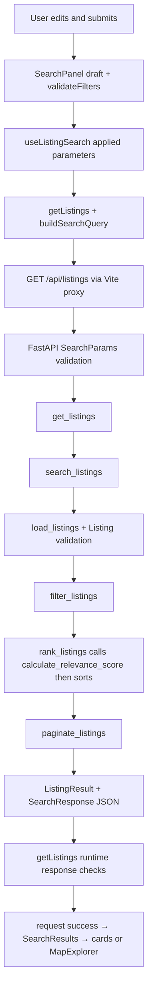

# HAVEN interview preparation

Source-reviewed on **2026-10-20** against the working tree on **`feature/haven-showcase`**, including its uncommitted showcase changes. This describes the current source, not the preserved submitted ZIP. The assessment baseline and later enhancements are deliberately distinguished below.

Use this as a practice guide, not a script to memorize. Read a section, find its code, explain it in your own words, then try its exercise. Sample first-person answers are wording to adapt after you can demonstrate the behavior; they are not claims that you personally wrote or verified every line.

The [codebase guide](CODEBASE_GUIDE.md) contains deeper implementation detail, the [design system](DESIGN_SYSTEM.md) records visual decisions, and the [fix log](FIX_LOG.md) records confirmed fixes and verification limits. Older phase records describe earlier behavior; the current source takes precedence.

## Contents

1. [Project overview](#1-project-overview)
2. [Technology stack](#2-technology-stack)
3. [Full-stack architecture](#3-full-stack-architecture)
4. [React fundamentals in this code](#4-react-fundamentals-in-this-code)
5. [Search state management](#5-search-state-management)
6. [Python and FastAPI](#6-python-and-fastapi)
7. [Filtering and relevance algorithms](#7-filtering-and-relevance-algorithms)
8. [Map Explorer](#8-map-explorer)
9. [UI and UX decisions](#9-ui-and-ux-decisions)
10. [Testing and debugging](#10-testing-and-debugging)
11. [Engineering trade-offs](#11-engineering-trade-offs)
12. [AI-assisted development](#12-ai-assisted-development)
13. [Live coding practice](#13-live-coding-practice)
14. [Interview questions](#14-interview-questions)
15. [Quick reference](#15-quick-reference)

## 1. Project overview

HAVEN searches twelve supplied property-feed records through a React interface and a Python API. Users filter records, provide an optional target budget, see ranked results and move between pages. It handles invalid inputs, no matches, loading and request failures explicitly.

The [candidate handout](Coding_Test_Question_Paper.pdf) requires React, a backend in Python/Go/Java, real API integration, five eligibility filters (`minPrice`, `maxPrice`, `minBedrooms`, `city`, description keyword), budget-and-recency relevance, pagination, and core edge-case tests. TypeScript is preferred. The scoring formula is left to the candidate; visual polish is explicitly not the assessment's priority. The [take-home addendum](Instructions.pdf) requests the runnable application and ZIP/README, with live extensions during the interview.

Python/FastAPI, the 70/30 weights, a 180-day recency window, exact city matching and default page size 10 are implementation choices. Map Explorer, property details, the advanced filter presentation/histogram, themes, floating search capsule and editorial slideshow are additional showcase features. The advanced panel exposes the same supported search contract; it is not an expanded backend search engine.

The central engineering problems are keeping filtering distinct from ranking, preserving feed identities, producing predictable pages, rejecting invalid data, and preventing old requests or unsent edits from changing the displayed results.

### A natural 60–90 second introduction

> HAVEN is a full-stack property search application built around twelve supplied MLS records. The React frontend sends real requests to a FastAPI backend, where I can trace the search through validation, loading, filtering, scoring, sorting and pagination. The backend decides which records match and how they rank; the frontend presents that result and manages editing and interaction state.
>
> The relevance formula combines budget proximity and recency. I can explain its assumptions and test it with a fixed date, so the result is reproducible. I also keep source and ID together because two feeds can describe the same property without being the same listing record.
>
> After submission, I used Codex to help develop additional showcase features, including a map, accessible property details, advanced filter presentation and themes. The map and cards use the same selected identity, and those interactions do not trigger new listing searches. My preparation is focused on understanding the generated code, its tests and trade-offs, and making small changes while explaining the reasoning. The submitted ZIP remains separate from this newer showcase branch.

Practice replacing any sentence you cannot yet defend with a narrower statement of what you understand.

## 2. Technology stack

Versions below come from [frontend/package.json](../frontend/package.json) and [backend requirements](../backend/requirements.txt), not a claim about the latest releases. Alternatives are discussion options, not technologies implemented here.

| Technology | Role and actual HAVEN use | Why it fits; alternative and trade-off |
| --- | --- | --- |
| React 19.2 | Functions such as `SearchPanel` and `ListingCard` render state into UI; React DOM mounts the tree. | Required by the assignment. Reusable components suit multiple views; a simpler static page would need less state machinery but would not satisfy the React requirement. |
| TypeScript 5.9 | Strict compile-time checks for props, API interfaces and request-state variants. | Makes state/contract mistakes easier to catch than plain JavaScript. Adds type maintenance and cannot validate network data at runtime by itself. |
| Vite 7.1 | Development server, React tooling, production bundles and `/api` proxy in [vite.config.ts](../frontend/vite.config.ts). | A small client application needs little framework infrastructure. A server-rendered framework could help a public search product's indexing, but adds deployment and rendering complexity absent here. |
| Python | Implements the HTTP service and readable search functions. | Allowed by the assessment and suitable for explaining algorithms. Go or Java could serve the same contract; Python's simple iteration is sufficient for twelve records, not a scaling strategy. |
| FastAPI 0.119 | Routes in `main.py`, typed queries, dependencies and generated API docs. | Connects validation to HTTP with little boilerplate. Flask is an alternative, but would require more explicit schema/documentation wiring. Framework conventions still need to be understood. |
| Pydantic 2.12 | Validates `Listing`, `SearchParams` and public response models. | Centralizes constraints and aliases. Handwritten validators offer more direct control but more repetitive checks; Pydantic's strict/coercing modes must be chosen deliberately. |
| Local JSON | `load_listings` reads the supplied file on every search. | Reproducible, no database setup. A database would support indexes, updates and larger datasets, but would add unnecessary scope for this assessment. |
| React Leaflet 5 / Leaflet 1.9 | React components connect listing props to Leaflet's map, markers, tile layers and camera. | Reuses established mapping interaction rather than writing projection, dragging and tile loading. A vector-map library is another option; either adds weight, provider dependencies and lifecycle concerns. |
| pytest 8.4 | Python model, repository, algorithm, service and HTTP tests. | Fixtures and parameterized cases make boundaries readable. Standard-library unittest could work; pytest adds a development dependency. |
| Vitest 3.2 | Runs frontend tests with Vite's TypeScript/React setup. | Shares project tooling; Jest is an alternative. Browser APIs still need a browser or deliberate mocks. |
| React Testing Library 16.3 | Tests visible roles, fields and user-observable state in jsdom. | Encourages behavioral tests over component internals. Does not prove layout, real native focus containment or physical-device behavior. |

Other verified dependencies: Uvicorn serves the Python application; HTTPX supports FastAPI TestClient; jsdom supplies a simulated DOM; jest-dom adds assertions; axe-core performs automated accessibility checks; Fontsource packages provide local Inter and Playfair Display fonts. Playwright is used by optional browser scripts through an **external installation**, not declared as a frontend dependency. No Redux, database, authentication or charting framework is present.

## 3. Full-stack architecture



Trace a submission using these real files:

1. [SearchPanel.tsx](../frontend/src/components/SearchPanel.tsx) calls `validateFilters(draft, 1, applied.pageSize)` on form submission. Invalid drafts get focused error feedback; valid drafts call `search(params)`.
2. [useListingSearch.ts](../frontend/src/search/useListingSearch.ts) sets applied parameters and searching state. Its effect calls the API with an AbortController.
3. [api/listings.ts](../frontend/src/api/listings.ts) encodes supported fields with `URLSearchParams`, checks HTTP status, then validates unknown JSON before returning `SearchResponse`.
4. [main.py](../backend/app/main.py) receives validated `SearchParams` plus an injected date and data path. [search.py](../backend/app/search.py) coordinates repository, filter, rank and pagination functions.
5. `rank_listings` calculates scores **before** sorting; there is no separate scoring pass in `search_listings`. The route adds `relevanceScore` to response records without changing the source dataset.
6. React stores the successful response and renders that server order. It does not re-score or re-sort it.

A useful boundary: the API client knows HTTP, the hook knows request lifecycle, the components know presentation, and Python business functions know matching/ranking. The map is a presentation branch after the response, not another search backend.

## 4. React fundamentals in this code

Examples are exact source excerpts or explicitly shortened extracts. They rely on the surrounding component's imports and variables; they are not standalone applications.

### Functional components

A functional component is a function that returns UI markup. [App.tsx](../frontend/src/App.tsx) composes independently understandable sections:

```tsx
<Hero theme={theme} />
<SearchPanel appearance={{ theme, preference, onThemeChange: selectTheme }} />
<EditorialSection theme={theme} />
```

This keeps page composition separate from search behavior. Interview wording: “App puts the page together; SearchPanel owns search interactions rather than placing every detail in App.” Most components are functions; `MapBoundary` is a class error boundary, an intentional exception.

### Props

Props are inputs passed from parent to child. [ListingCard.tsx](../frontend/src/components/ListingCard.tsx) declares its contract:

```tsx
interface ListingCardProps {
  listing: Listing;
  onOpen?: (listing: Listing, opener: HTMLButtonElement) => void;
  variant?: 'default' | 'compact' | 'featured';
  action?: 'details' | 'select';
}
```

Variants reuse facts and formatting at different densities. Interview wording: “The parent supplies the listing and action; the card does not fetch or own a competing copy of the property.”

### useState

`useState` retains component state between renders and requests another render when updated. In [SearchPanel.tsx](../frontend/src/components/SearchPanel.tsx):

```tsx
const [view, setView] = useState<ResultsView>('grid');
```

The mode survives result requests because its owner stays mounted. Interview wording: “I store choices that need to persist, such as Grid or Map, in their closest shared owner.” A state setter schedules a render; it does not mutate the current render's variable immediately.

### useEffect

An effect synchronizes React with an external system, such as a browser preference or network request. This excerpt from [useTheme.ts](../frontend/src/theme/useTheme.ts) subscribes to system appearance:

```tsx
const media = matchMedia(SYSTEM_QUERY);
const update = () => setSystemDark(media.matches);
update();
media.addEventListener('change', update);
return () => media.removeEventListener('change', update);
```

It belongs inside the hook's effect, not in rendering, which should not add listeners repeatedly. Interview wording: “The effect keeps React in sync with the browser, and its cleanup removes the subscription.”

### Custom hooks

A custom hook packages related state and effects; calling it does not create global shared state. [SearchPanel.tsx](../frontend/src/components/SearchPanel.tsx) calls the main search hook once:

```tsx
const { applied, request, search, retry } = useListingSearch();
```

This separates request lifecycle from markup. Interview wording: “Calling this hook in a second toolbar would create a second request owner. The toolbar instead receives state and callbacks from SearchPanel.”

### Controlled inputs

A controlled input displays a React value and reports edits back to that owner. [FilterFields.tsx](../frontend/src/components/FilterFields.tsx), shortened:

```tsx
<input value={draft[key]}
  onChange={event => onChange(key, event.target.value)} />
```

Drafts stay strings so empty or unfinished input can be represented without silently turning it into zero. Interview wording: “Typing updates the draft, and validation converts it to API parameters only when the user submits.”

### Derived state

Derived values are calculated from existing state rather than stored separately. In [MapExplorer.tsx](../frontend/src/map/MapExplorer.tsx):

```tsx
const selected = data.items.find(listing => listingKey(listing) === selectedKey);
const remaining = selected
  ? data.items.filter(listing => listingKey(listing) !== selectedKey)
  : data.items;
```

There is no second independently editable selected property object in MapExplorer. Interview wording: “The selected key is authoritative; featured content and other homes are derived from the same response.”

### Conditional rendering

Conditional rendering chooses UI based on state. [SearchResults.tsx](../frontend/src/components/SearchResults.tsx) derives available data:

```tsx
const data = request.status === 'success' ? request.data : null;
const busy = request.status === 'loading' || request.status === 'searching';
```

The JSX then shows skeletons, recovery actions, cards or a map. Interview wording: “The request status makes loading, success and failure explicit, so stale data is not accidentally treated as the new successful search.”

### Lifecycle and cleanup

Mount means entering the rendered tree; unmount means leaving it. Effects also clean up before rerunning when their dependencies change. [useListingSearch.ts](../frontend/src/search/useListingSearch.ts) returns:

```tsx
return () => controller.abort();
```

Its success and failure handlers separately check `controller.signal.aborted`. Interview wording: “Cleanup cancels obsolete work, and the guard stops a late result from overwriting the current search even if a transport ignores cancellation.” Development StrictMode in [main.tsx](../frontend/src/main.tsx) deliberately checks effect setup/cleanup more than once; it is not proof of duplicate production submissions.

### State ownership

One owner means one authoritative value for a particular concern, not one state variable for the entire application. [AdvancedFilterDialog.tsx](../frontend/src/components/AdvancedFilterDialog.tsx) intentionally owns a disposable edit:

```tsx
const [draft, setDraft] = useState<FilterDraft>(() => ({ ...initialDraft }));
```

Apply sends that snapshot back; Cancel discards it. Interview wording: “The dialog draft has a different purpose from applied search criteria. That separation lets users cancel without undoing the current results.”

### Parent-child communication

Parents pass data down; children call supplied callbacks to request changes. In [SearchPanel.tsx](../frontend/src/components/SearchPanel.tsx):

```tsx
onApply={(values, params) => {
  setDraft({ ...values }); setErrors({}); setPanelOpen(false); search(params);
}}
```

This is the advanced dialog's commit point. Interview wording: “The child handles editing and validation, but the existing search owner decides when those edits become an applied search.”

### Event handling

An event handler runs in response to an action. [ListingCard.tsx](../frontend/src/components/ListingCard.tsx) uses a real button:

```tsx
onClick={event => onOpen(listing, event.currentTarget)}
```

`currentTarget` is the button, retained as a focus-return destination. Interview wording: “A native button already supports keyboard activation, so I do not add competing card click and key handlers.” CSS stretches that single button's hit area across the card.

### Other hooks actually used

- **useRef:** stores a DOM handle or mutable value without triggering renders. `const dialog = useRef<HTMLDialogElement>(null)` in the advanced dialog allows `showModal()` and focus work. “Refs connect React to imperative browser APIs; they are not a substitute for visible state.”
- **useMemo:** reuses a derived calculation while dependencies are unchanged. `const locations = useMemo(() => groupMapLocations(listings), [listings])` in ListingMap also keeps the locations array stable across theme changes. “This avoids unnecessary grouping and viewport effects; it does not cache API results.”
- **useId:** produces IDs for accessible relationships. `const headingId = useId()` connects ListingCard's article to its heading. “It avoids duplicate DOM IDs; list identity still comes from source plus ID.”

Do not claim HAVEN uses useReducer, useCallback or a global state library; those are not needed for the flow described here. A React `key` also matters: listing keys preserve identity across renders, while the footer deliberately keys its progress fill by slide index to restart the CSS animation.

## 5. Search state management

| Concern | Actual owner | What changes it |
| --- | --- | --- |
| Main draft strings/errors | `SearchPanel` | Quick controls, city capsule, clear or successful advanced Apply |
| Advanced dialog draft/errors | `AdvancedFilterDialog` | Local edits/reset; discarded on dismissal |
| Applied numeric/text criteria and page | `useListingSearch` | Valid submission, pagination, clear |
| Request loading/success/error | `useListingSearch` | Request start, guarded completion, retry |
| Grid/Map | `SearchPanel` | Shared `ResultsViewToggle` callbacks |
| Map selected identity | `SearchResults.selectedListing` | Compact card/marker callback; cleared on request changes or Grid |
| Details modal record/opener | `SearchResults.details` | Details button, close/cancel; cleared on request changes |
| Histogram preview | `usePriceDistribution` | Debounced city/bedroom/keyword context; independent of applied results |
| Theme preference | `App` calling `useTheme` once | Appearance controls or system preference |

The capsule edits exactly the same city draft as the original form. Both forms submit through `SearchPanel.submit`; all six supported draft fields are validated, page resets to 1, and existing view mode stays. Pagination uses `{ ...applied, page }`, so unsent draft edits do not leak into the next page. Retry repeats applied parameters through an attempt counter. Main Clear submits defaults; advanced Reset only edits the dialog snapshot until Apply.

`selectedListing` contains a composite key **and the response reference it came from**. `selectedKey` is suppressed unless that response is still current, then effects clear stored selection. This avoids briefly displaying an old selected home under a new result set. Details-modal state is a separate presentation concern; compact cards and markers do not maintain competing map selections.

Stale response means an older request finishes after a newer interaction. Each search effect has its own AbortController; cleanup aborts it, and both completion paths check its signal. No query cache, URL persistence or global store is implemented.

### The histogram exception worth explaining

[usePriceDistribution.ts](../frontend/src/search/usePriceDistribution.ts) waits 300ms after relevant draft changes, then [getDistributionPrices](../frontend/src/api/priceDistribution.ts) collects pages of ten sequentially. It uses city, minimum bedrooms and keyword, excluding price bounds and ranking-only budget. It checks totals, page metadata, count and duplicate composite identities, and refuses more than 100 pages rather than showing incomplete data as complete.

The histogram is therefore a preview of all matching feed-record prices **before price limits**, not just the current result page and not unique physical homes. Price edits change bin highlighting locally; they do not refetch. This preview does not own the main search or its page, and its consistency checks cannot guarantee a transactional snapshot if data changes between requests.

## 6. Python and FastAPI

A route connects a URL/method to a Python function. Query parameters are the values after `?` in a URL. In [main.py](../backend/app/main.py), the actual route signature is:

```python
@app.get("/api/listings", response_model=SearchResponse)
def get_listings(
    params: Annotated[SearchParams, Query()],
    as_of_date: Annotated[date, Depends(get_reference_date)],
    data_path: Annotated[Path, Depends(get_listing_path)],
) -> SearchResponse:
```

`Query()` tells FastAPI to populate the search model from query parameters. `Depends(...)` is dependency injection: FastAPI obtains the date and file path from small functions, making them replaceable in tests. This is concrete dependency injection, not an abstract service framework. The route is synchronous and calls synchronous local file/CPU work; adding `async` alone would not make that work faster.

Python type hints describe intended inputs and outputs for tools and readers. They do not automatically validate ordinary function calls. Pydantic performs runtime validation at model construction, which is why pure business functions accept already validated inputs.

| Model | Responsibility |
| --- | --- |
| `Listing` in [models.py](../backend/app/models.py) | Strict feed types, nonnegative numeric fields, finite numbers, allowed status values and explicitly parsed ISO dates; source/ID identity property |
| `SearchParams` in the same file | Optional query filters, numeric-string conversion, nonnegative bounds/bedrooms, positive budget/page/pageSize, integer bedrooms/pages, blank-text normalization and range-order check |
| `ScoredListing` in [ranking.py](../backend/app/ranking.py) | Frozen dataclass pairing a source record with an unrounded score; freezing the wrapper does not freeze its nested model |
| `PaginatedResults` in [pagination.py](../backend/app/pagination.py) | Internal page and totals, without HTTP concerns |
| `ListingResult` / `SearchResponse` in [schemas.py](../backend/app/schemas.py) | Public JSON contract, including camelCase aliases such as `relevanceScore` and `totalCount` |

Feed JSON is strict because the supplied file has defined types. Queries naturally arrive as strings, so SearchParams allows appropriate conversion. Both reject nonfinite values, and SearchParams explicitly rejects booleans being treated as numbers. `listedDate` must be a valid `YYYY-MM-DD`, not a timestamp. Geographic ranges are checked by the map helper; the Listing model itself only ensures finite coordinates.

### Walk through one request

For `/api/listings?city=Springfield&maxPrice=500000&targetBudget=500000&pageSize=1`:

1. FastAPI validates and converts the query into `SearchParams`; omitted page is 1.
2. `get_reference_date` supplies today's UTC date once for the request. `get_listing_path` supplies the project-relative dataset path.
3. `load_listings` reads UTF-8 JSON, requires an array, validates every record and returns fresh models. One malformed record fails the load; records are not silently skipped or deduplicated.
4. `filter_listings` keeps A1 and B7. `rank_listings` calculates each score using the same date and sorts the full matching set.
5. `paginate_listings` returns the first record with totalCount 2 and totalPages 2. The exact score depends on the reference date; section 7 pins a date for reproducibility.
6. The route constructs response models, preserving external field names. React validates the JSON shape and renders it.

| Outcome | HTTP behavior and UI consequence |
| --- | --- |
| Valid matches | 200, ranked page and metadata |
| No matches | 200, empty items and zero totals; empty-state UI |
| Page beyond last page | 200, empty items but accurate totals/requested page; first-page recovery |
| Invalid query | 422 with FastAPI validation detail; client can display field/range feedback |
| Missing/malformed/invalid dataset | Repository error is logged internally; route returns generic 503 without leaking file paths |
| Unexpected programming failure | Not disguised as a dataset error; requires investigation |

`GET /api/health` only returns `{"status":"ok"}`. It does not validate the dataset or prove search readiness. The public React page does not request health automatically.

## 7. Filtering and relevance algorithms

### Eligibility: which records survive?

[filter_listings](../backend/app/filtering.py) scans records and rejects the first failed condition. This is AND logic: every supplied filter must pass.

| Input | Actual rule |
| --- | --- |
| minPrice / maxPrice | Inclusive bounds: equal prices pass |
| minBedrooms | Listing bedrooms must be at least the minimum |
| city | Trimmed, case-insensitive exact match using `casefold()` |
| keyword | Case-insensitive substring of description only; not address or a semantic amenity search |
| Blank city/keyword | Normalized to omitted by SearchParams |
| targetBudget | Does not remove records; affects scoring later |

Example: city ` Springfield `, minPrice 450000, maxPrice 452000, minBedrooms 2 and keyword `TOP` keep MLS_A/A1 and MLS_B/B7. Setting both price bounds to 450000 keeps A1. Searching keyword `pets` may match “no pets”: substring matching does not interpret negation. Pending and sold records remain eligible unless they fail an actual supported filter; there is no status filter.

### Relevance: how suitable are the surviving records under this heuristic?

A heuristic is an explicit rule of thumb, not a trained model or probability. [calculate_relevance_score](../backend/app/scoring.py) uses:

```text
ageDays      = max(0, (referenceDate - listedDate).days)
recencyScore = 100 × max(0, 1 - ageDays / 180)
budgetScore  = 100 × max(0, 1 - abs(price - targetBudget) / targetBudget)
score        = 0.70 × budgetScore + 0.30 × recencyScore
```

Both factors are normalized to 0–100 so their weights are comparable. The final value is bounded to that range. Without a budget, the function returns the **full recency score**, not 30% of it. Future dates count as age zero; ages of 180 days or more receive zero recency. Equal price distances above/below budget are penalized equally, so the score is not a maximum-price constraint.

### Worked examples from the real dataset

Use the explicit reference date **2026-09-28** and target budget **$500,000**. These are learning/test inputs, not the current date or an API date override.

| Record | Price / listed date | Budget score | Age / recency score | Combined score |
| --- | --- | --- | --- | --- |
| MLS_A/A1 | $450,000 / 2026-08-29 | `100 × (1 - 50000/500000) = 90` | 30 days / `83.333333…` | `63 + 25 = 88` |
| MLS_B/B7 | $452,000 / 2026-08-27 | `100 × (1 - 48000/500000) = 90.4` | 32 days / `82.222222…` | `63.28 + 24.666666… = 87.946666…` |

B7 is closer to budget but older, so A1 ranks first. Without a budget, A1 scores 83.333333…. Both can display **88.0** on cards while keeping different unrounded values for sorting. Do not infer a tie from the rounded badge.

An executable exercise from `backend/`, using actual functions:

```python
from datetime import date
from app.models import SearchParams
from app.search import search_listings

params = SearchParams(city="Springfield", maxPrice=500000,
                      targetBudget=500000, pageSize=1)
page = search_listings(params, date(2026, 9, 28))
assert page.results[0].listing.identity == ("MLS_A", "A1")
assert abs(page.results[0].relevance_score - 88) < 1e-10
assert (page.total_count, page.total_pages) == (2, 2)
```

### Deterministic ranking and pagination

Deterministic means the same records, parameters and date produce the same order. [rank_listings](../backend/app/ranking.py) sorts by score descending, actual listed date descending, source ascending, then ID ascending:

```python
return sorted(scored, key=lambda item: (
    -item.relevance_score,
    -item.listing.listed_date.toordinal(),
    item.listing.source,
    item.listing.id,
))
```

Python compares tuple fields in order. Negating only score/date reverses those priorities; source/ID remain normal case-sensitive string order. Complete ties retain input order because Python sorting is stable. Future dates are clamped only for scoring, not for the date tie-breaker. Records are never merged.

[Pagination](../backend/app/pagination.py) calculates `start = (page - 1) * page_size`, slices through `start + page_size`, and computes `(total_count + page_size - 1) // page_size` total pages. Twelve results at size five yield 5, 5 and 2 items. In the A1/B7 example, size one yields A1 on page 1, B7 on page 2, and empty items with count 2/pages 2 on page 3. Sorting **before** slicing makes the first page globally best-ranked, not just best within an arbitrary subset.

### Cost and limitations

For n loaded records and m matches, loading/validation and filtering are broadly O(n), scoring is O(m), sorting is O(m log m), and copying a page of k records is O(k). O means how work grows as the input grows; keyword scans also depend on description length. In-memory records and sorted wrappers require space proportional to the dataset/matches. Pagination limits response/rendering size, but does not avoid loading and ranking the full matching set on each request.

The weights and window are explainable choices, not empirically optimized recommendations. As the fixed sample ages, recency scores eventually reach zero, although tie-breaking still produces an order. A real product would need explicit data freshness and ranking-quality evaluation.

## 8. Map Explorer

The map was added after submission to explore the supplied coordinates and demonstrate shared selection and accessible interaction. It is not required to prove the search algorithm.

[MapExplorer.tsx](../frontend/src/map/MapExplorer.tsx) lazily imports ListingMap behind Suspense (loading UI) and MapBoundary (render/import failure isolation). Initial Grid does not instantiate Leaflet or request map tiles. React Leaflet connects React props/components to Leaflet instances; Leaflet handles geographic projection, tiles, dragging, zoom and marker placement. HAVEN supplies listing data, grouping, selection, controls and accessibility behavior.

### Coordinates, markers and identity

[groupMapLocations](../frontend/src/map/mapListings.ts) groups exact `[latitude, longitude]` pairs from the **current API page**. It preserves each original record, rejects nonfinite/out-of-range coordinates for the map only, and keeps those records available as cards. It does not geocode addresses, jitter positions or combine nearby points into geographic clusters.

A single-record marker shows a compact price. A shared-coordinate marker shows the number of records and opens a chooser with individual MLS buttons. A1/B7 have identical coordinates but distinct descriptions/prices/identities; both remain selectable. Invalid-coordinate notices and the page/count scope prevent a map from implying more complete coverage than it has.

Actual identity helper:

```ts
export function listingKey(listing: Pick<Listing, 'source' | 'id'>): string {
  return JSON.stringify([listing.source, listing.id]);
}
```

JSON-encoding the pair avoids ambiguous delimiter concatenation. It is a feed-record identity, not proof of a unique physical home. The supplied IDs happen to differ, but the contract only promises uniqueness within a source.

### Shared selection and camera behavior

`SearchResults` owns the selected key; compact cards and marker/chooser callbacks both call the same `onSelect`. `MapExplorer` derives the featured record and other matching homes from `data.items`. Selection updates the highlighted marker and featured card without another API request or camera movement. The separate View details action opens the existing modal with that exact record.

Selection focuses the selected-property heading. Closing selection returns to the originating compact card if available; marker-origin selection uses Fit visible listings or the list heading as a fallback. Marker Enter comes from Leaflet; HAVEN adds Space activation and popup Escape/focus behavior. Wheel zoom is disabled to preserve page scrolling; zoom buttons and focused-map keyboard controls remain available.

[MapViewport.tsx](../frontend/src/map/MapViewport.tsx) calls `fitResults` on a new locations set and after the entrance settles. ResizeObserver calls `invalidateSize` without panning; crossing the 768px or 1200px layout boundary also refits. Selection/theme changes preserve the locations reference, so they do not request a new fit. The user can explicitly fit again with MapControls.

### Layout and lifecycle

At 1200px and wider, CSS uses 42% results / 58% sticky right map with a 28px gap. Results scroll with the page; the map offset includes the floating capsule when visible and stays 24px below it. From 768px to 1199px, the full-width map sits above a bounded scrolling results region. Below 768px, Map is a viewport workspace with floating search and a compact selected-home deck. Desktop remains the sticky-column layout.

MapViewport disconnects ResizeObserver and cancels its scheduled frame/timer; marker effects remove native key listeners and cancel focus frames; MapControls removes its `zoomend` subscription. React Leaflet owns its map/layer lifetime. MapTiles cancels its loading timeout. Keeping these responsibilities explicit avoids callbacks touching removed elements after a view change.

### Phone map: presentation changes without a second state system

The previous phone layout stacked a map above desktop-style results. The new layout gives the map the main canvas, with search at the top and one selected home near the bottom. This reduces competition for space; it does not change which records match or how they rank.

`useMobileMap` tracks the breakpoint and view, manages background scroll locking, and restores page position on exit. `MobileMapHeader` receives the existing `SearchPanel` city draft and callbacks. `MobileMapDeck` receives the current API page and selected record; its Previous/Next controls call the same `onSelect` as markers. `SearchResults` remains the sole owner of the source/ID selection. This demonstrates controlled components, props, derived data, refs for focus, and effects with cleanup.

React Leaflet/Leaflet still own map projection and interaction. `fitResults` reserves overlay space when fitting, but selecting another record or changing themes does not refit or fetch. Shared-coordinate choices use a React portal into the phone overlay layer, preventing the header from covering an anchored popup; this changes DOM placement, not selection ownership. Details and Filters reuse the existing dialogs. The summary says “on this page” because this is paginated search, not a new geographic viewport query.

Tradeoffs: Previous/Next buttons were chosen over custom swipe gestures to preserve straightforward keyboard/touch access. On short phones the card scrolls independently. The theme switch offers light/dark; the full preference controls remain elsewhere. Fit is retained instead of adding unsupported geolocation or favorites from the visual reference.

Interview wording: “I separated mobile presentation from search state. The map, card and navigation all use one selected record, so the interface changes without duplicating data or making extra requests. I also reserved space for the overlays and tested focus, small screens and desktop regressions.”

### Tile providers and limits

[MapTiles.tsx](../frontend/src/map/MapTiles.tsx) currently selects themed Stadia raster URLs for localhost/127.0.0.1 and standard OpenStreetMap URLs on other hosts. Tile failure or a ten-second startup stall falls back to the standard source; cards and markers remain available. Theme changes replace the tile layer rather than the whole camera. This describes configured code, **not verification of current provider terms, availability or production licensing**; review those before hosting.

A mapping library avoids implementing projection, tile fetching, panning and keyboard behavior from scratch. Costs include bundle weight, an imperative lifecycle inside React, external tile service dependence and potentially overlapping pins. The map shows a page, not every match or a viewport-filtered search. Tests often substitute tile fixtures; passing them does not establish live-provider behavior or complete accessibility certification.

## 9. UI and UX decisions

The Architectural Editorial light mode and Deep Obsidian dark mode are approved design preferences, not algorithm requirements or proof of improved conversion. Their practical implementation combines readable hierarchy, deliberate spacing and consistent interaction states.

| Decision | Actual implementation and engineering reason |
| --- | --- |
| Semantic design tokens | [tokens.css](../frontend/src/theme/tokens.css) names roles such as surface, text, accent and focus ring. Components share roles instead of duplicating unrelated colors. |
| Dark hierarchy | Page `#0D0F10`, main surface `#111315`, elevated surface `#16181B`, hover `#1B1E21`, border `#34373A`, champagne accent `#D5B98C`; control borders/focus have separate contrast roles. |
| Theme ownership | `useTheme` separates saved preference from resolved light/dark. [theme-init.js](../frontend/public/theme-init.js) sets the initial root palette before React; storage failures fall back safely. Cross-tab preference sync is not implemented. |
| Phone Map | Floating controlled search, one selected-property deck and a real current-page summary below 768px; tablet/desktop keep their existing layout. |
| Responsive results | Grid uses one/two/three columns below 768px/from 768px/from 1200px. Natural card height, reserved image ratios and bottom-aligned actions preserve alignment without fixed clipped text boxes. |
| Floating search capsule | [useStickySearch](../frontend/src/search/useStickySearch.ts) observes the original form and search section, not continuous scroll events. The capsule edits the same city draft and submits all existing criteria. |
| Advanced filters | Native dialog, initial Close focus, Escape, explicit Tab boundaries, scroll lock and opener restoration. Mobile uses a full-screen presentation with an independently scrolling content area and reachable actions. |
| Price controls | Shared `DualPriceSlider` and numeric drafts; the visual scale does not silently clamp precisely typed values. The histogram exposes text counts as an alternative to color/shape. |
| Images | [imageAssets](../frontend/src/assets/images.ts) centralizes paths; responsive WebPs, srcSet and reserved dimensions reduce unnecessary transfer/layout changes. Hero is prioritized; property/footer images are lazy. |
| Illustration honesty | [getListingImage](../frontend/src/assets/listingImage.ts) hashes source/ID to a stable illustration. Empty alt text and visible disclaimers avoid presenting decorative scenes as actual property evidence. |
| Card interaction | One native action button, stretched hit area, restrained full-card lift/image zoom for fine pointers, visible focus and touch controls. Reduced motion removes movement. |
| Footer | One CSS-timed five-second bar, one Next control, paused off-screen/hover/focus/hidden tab. Reduced motion leaves manual navigation; no automatic slide announcements. |

Search-first means the real filters, ranking and recovery states remain usable independently of map tiles or decorative images. Unsupported property type, amenities, lifestyle and listing-preference buttons are disabled previews; Rent is disabled and the Buy display does not verify sale availability. Bathrooms are displayed facts, not a supported filter. These distinctions protect data accuracy rather than pretending the API can support every visual concept.

Accessibility is more than adding labels: native controls, connected errors, modal focus boundaries, restoration and reduced motion must work together. Automated audits help, but human screen-reader use, device behavior and image-backed contrast need their own verification. The [fix log](FIX_LOG.md) provides a concrete Safari focus-lifecycle example to discuss.

## 10. Testing and debugging

A unit test isolates a small rule; a component test renders UI and exercises interactions; an integration test checks several real layers together. HAVEN uses all three, plus optional browser regressions.

| Layer | Real examples | What it establishes / does not establish |
| --- | --- | --- |
| Python rules | [test_filtering.py](../backend/tests/test_filtering.py), [test_scoring.py](../backend/tests/test_scoring.py), [test_ranking.py](../backend/tests/test_ranking.py), [test_pagination.py](../backend/tests/test_pagination.py) | Bounds, no matches, ties, order, nonmutation and page behavior; not browser behavior |
| Loading and models | [test_models.py](../backend/tests/test_models.py), [test_repository.py](../backend/tests/test_repository.py) | Invalid fields/files, strict feed contracts and preserved identities |
| Service and HTTP | [test_search.py](../backend/tests/test_search.py), [test_listings_api.py](../backend/tests/test_listings_api.py) | Real pipeline and request/response contract via TestClient, without a bound network port |
| React state and inputs | [search.test.tsx](../frontend/src/search/search.test.tsx), [stickySearch.test.tsx](../frontend/src/search/stickySearch.test.tsx), [AdvancedFilterDialog.test.tsx](../frontend/src/components/AdvancedFilterDialog.test.tsx) | Draft/Apply/Cancel, errors, shared city, paging, abort guards and observer cleanup |
| Map behavior | [mapListings.test.ts](../frontend/src/map/mapListings.test.ts), [MapExplorer.test.tsx](../frontend/src/map/MapExplorer.test.tsx), [MapTiles.test.tsx](../frontend/src/map/MapTiles.test.tsx) | Grouping, selection, fallback and cleanup; renderer mocks are not real cartography |
| Recent interactions | [FilterControls.test.tsx](../frontend/src/components/FilterControls.test.tsx), [EditorialSlideshow.test.tsx](../frontend/src/components/EditorialSlideshow.test.tsx) | Slider gesture lifecycle, single bar/manual navigation, pause conditions and cleanup |
| Real browser | [check_map_explorer.cjs](../frontend/scripts/check_map_explorer.cjs), [check_slider_pointer.cjs](../frontend/scripts/check_slider_pointer.cjs), [check_footer_blend.cjs](../frontend/scripts/check_footer_blend.cjs) | Native events, geometry, CSS timing, screenshots and scoped Axe checks; coverage varies by script/browser |

### Why the date is fixed in tests

A test that reads today's date can change its expected score tomorrow. Scoring receives a date argument, and API tests override the date dependency:

```python
app.dependency_overrides[get_reference_date] = lambda: AS_OF_DATE
```

The API fixture restores prior overrides in `finally`, including when a test fails. Algorithm tests use `pytest.approx` for floating-point results; this allows a tiny numeric tolerance, not arbitrary ranking differences. Tests separately protect full-precision sorting and display rounding.

### Commands

Run from the project root unless a command explicitly changes directory:

```sh
# Entire backend, including HTTP contract tests
backend/.venv/bin/python -m pytest backend
# Focused algorithm examples
backend/.venv/bin/python -m pytest backend/tests/test_scoring.py backend/tests/test_pagination.py
# Entire frontend
npm --prefix frontend test
# Focused component tests
npm --prefix frontend test -- src/components/EditorialSlideshow.test.tsx
# Standalone TypeScript and production packaging
(cd frontend && npx tsc --noEmit)
npm --prefix frontend run build
# Whitespace/conflict-marker sanity check for tracked changes
git diff --check
```

For an optional browser script, start backend and frontend as documented in [README.md](../README.md), then supply the existing external Playwright installation:

```sh
NODE_PATH=/path/to/existing/node_modules HAVEN_BASE_URL=http://127.0.0.1:5185 \
  node frontend/scripts/check_footer_blend.cjs
```

The NODE_PATH is a placeholder to replace, not a directory shipped with the repository. Chrome/browser binaries must be available; ordinary `npm test` does not run these scripts. Map browser audits intercept tiles, keeping third-party network behavior outside the result. A build proves compilation/bundling, not end-to-end API communication. Axe findings are automated evidence, not a declaration that every user/device/accessibility need has been tested.

### Debugging rehearsal

For wrong search results, inspect the actual network query first, then validated parameters, matching candidates, score values, sorted order and page slice. For stale results, artificially delay an earlier response and confirm the aborted request cannot publish. For a map-only issue, compare the card's composite key, selected key and grouped coordinate before changing the API. For Safari slider behavior, separate pointer events from focus/blur dismissal rather than assuming numeric parsing is wrong.

The latest recorded frontend run before this documentation task was 146 tests plus TypeScript/build; earlier backend and browser totals are phase-specific evidence in the codebase guide and fix log. Do not present those historical runs as new checks from this task.

## 11. Engineering trade-offs

| Choice | Benefit now | Limit or production direction |
| --- | --- | --- |
| JSON loaded per search | Tiny setup, supplied dataset remains visible and reproducible | Repeated I/O and full-memory search; a larger feed needs ingestion, indexed storage and freshness rules |
| Separate business functions | Direct tests and narrow interview changes | More files to navigate; avoid adding generic layers without a concrete requirement |
| Backend pagination | One ranking authority, accurate totals, small responses | Full ranking still happens in memory; database queries/cursors may be needed at scale |
| Page-scoped map | Cards and markers share the same fetched data and ranking scope | Does not show every matching home; a future bounds-search/aggregation API is a distinct feature |
| All-page histogram preview | Genuine counts with the existing API, no invented distribution | Extra sequential requests, 1,000-record bound, no transactional snapshot; server aggregation would scale better |
| Disabled unsupported filters | Honest distinction between roadmap and functioning search | Visual previews still need clear labels; adding behavior requires a real contract and data semantics |
| Local state and callbacks | No global store dependency; ownership remains explainable | Prop wiring grows with features; reconsider only when actual complexity justifies it |
| Lazy map and responsive assets | Initial Grid avoids mapping code/tiles; smaller relevant images | First Map open needs loading UI, imagery is still illustrative, provider availability remains external |
| Native controls/dialogs | Existing keyboard/platform behavior, fewer custom mechanisms | Browser differences still require real testing; the Safari popover issue demonstrates this |
| Stable focus and reduced motion | Usable keyboard flow and calmer interactions | Must be checked alongside animated layouts, not assumed from CSS alone |

For production scale, discuss requirements before selecting infrastructure: data volume/update rate, map coverage, geographic search, caching, API limits, observability, provider terms and hosting. Authentication, a database, deployment, deduplication and a sort API are not implemented. The current API has no maximum pageSize cap; the histogram's own bound is not an API-wide limit.

One particularly useful answer: “I would measure a real bottleneck before changing the architecture. The previous mouse-wheel scrolling investigation did not establish an application root cause, so I would not claim the footer rewrite fixed Safari scrolling.”

## 12. AI-assisted development

The assessment explicitly permits AI assistants, but expects the candidate to explain, defend and modify generated code. [README.md](../README.md) discloses Codex assistance for implementation, tests, documentation and verification. The conversation records the developer supplying constraints, approved visual directions, narrowed task scopes and observed browser symptoms; Codex performed substantial coding and checks.

A truthful explanation to adapt:

> I used Codex extensively to help implement and refine the application, generate tests and maintain documentation. I supplied requirements and design feedback and kept work in bounded tasks, including preserving the submitted ZIP. I am preparing by tracing the generated code, checking the contracts and practicing changes rather than claiming every line was written manually. I can show the tests and explain what they prove, and I will say when a behavior has not been verified.

Do not claim you independently designed every module, manually wrote every test, or personally executed every recorded browser check. A tool's source review also does not prove your own understanding. Demonstrate that understanding by predicting an outcome and then confirming it.

| Activity | Honest preparation approach |
| --- | --- |
| Requirements interpretation | Separate the handout's required filters/UI from chosen scoring details and later showcase requests. Clarify unknown requirements aloud. |
| Architecture decisions | Trace one request and explain why business logic is outside routes; evaluate the generated structure rather than merely naming its files. |
| Prompting/task breakdown | Use the actual pattern of focused tasks: scope, preservation constraints, expected behavior, tests and documentation. |
| Code review | Read the changed function, inputs, outputs, failure cases and cleanup. Do not equate accepting generated code with reviewing it. |
| Testing | Inspect assertions, not just green counts; distinguish mocks, local browsers and real services/devices. |
| Debugging/iteration | Use the Safari focus issue or footer simplification from FIX_LOG; separate reproduced cause from the original symptom report. |
| Learning | Explain one function without the guide, modify a small behavior, update its test, and identify what remains uncertain. |

Suggested self-check before saying “I understand this”: explain why an old response is ignored, calculate A1's score, locate the Apply commit point, and show why a shared-location marker does not delete either record.

## 13. Live coding practice

These are **unimplemented exercises**, not instructions to change the application now. Clarify the desired behavior first, identify the narrowest path, add a meaningful failing test, implement, then run the affected and broader checks. Preserve the submitted ZIP and unrelated working-tree changes.

### A. Add a minimum-bathrooms filter

Clarify whether fractional values are allowed and whether the histogram should respect the filter. Add `minBathrooms` validation/alias to [models.py](../backend/app/models.py), a condition in [filtering.py](../backend/app/filtering.py), and the frontend contract/query whitelist in [api/listings.ts](../frontend/src/api/listings.ts). Extend draft defaults/labels/validation in [filters.ts](../frontend/src/search/filters.ts), the appropriate field layout, and histogram criteria if it changes membership. Also inspect the capsule's applied-filter badge.

Tests: model boundaries, inclusive fractional filtering, API query contract, encoded parameters, draft Apply/Cancel and histogram context. Practice: write the expected results for a 1.5-bath minimum before implementing it; explain why adding only a dropdown would not create a functioning filter.

### B. Change relevance weights

Change `BUDGET_WEIGHT`/`RECENCY_WEIGHT` in [scoring.py](../backend/app/scoring.py), keeping their sum one. Update the explanatory text in SearchResults and ListingDetails as well as tests/docs; the UI currently spells out 70/30 and does not fetch scoring metadata.

Tests: [test_scoring.py](../backend/tests/test_scoring.py), expected ranked orders/API scores and frontend explanations. Practice: calculate A1 with 50/50 weights: `45 + 41.666666… = 86.666666…`; explain why the no-budget branch should remain recency-only unless the requirement changes.

### C. Add a sort option

Clarify whether price sorting still displays relevance scores and which direction/tie rules apply. Add a validated optional sort contract in SearchParams, route it through `search_listings`/`rank_listings`, then expose it in the frontend API types, query builder and applied state. Sort the full match set before pagination; keep the current relevance order as the default.

Tests: invalid sort names, default preservation, equal-price deterministic ties, page boundaries and UI submission. Practice: sketch a price-ascending tuple with explicit tie-breakers and explain why sorting just the ten displayed cards is incorrect.

### D. Change pagination behavior

Decide whether the request is a new default size, user-selectable size, an upper limit or different out-of-range behavior. Review [models.py](../backend/app/models.py), [pagination.py](../backend/app/pagination.py), frontend `defaultParams`/validation/clear behavior and [Pagination.tsx](../frontend/src/components/Pagination.tsx). SearchPanel currently resets to pageSize 10 on Clear, and the histogram explicitly requests ten per page; do not overlook those separate contracts.

Tests: defaults alignment, partial last page, zero results, exact boundaries, recovery and current page after size changes. Practice: for twelve matches and size five, predict pages 1–4 and their unchanged totals.

### E. Modify a React component

Practice adding the listed date to the normal ListingCard using actual API data and the UTC date-formatting pattern in [ListingDetails.tsx](../frontend/src/components/ListingDetails.tsx). The existing [listingPresentation.ts](../frontend/src/components/listingPresentation.ts) shares currency/number formatters; extracting a shared date formatter would be part of this proposed exercise. Decide whether compact/featured variants should also change; keep one native action and stable image framing.

Tests: [results.test.tsx](../frontend/src/search/results.test.tsx), card/detail consistency and browser wrapping/focus checks. Practice: explain props versus derived display values and why this does not require a new API request or stored date state.

### F. Diagnose draft synchronization

Simulate a defect where the capsule edits a private city state or where pagination submits the draft. Trace SearchPanel → StickySearchToolbar callbacks and `onPage` → applied parameters. Restore the single main draft owner while preserving the advanced dialog's intentional disposable snapshot.

Tests: [stickySearch.test.tsx](../frontend/src/search/stickySearch.test.tsx), [search.test.tsx](../frontend/src/search/search.test.tsx) and results pagination cases. Practice: edit city without submitting, move to page 2, then predict which city belongs in the network request.

### G. Extend an API response

Practice adding an explicit response-level reference date so clients could explain the server's score date without guessing. This is a proposed change, not a current field. Update SearchResponse in [schemas.py](../backend/app/schemas.py), its construction in `get_listings`, the frontend SearchResponse interface/runtime guard, and any UI that consumes it. Keep internal field names and public aliases deliberate.

Tests: API response/OpenAPI contracts, malformed payload rejection and fixtures/mocks that construct SearchResponse. Practice: explain why a TypeScript interface change alone does not ensure the server sends the new field.

For any exercise, finish with the required problem/cause/solution/verification/interview explanation if it fixes an issue. Meaningful architecture/interaction changes also update the relevant guide sections rather than rewriting unrelated documentation.

## 14. Interview questions

These 28 answers are starting points. Follow each with a source example you can navigate to and a test you can explain.

1. **What was required, and what did you add?** The assignment required a real React/API search, five filters, budget/recency ranking, pagination and tests. The map, details, advanced presentation, themes and slideshow are showcase additions.

2. **Why React?** It was required. Components and controlled state also let the main form, capsule, cards and map share behavior without maintaining separate search implementations.

3. **What are props versus state here?** A ListingCard receives its listing through props. SearchPanel stores editable draft and view state, then passes values and callbacks down.

4. **Why keep prices as strings while editing?** Empty and unfinished input need a faithful representation. Validation converts valid submitted values rather than coercing every keystroke.

5. **When do you use an effect?** For synchronization with external systems: requests, browser preference listeners or observers. I would derive the selected record during render rather than use an effect to copy it into another state variable.

6. **What makes a custom hook useful?** `useListingSearch` packages the applied parameters, request lifecycle and retry. SearchPanel calls it once; other controls receive callbacks instead of making their own searches.

7. **How do you avoid stale responses?** Each request has an AbortController. Cleanup aborts it, and completion checks the signal before publishing, including if the mocked transport ignores cancellation.

8. **Why is the modal draft separate?** Cancel must discard modal edits without changing the current results or main draft. Apply validates and commits the snapshot through the parent callback.

9. **What does useRef do that useState does not?** It retains a DOM handle or mutable value without rerendering. PriceRange tracks an active gesture in a ref; the visible open/closed choice is state.

10. **Does TypeScript validate an HTTP response?** No, its types are compile-time. `getListings` parses JSON as unknown and checks its shape before returning typed data; the server does fuller domain validation.

11. **What does FastAPI validate?** SearchParams validates the query before the route's search logic runs, and response models define serialization. Pure functions still rely on their documented validated inputs.

12. **Where is dependency injection used?** `get_listings` receives date and dataset path through Depends. Tests override them with a fixed date and temporary files, then restore the overrides.

13. **Why not put everything in the route?** The route should translate HTTP concerns, while independent functions handle loading, filtering, scoring and pagination. That makes an algorithm change testable without constructing an HTTP request.

14. **Is target budget a price limit?** No. Min/max price decide eligibility; target budget changes ordering among matches. Equally distant prices above and below the target get equal budget scores.

15. **Why 70/30 and 180 days?** Those are transparent implementation choices that prioritize budget while rewarding recency. They are not required constants or learned weights, and I can show how changing them affects a worked example.

16. **What happens without a budget?** Recency gets the full score. Returning only 30% would incorrectly penalize someone for omitting an optional preference.

17. **How are ties resolved?** By actual listed date descending, then source and ID ascending, using full score precision. Fully equal keys keep their input order through stable sorting.

18. **Why sort before pagination?** Otherwise a highly relevant record could be hidden on a later arbitrary page. Sorting all matches first gives each page a meaningful place in the global order.

19. **What is the main complexity?** After a linear scan and scoring, sorting m matches is generally O(m log m). The current backend still reads all records on every search, even for a small response page.

20. **What happens for bad input or missing data?** Invalid query values return 422; a valid no-match search returns 200 with empty totals; dataset load failures return a generic 503 while details stay in logs.

21. **Why keep source and ID together?** IDs are only guaranteed unique within a feed. A shared address or coordinate is not permission to merge records; the map chooser preserves both MLS identities.

22. **What does Leaflet do versus React Leaflet?** Leaflet handles the map mechanics. React Leaflet exposes React components around those instances; HAVEN supplies listing selection, grouping, controls and cleanup around them.

23. **Does the map display all matches?** It displays the current API page's valid coordinates and states that scope. The histogram deliberately collects all matching pages for a different preview purpose.

24. **Why not build a map yourself?** Projection, tile loading, camera interactions and keyboard behavior are substantial work unrelated to the assessment's search logic. The library is a practical trade-off, with bundle/provider/lifecycle costs to manage.

25. **How do you test accessibility?** With semantic component tests, browser keyboard/focus checks, contrast/layout review and Axe. Those do not replace physical-device or human screen-reader testing; map-pin spatial findings have explicit limits.

26. **Describe a real debugging example.** In the Safari search-bar slider, the confirmed issue was blur closing the popover during a native drag. The fix protected that gesture lifecycle rather than changing valid numeric parsing; FIX_LOG separates actual Safari checks from WebKit automation.

27. **What would you improve for scale?** I would clarify feed size/update frequency, then consider indexed storage, query limits and a histogram aggregation endpoint. I would measure performance and preserve deterministic ordering rather than simply increasing page size.

28. **How did you use AI?** Codex helped substantially with implementation, tests and documentation. I supplied scope/design feedback, and I need to demonstrate understanding through tracing, reviewing and changing the code, not imply it was all handwritten.

## 15. Quick reference

Use this compact sheet immediately before the interview; return to the sections above for explanations.

| Remember | Short answer |
| --- | --- |
| Product | Twelve real feed records; API-backed filtering, relevance and pagination; showcase UI adds exploration |
| Stack | React/TypeScript for controlled UI; Vite for tooling/proxy; Python/FastAPI/Pydantic for readable validated API; JSON for supplied data; Leaflet/React Leaflet for mapping |
| Frontend entry | `App.tsx` → `SearchPanel.tsx` → `useListingSearch.ts` → `api/listings.ts` → `SearchResults.tsx` |
| Backend entry | `main.py:get_listings` → `search.py:search_listings` → repository → filter → rank (score + sort) → paginate → schemas |
| Key state | Main draft: SearchPanel. Applied/page/request: useListingSearch. Modal: disposable snapshot. Map key/details: SearchResults. Theme: App/useTheme. |
| Scoring | `B = 100 max(0,1−abs(price−budget)/budget)`; `R = 100 max(0,1−max(0,age)/180)`; score `0.7B+0.3R`; no budget → R |
| Example | A1 at $500k budget and 2026-09-28: B=90, R=83⅓, score=88. B7≈87.9467; retain precision. |
| Order/page | Score ↓, listedDate ↓, source ↑, id ↑; sort before slice; default 1/10; out-of-range page keeps totals |
| HTTP | 200 matches/empty; 422 invalid query; 503 dataset failure; health is availability only |
| Identity/map | `listingKey` encodes `[source,id]`; `groupMapLocations` groups exact coordinates without merging records; current-page markers |
| Important hooks | useListingSearch, usePriceDistribution, useStickySearch, useTheme; useEffect cleanup, useRef DOM/gesture handles, useMemo derived map groups, useId labels |
| Interaction | Native buttons/dialogs, focus restoration, shared selection, reduced motion; CSS-driven footer progress with Next |
| Test commands | `backend/.venv/bin/python -m pytest backend`; `npm --prefix frontend test`; `npm --prefix frontend run build`; `git diff --check` |
| Trade-offs | Full in-memory ranking, fixed heuristic, page-scoped map, bounded all-page histogram, external tile services, illustrative imagery |
| Avoid overclaiming | No semantic pet filter, deduplication, database, sort UI, auth or deployment. Browser mocks/Axe are not device/provider/screen-reader certification. |
| AI disclosure | Codex-assisted; explain what you understand and demonstrate one small change. Never claim unperformed manual work. |

**Practice route:** explain the request pipeline → calculate A1 → demonstrate draft versus Apply → select a shared-coordinate MLS record → discuss one verified fix → make one bounded exercise change.

### Source review and remaining gaps

This document was checked against the current source, dependency files, original PDFs, test definitions and recent recorded verification. It is a learning snapshot of an uncommitted showcase working tree, not a release claim. Verification for this documentation task: all guide links/anchors and referenced source symbols were checked, the real filtering/scoring/page examples were executed, and 73 focused scoring/pagination tests passed. The proposed 50/50-weight calculation was checked separately without changing the algorithm. `git diff --check` passed; the full frontend/backend suites, build and browser scenarios were not rerun for this documentation-only task.

Before the interview, the developer should rehearse the examples aloud, confirm the intended demonstration checkout, and personally practice the changes in section 13. Current provider licensing/availability, physical-device behavior, full cross-browser coverage and human screen-reader operation require separate review. These notes cannot establish the developer's understanding in advance; the exercises are intended to make it demonstrable.
